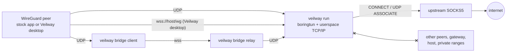
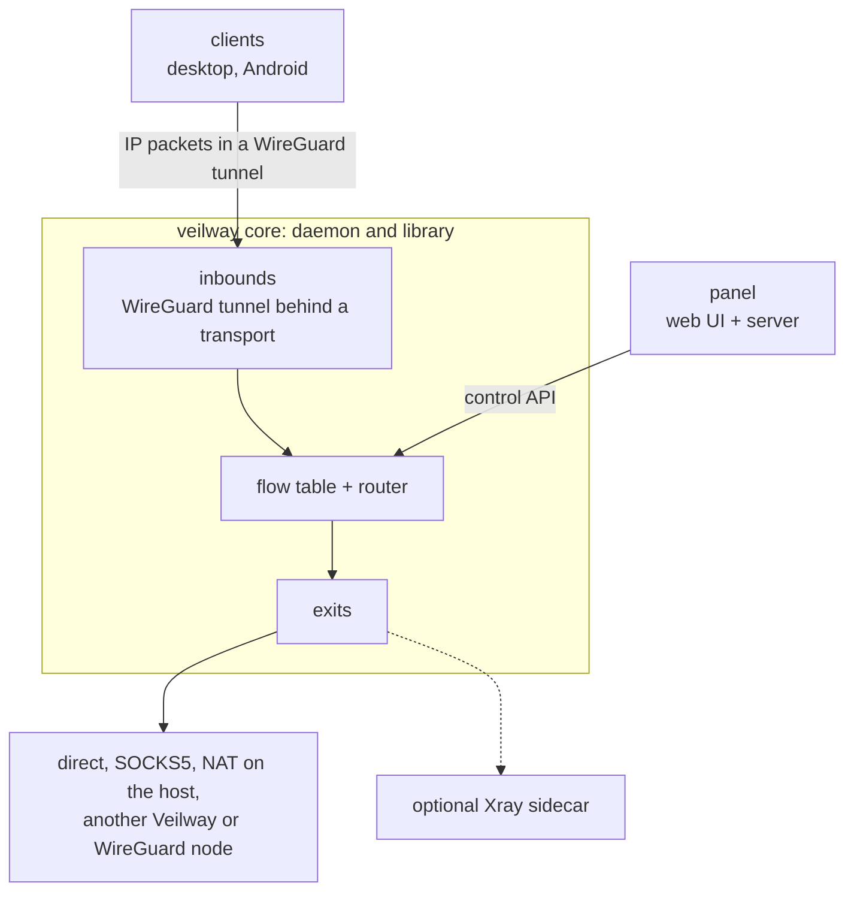

<p align="center">

</p>

<h1 align="center">Veilway</h1>

<p align="center" dir="rtl">
یک هستهٔ VPN بر پایهٔ WireGuard و نوشته‌شده با Rust،<br>
با یک پنل وب و کلاینت‌های رسمی دسکتاپ و اندروید.
</p>

<p align="center">
<a href="README.md">English</a> | <b>فارسی</b>
</p>

<p align="center">
<a href="https://github.com/veilway-project/veilway/actions/workflows/ci.yml"></a>
<a href="https://github.com/veilway-project/veilway/releases/latest"></a>
<a href="LICENSE"></a>
<a href="https://t.me/VeilwayGroup"></a>
</p>

<!-- SCREENSHOT SLOT 1 (hero): desktop client, connected state, dark mode, Persian UI, about 380px wide, centered. Produce it from the real UI. Do not add a mockup. -->

<div dir="rtl">

## Veilway چیست

Veilway یک VPN لایهٔ ۳ است. کلاینت یک کارت شبکهٔ مجازی می‌گیرد، بسته‌های IP به‌طور کامل درون یک تونل WireGuard دست‌نخورده جابه‌جا می‌شوند و سرور تصمیم می‌گیرد هر جریان از کجا خارج شود. رمزنگاری همان رمزنگاری WireGuard است و با [boringtun](https://github.com/cloudflare/boringtun) انجام می‌شود. آنچه Veilway اضافه می‌کند دور تونل قرار دارد: ترنسپورت‌هایی که تونل را از شبکه‌هایی عبور می‌دهند که UDP ساده در آن‌ها بسته است، جداسازی سخت‌گیرانه میان همتاها، و کنترل روی نقطهٔ خروج.

دور هسته یک پنل وب، کلاینت دسکتاپ و اندروید، و مستندات فارسی و انگلیسی قرار دارد. هسته کتابخانهٔ Rust هم هست. بخش «وضعیت» می‌گوید چه چیزی کار می‌کند و چه چیزی آزموده شده است.

## برای چه کسانی است

- کسانی که برای خودشان یا یک گروه کوچک سرور VPN راه می‌اندازند، روی شبکه‌ای که UDP را می‌بندد یا کند می‌کند.
- گردانندگانی که می‌خواهند هر همتا فقط از یک پروکسی بالادستی خارج شود و هیچ راهی به همتاهای دیگر یا خود میزبان نداشته باشد.
- برنامه‌نویسانی که یک موتور سرور یا کلاینت WireGuard را به شکل کتابخانهٔ Rust می‌خواهند.

## وضعیت

> **آلفا.** `v0.1.0-alpha` نخستین انتشار است و Veilway هیچ بازبینی امنیتی بیرونی نداشته است. رمزنگاری تونل از WireGuard است، اما هیچ بخشی از آن در برابر بازرسی عمیق بسته‌ها (DPI) یا کاوش فعال سنجیده نشده است. هر ترنسپورت در ردهٔ «قابل شناسایی» (Detectable) است: WireGuard ساده روی UDP به‌آسانی شناسایی می‌شود، و ترنسپورت‌های دیگر سخت‌تر دیده می‌شوند، نه نامرئی. جایی که از کار افتادن آن شما را به خطر می‌اندازد به آن تکیه نکنید.

تا اینجا آزموده شده: آزمون آلفا (یک سرور تازهٔ systemd که با اسکریپت نصب شده، پنل، و وصل شدن یک کلاینت) ۵۵ بررسی را می‌گذراند، آزمون Xray ۱۱۹ بررسی را، و کلاینت لینوکس در Docker و روی یک نود واقعی یک بررسی ۷۰‌نقطه‌ای را. برنامهٔ اندروید روی یک گوشی واقعی استفاده شده است. کلاینت ویندوز یک آزمون دودی روی یک رانر واقعی ویندوز گذرانده و هرگز به نود وصل نشده است. کلاینت مک هرگز روی یک مک واقعی اجرا نشده است. جدول کامل در [صفحهٔ آلفا](https://veilway-project.github.io/veilway-docs/fa/alpha/) است.

### آنچه امروز کار می‌کند

| بخش | کاری که می‌کند |
|---|---|
| سرور (`veilway run`) | تونل WireGuard را برای چندین همتا در فضای کاربر خاتمه می‌دهد (terminate)، روی UDP و روی WebSocket (هر دیتاگرام WireGuard یک فریم باینری است). چند ورودی در یک پردازه اجرا می‌شوند. با خروجی‌های `netstack` نه دستگاه TUN در کار است، نه مسیریابی هسته، و نه نیازی به root جز برای گشودن پورت زیر 1024. خروجی `l3` (فقط لینوکس) یک دستگاه TUN اضافه می‌کند و به `CAP_NET_ADMIN` نیاز دارد. |
| خروج | هر جریان از خروجی‌ای بیرون می‌رود که قانون‌های مسیریابی برایش انتخاب می‌کنند. یک خروجی یا TCP و UDP را از راه outbound خودش دوباره برقرار می‌کند (یک SOCKS5 بالادستی یا اتصال مستقیم از خود نود)، یا روی میزبان لینوکسی همهٔ پروتکل‌های IP را به هستهٔ سیستم‌عامل می‌سپارد. اگر SOCKS5 بالادستی UDP نداشته باشد DNS روی TCP می‌رود. |
| جداسازی همتاها | هیچ همتایی به دروازه (gateway) یا میزبان نمی‌رسد. اینکه به کاربران دیگر و بازه‌های خصوصی برسد یا نه را قانون‌های مسیریابی تعیین می‌کنند، و پیکربندی نمونه هر دو را رد می‌کند. |
| پیکربندی و بارگذاری دوباره | یک فایل پیکربندی JSON نسخه‌دار. `veilway check` آن را اعتبارسنجی می‌کند و `veilway schema` اسکیمای JSON آن را چاپ می‌کند. نود با سیگنال SIGHUP فایل را دوباره می‌خواند: فایل خراب پیکربندی در حال اجرا را تغییر نمی‌دهد، و کاربری که غیرفعال، حذف یا منقضی شود در کمتر از یک ثانیه قطع می‌شود. |
| کاربران و سهمیه | سهمیهٔ هر کاربر در یک دورهٔ زمانی، شمارنده برای هر کاربر، ورودی و خروجی، و نگه‌داری مصرف در یک فایل وضعیت که با بارگذاری دوباره و راه‌اندازی دوباره از بین نمی‌رود. `veilway usage reset` شمارش یک کاربر را از نو شروع می‌کند. |
| API کنترل | HTTP و JSON روی یک سوکت یونیکس روی نود، با اسکیمای OpenAPI: وضعیت، پیکربندی (خواندن، اعتبارسنجی، مقایسه، اعمال)، کاربران، آمار زنده، نشست‌ها، خروجی‌ها، لینک‌ها و جریان رویدادها. [packages/sdk](packages/sdk) یک کلاینت TypeScript است که از روی اسکیما ساخته می‌شود. هنوز دسترسی از راه دور ندارد. |
| `veilway doctor` | بررسی می‌کند که پیکربندی از میزبان و شبکه چه نیازهایی دارد (پورت‌ها، گواهی‌ها، DNS، هر outbound، `l3`، فایل وضعیت و فایل replay، سوکت کنترل) و هیچ چیزی را تغییر نمی‌دهد. |
| پروتکل بومی، سمت نود | یک ورودی `veilway` کانال کنترل را درون تونل ارائه می‌دهد (انتخاب خروجی برای هر دستگاه، مصرف، اطلاعیه‌ها، MTU) و چهار ترنسپورت بومی: `udp-obfs` (UDP مبهم‌سازی‌شده)، `tls` (یک شنوندهٔ مستقیم TLS که هر غریبه را به وب‌سرور خود اپراتور می‌فرستد)، و `ws` و `fronted` که از راه وب‌سرور اپراتور یا یک CDN می‌رسند. برنامه‌ها از هر پنج ترنسپورت (شامل `udp`) به نود وصل می‌شوند. [صفحهٔ آلفا](https://veilway-project.github.io/veilway-docs/fa/alpha/) می‌گوید هر کدام روی چه چیزی آزموده شده‌اند. |
| کتابخانهٔ کلاینت ترنسپورت | `crates/veilway-transport` سمت کلاینت چهار ترنسپورت بومی است. آزمون‌هایش روی نود واقعی اجرا می‌شوند. موتور کلاینت از آن استفاده می‌کند و برنامه‌ها هم همین‌طور. |
| پنل | پنل وب ([veilway-panel](https://github.com/veilway-project/veilway-panel)) نود را از راه API کنترل اداره می‌کند: راه‌اندازی راهنمایی‌شده (نود ورودی، تونل معکوس، رله‌ها)، کاربران، گروه‌ها، inboundها، outboundها، خروج‌ها، خروج پیش‌فرض و خروج هر کاربر، مسیریابی، اطلاعیه‌ها، DNS و گزارش‌ها، مدیران، پشتیبان‌گیری و بازیابی، و دکمهٔ به‌روزرسانی. فقط روی loopback گوش می‌دهد، پس TLS را وب‌سروری که جلوی آن است فراهم می‌کند. [راهنمای پنل](https://veilway-project.github.io/veilway-docs/fa/manuals/panel/) را ببینید. |
| اشتراک‌ها | لینک اشتراک کلید دروازهٔ (gateway) ارائه‌دهنده را همراه دارد. درخواست‌ها و پاسخ‌ها سرتاسر رمزنگاری می‌شوند (Oblivious HTTP روی HPKE)، پس یک آینهٔ رله چیزی از محتوا نمی‌بیند. نقطه‌های پایانی (endpoint) نام دارند، در `sub_path/<endpoint name>` در دسترس‌اند و برای هر کاربر و هر گروه تخصیص داده می‌شوند؛ جابه‌جایی میان آن‌ها امضا می‌شود. آینه‌های ایستا و آینه‌های رله (`veilway mirror`) وقتی نشانی اصلی بسته است اشتراک را در دسترس نگه می‌دارند، و برنامه پیش از استفاده از نشانی‌های پشتیبان به‌روزرسانی می‌پرسد. نقطه‌های پایانی ساده با `http://` هم ممکن‌اند، با یک هشدار. قالب آن در [صفحهٔ اشتراک](https://veilway-project.github.io/veilway-docs/fa/protocol/subscription-format/) آمده است. |
| افزونهٔ Xray | اختیاری. به برنامه‌های معمولی VLESS و Trojan (با TLS) و Shadowsocks اجازه می‌دهد از راه یک نود وصل شوند، روی TCP و UDP، با همان کاربران، سهمیه‌ها، قانون‌ها و خروج‌ها. باینری رسمی `xray` را اجرا می‌کند که `veilway.sh addon xray install` دانلود می‌کند و با یک SHA-256 ثابت می‌سنجد. VMess، Reality و خروج‌های `l3` یا `chain` برای کاربران Xray ساخته نشده‌اند. Veilway پروژه‌ای جداست و جایگزین Xray نیست. [صفحهٔ Xray](https://veilway-project.github.io/veilway-docs/fa/manuals/xray/) را ببینید. |
| لینک بین نودها | دو نود را به هم وصل می‌کند تا کاربران به یکی وصل شوند و ترافیکشان از دیگری خارج شود، در هر دو جهت. پنل هر دو گرداننده را راهنمایی می‌کند، یا آن‌ها با `veilway link offer` و `veilway link answer` جفت می‌شوند که دو کد رد و بدل می‌کنند و یک اثرانگشت را مقایسه می‌کنند. |
| پل (`veilway bridge`) | `client` به برنامهٔ معمولی WireGuard یک نقطهٔ UDP محلی می‌دهد و آن را روی `wss://` می‌برد. `relay` اتصال WebSocket می‌پذیرد و به هر پورت UDP WireGuard می‌فرستد. |
| برنامه‌های دسکتاپ و اندروید | اشتراک‌ها (با لینک، با فایل، از جمله فایل مهروموم‌شدهٔ `.vwsealed` با گذرواژه، و روی دسکتاپ با تصویر QR) و پروفایل‌های تکی، «اشتراک‌گذاری اشتراک» (فقط لینک)، انتخاب خروجی، آمار زنده، جزئیات اتصال، کلید قطع (kill switch)، DNS سنجاق‌شده به تونل و به‌روزرسانی درون برنامه‌ای. برنامهٔ دسکتاپ روی لینوکس، مک و ویندوز اجرا می‌شود و برنامهٔ اندروید یک APK با معماری arm64 است. راهنمای هر پلتفرم را در [راهنمای کلاینت](https://veilway-project.github.io/veilway-docs/fa/manuals/client/) ببینید. |

محدودیت‌های شناخته‌شده: هر ترنسپورت در ردهٔ «قابل شناسایی» است. macOS هرگز به نودی روی یک مک واقعی وصل نشده است، و ویندوز یک آزمون دودی روی یک رانر واقعی گذرانده اما به یک نود واقعی وصل نشده است. `fronted` فقط HTTP/1.1 را می‌فهمد و پشت یک CDN واقعی اجرا نشده است. ICMP و پروتکل‌های غیر از TCP و UDP از بالادست SOCKS5 رد نمی‌شوند (پینگ را خود نود پاسخ می‌دهد و فقط خروجی `l3` روی لینوکس همهٔ پروتکل‌های IP را عبور می‌دهد). API کنترل فقط روی خود نود و روی یک سوکت یونیکس در دسترس است. [صفحهٔ آلفا](https://veilway-project.github.io/veilway-docs/fa/alpha/) می‌گوید هر بخش روی چه چیزی آزموده شده و چه چیزی نه.

## هنوز ساخته نشده

- برنامهٔ دسکتاپ روی یک مک واقعی و یک رایانهٔ ویندوزی واقعی، و `fronted` پشت یک CDN واقعی آزموده نشده‌اند.
- افزونهٔ Xray: VMess، Reality، و خروج‌های `l3` و `chain` برای کاربران Xray.
- بعد از آلفا: HTTP/2 روی ترنسپورت‌های جریانی، شکل‌های بیشتر `fronted` و اتصال‌های به‌هم‌پیوستهٔ اختیاری.

## نصب

روی یک سرور لینوکس با systemd (x86_64 یا aarch64)، روش پیشنهادی اسکریپت نصب است. نسخهٔ امضاشده را دانلود می‌کند، امضای minisign و برچسب داخل آن را بررسی می‌کند (در غیر این صورت نصب نمی‌کند)، سرویس‌های systemd و یک کاربر اختصاصی می‌سازد، و به‌روزرسانی، پشتیبان‌گیری و حذف را هم انجام می‌دهد:

</div>

```
curl -fsSL https://raw.githubusercontent.com/veilway-project/veilway/main/scripts/veilway.sh | sudo bash
```

<div dir="rtl">

بدون آرگومان یک منو نشان می‌دهد. همین کارها به شکل دستور هم کار می‌کنند: `install node|panel|both|mirror`، `update`، `status`، `logs`، `restart`، `check`، `doctor`، `backup [file]`، `restore <file>`، `uninstall`، `version`، `addon xray [install|remove|status]` و `panel-prefix [/new-path]`. `install mirror` یک آینهٔ رله برای نقطهٔ پایانی اشتراک پنل برپا می‌کند. `panel-prefix` صفحه‌های مدیریت پنل را به یک مسیر تازه می‌برد (اگر مسیری ندهید، تصادفی). گزینه‌ها `--dry-run` (فقط می‌گوید چه می‌کرد و چیزی را تغییر نمی‌دهد)، `--yes` و `--version <tag>` هستند. اگر می‌خواهید، پیش از اجرا با root اسکریپت را بخوانید: `scripts/veilway.sh`. پنل فقط روی loopback گوش می‌دهد، پس برای TLS وب‌سرور خودتان را جلوی آن بگذارید. [صفحهٔ شروع](https://veilway-project.github.io/veilway-docs/fa/getting-started/) گام‌به‌گام توضیح می‌دهد.

## شروع سریع

برای ساخت از کد منبع به یک نسخهٔ پایدار زنجیره‌ابزار Rust نیاز دارید. پروکسی SOCKS5 بالادستی اختیاری است: خروجی می‌تواند مستقیم از خود سرور هم بیرون برود.

### ۱. ساخت (حدود ۵ دقیقه)

</div>

```
git clone https://github.com/veilway-project/veilway
cd veilway
cargo build --release --workspace
```

<div dir="rtl">

فایل اجرایی در `target/release/veilway` ساخته می‌شود. برای یک باینری ایستای لینوکس، اگر [cargo-zigbuild](https://github.com/rust-cross/cargo-zigbuild) نصب باشد:

</div>

```
cargo zigbuild --release --locked --target x86_64-unknown-linux-musl -p veilway --bin veilway
```

<div dir="rtl">

### ۲. ساخت کلیدها (حدود ۱ دقیقه)

</div>

```
./target/release/veilway genkey
```

<div dir="rtl">

یک `private_key` و `public_key` متناظرش را چاپ می‌کند. یک بار برای سرور و یک بار برای هر همتا اجرایش کنید.

### ۳. نوشتن پیکربندی (حدود ۲ دقیقه)

</div>

```
cp config.example.json config.json
```

<div dir="rtl">

فایل `config.json` را ویرایش کنید:

- در `private_key` هر inbound که نگه می‌دارید کلیدی از `veilway genkey` بگذارید. کلیدهای نمونه فقط جانگهدارند.
- در outbound با نام `proxy`، `server` و اطلاعات ورود را روی SOCKS5 خودتان تنظیم کنید. برای خروج بدون پروکسی، `outbound` خروجی `main` را روی `plain` (outbound مستقیم) بگذارید.
- زیر `users`، کلید عمومی هر دستگاه را در `public_key` بنویسید و در `addresses` نشانی‌ای از استخر inbound همان دستگاه بدهید.
- خروجی `node` به لینوکس با `CAP_NET_ADMIN` و برنامه‌های `ip` و `nft` (بسته‌های iproute2 و nftables) نیاز دارد؛ روی هر سیستم دیگری آن را با هرچه نامش را آورده حذف کنید: قانون‌های `staff-intranet` و `staff-ping`، مقدار `"exit": "node"` برای alice و `"node"` در `exits` مربوط به bob.
- ترنسپورت `ws` روی پورت 443 به فایل‌های گواهی در مسیرهای `tls` نیاز دارد، نسبت به پوشهٔ فایل پیکربندی. برای شروع فقط با UDP آن ترنسپورت را پاک کنید.

`veilway run` پیکربندی‌ای را که گروه یا دیگران بتوانند بخوانند نمی‌پذیرد، پس دسترسی را محدود کنید و بعد اعتبارسنجی کنید:

</div>

```
chmod 600 config.json
./target/release/veilway check --config config.json
```

<div dir="rtl">

بعد `veilway doctor` امتحان می‌کند که پیکربندی از این میزبان و از شبکه چه می‌خواهد، و هیچ چیزی را تغییر نمی‌دهد: هر نشانی شنود، هر گواهی، هر سرور DNS روی UDP و TCP، هر outbound (برای پروکسی SOCKS5 اتصال، دست‌دادن، یک CONNECT و یک UDP ASSOCIATE، هرکدام در یک خط جدا)، پیش‌نیازهای `l3`، فایل وضعیت و سوکت کنترل. برای هر بررسی یک خط با `ok`، `warn`، `fail` یا `skipped` چاپ می‌کند و هرگز کلید، گذرواژه یا نشانی یک پروکسی یا سرور DNS را چاپ نمی‌کند.

</div>

```
./target/release/veilway doctor --config config.json
```

<div dir="rtl">

مثل `run` گزینه‌های `--allow-readable-config`، `--state`، `--api` و `--no-api` را می‌پذیرد، `--json` برای یک سند JSON، و `--timeout <seconds>` برای هر گام روی شبکه (پیش‌فرض ۵، حداکثر ۱۰، و برای همهٔ گام‌ها روی هم ۴۵ ثانیه؛ بعد از آن هرچه مانده `skipped` می‌شود). نشانی شنودی که گرفته شده فقط وقتی `ok` است که نودِ پشت سوکت کنترل بگوید خودش آن را گرفته است. کد خروج وقتی هیچ بررسی‌ای شکست نخورد 0 است، وقتی یک بررسی شکست بخورد 1، و وقتی فایل پیکربندی خوانده نشود 2.

### ۴. اجرای سرور

</div>

```
./target/release/veilway run --config config.json
```

<div dir="rtl">

سرور هنگام شروع کلید عمومی خودش را در لاگ می‌نویسد. با `RUST_LOG=debug` جزئیات بیشتری می‌بینید.

مصرف هر کاربر در `veilway-state.json` کنار فایل پیکربندی نگه داشته می‌شود تا سهمیه‌ها با راه‌اندازی دوباره از بین نروند. با `--state <file>` می‌توانید جای دیگری برایش تعیین کنید. `veilway usage reset --user <name>` شمارش سهمیهٔ یک کاربر را روی نودی که در حال اجراست از نو شروع می‌کند، پس کاربری که سهمیه‌اش تمام شده بود دوباره می‌تواند وصل شود، و `--totals` شمارنده‌های کل او را هم صفر می‌کند.

### ۵. اتصال یک همتا

با هر برنامهٔ WireGuard، روی UDP:

</div>

```
[Interface]
PrivateKey = <peer private key>
Address = 10.7.0.2/32
DNS = 1.1.1.1

[Peer]
PublicKey = <server public key>
Endpoint = 203.0.113.10:51820
AllowedIPs = 0.0.0.0/0
PersistentKeepalive = 25
```

<div dir="rtl">

جایی که UDP بسته است، پل را کنار برنامهٔ WireGuard اجرا کنید و به‌جای آن `Endpoint = 127.0.0.1:51820` بگذارید. این کار به یک ترنسپورت `ws` روی سرور با گواهی معتبر برای دامنهٔ شما نیاز دارد (گام ۳)، یا به یک `veilway bridge relay` جلوی سرور (بخش «رلهٔ WebSocket» را ببینید). به‌جای `vpn.example.com` نام میزبان خودتان را بگذارید.

</div>

```
veilway bridge client --listen 127.0.0.1:51820 --url wss://vpn.example.com/wg
```

<div dir="rtl">

گزینهٔ `--insecure` بررسی گواهی را رد می‌کند و فقط برای آزمایش یک رله با گواهی خودامضا است.

## اجرا با Docker

اسکریپت نصب روش پیشنهادی است؛ Docker یک گزینه است. ایمیج‌ها برای linux/amd64 و linux/arm64 با هر برچسب `v*` در `ghcr.io/veilway-project/veilway` منتشر می‌شوند. کانتینر با کاربر غیر root اجرا می‌شود و پیکربندی و وضعیتش در volumeها هستند.

ابتدا `config.json` را در volume پیکربندی بگذارید، با مالک uid 65532 و حالت 600 (دستورها در [deploy/compose](deploy/compose/README.md) هستند). بعد:

</div>

```
docker run -d --name veilway --restart unless-stopped \
  -v veilway-config:/etc/veilway -v veilway-data:/var/lib/veilway \
  -p 51820:51820/udp ghcr.io/veilway-project/veilway:latest
```

<div dir="rtl">

یک پردازهٔ غیر root نمی‌تواند پورت زیر 1024 را بگیرد. پورت پیکربندی را بالای 1023 بگذارید و آن را با پورت دلخواه منتشر کنید، مثلاً `-p 443:8443`.

خروجی `l3` به دستگاه TUN و NET_ADMIN نیاز دارد و پردازه‌اش باید root باشد: `--user 0 --cap-add NET_ADMIN --device /dev/net/tun` را اضافه کنید. خروجی‌های netstack به هیچ‌کدام نیاز ندارند.

[deploy/compose](deploy/compose/README.md) نود و [پنل](https://github.com/veilway-project/veilway-panel) را با هم اجرا می‌کند.

## پیکربندی سرور

`config.json` یک سند JSON نسخه‌دار است (`"version": 1`). `veilway check` آن را اعتبارسنجی می‌کند و کلید ناشناس خطاست.

| بخش | معنی |
|---|---|
| `log` | سطح گزارش، و اینکه مقصدها اجازهٔ ظاهر شدن در گزارش‌ها را دارند یا نه (به‌طور پیش‌فرض خاموش). |
| `dns` | resolverهای بالادستی، و اینکه هر پرسش DNS از تونل را خود نود پاسخ بدهد یا نه. |
| `groups` | نام گروه‌هایی که کاربران و قانون‌ها می‌توانند به آن‌ها اشاره کنند. |
| `inbounds` | تونل‌های WireGuard: یک کلید، یک استخر نشانی و یک یا چند ترنسپورت (`udp`، `ws`). یک inbound از نوع `veilway` کانال کنترل و ترنسپورت‌های بومی (`udp-obfs`، `tls`، `ws`، `fronted`) را اضافه می‌کند. |
| `outbounds` | راه‌های برقراری جریان: `direct` یا `socks5`. |
| `exits` | راه‌های خروج نام‌دار، هرکدام با یک backend (`netstack`، `l3`، `block`، یا `chain` از راه لینک بین نودها). |
| `routing` | خروج پیش‌فرض و فهرستی مرتب از قانون‌ها بر پایهٔ inbound، گروه، مقصد، دامنه و پروتکل. |
| `users` | کاربران با گروه‌ها، خروج‌های مجاز، تاریخ انقضا و سهمیهٔ اختیاری، و دستگاه‌ها (کلید عمومی، نشانی‌ها، رازهای ترنسپورت). |
| `notices` | متن ساده‌ای که گرداننده از راه کانال کنترل برای همهٔ دستگاه‌ها می‌فرستد. اختیاری. |
| `replay` | جایی که ترنسپورت‌های مبهم‌سازی‌شده حافظهٔ replay خود را نگه می‌دارند. اختیاری. |
| `links` | لینک‌ها به نودهای دیگر. اختیاری. |
| `public_addresses` | نام میزبان‌ها یا نشانی‌های IP که پروفایل‌های این نود همراه دارند، بدون پورت. اختیاری. |
| `xray` | افزونهٔ اختیاری Xray: inboundهای Xray که کاربران فهرست‌شده در `clients` خود را حمل می‌کنند. اگر نباشد خاموش است. اختیاری. |

همهٔ کلیدها، پیش‌فرض‌ها و قواعد اعتبارسنجی در [مرجع پیکربندی](https://veilway-project.github.io/veilway-docs/fa/reference/config/) آمده است. یک نمونهٔ کامل در [config.example.json](config.example.json) هست.

## رلهٔ WebSocket

با یک ترنسپورت `ws` روی inbound، خود سرور اتصال WebSocket را می‌پذیرد. `veilway bridge relay` نسخهٔ مستقل همین کار است: WebSocket را خاتمه می‌دهد و به هر پورت UDP WireGuard، حتی WireGuard هسته، می‌فرستد. هر اتصال سوکت UDP محلی خودش را دارد، پس جابه‌جایی میان شبکه‌ها و چند کلاینت پشت یک NAT درست کار می‌کند.

با گواهی خودش:

</div>

```
veilway bridge relay --listen 0.0.0.0:443 --path /wg --target 127.0.0.1:51820 \
  --cert /etc/letsencrypt/live/vpn.example.com/fullchain.pem \
  --key /etc/letsencrypt/live/vpn.example.com/privkey.pem
```

<div dir="rtl">

پشت یک پروکسی معکوس که گواهی را خودش دارد و روی همان میزبان یک سایت معمولی هم نشان می‌دهد:

</div>

```
veilway bridge relay --listen 127.0.0.1:8443 --path /wg --target 127.0.0.1:51820
```

<div dir="rtl">

گزینهٔ `--max-conns` (پیش‌فرض 1024) سقف اتصال‌های هم‌زمان رله را تعیین می‌کند.

## برنامهٔ دسکتاپ

`apps/desktop` یک برنامهٔ Tauri 2 برای لینوکس، مک و ویندوز است. اشتراک یا یک پروفایل تکی را وارد می‌کند، خودش را از روی انتشار به‌روز می‌کند و تونل را در یک کمکی ممتاز اجرا می‌کند که به دسترسی مدیر نیاز دارد. این برنامه از موتور کلاینت در `crates/veilway-engine` استفاده می‌کند. `apps/android` برنامهٔ اندروید است.

</div>

<!-- SCREENSHOT SLOT 2: desktop client, profile list and disconnected state, dark mode, Persian UI, two images side by side. Produce them from the real UI. -->

<div dir="rtl">

`wintun.dll` در مخزن نیست. آن را دریافت کنید و بعد بررسی کنید برنامه کامپایل می‌شود:

</div>

```
apps/desktop/scripts/fetch-wintun.sh
cd apps/desktop/src-tauri && cargo check
```

<div dir="rtl">

خود نصب‌کننده روی ویندوز و از همان پوشه ساخته می‌شود:

</div>

```
npx --yes @tauri-apps/cli@^2 build
```

<!-- SCREENSHOT SLOT 3: web panel dashboard, dark mode, Persian UI, full width. The panel lives in veilway-panel. Add it here once it is captured from the real UI. -->

<div dir="rtl">

## معماری

مسیر داده در حال حاضر:

</div>



<div dir="rtl">

سرور هر بسته را رمزگشایی می‌کند، بررسی می‌کند که نشانی مبدأ به همان دستگاه تعلق داشته باشد و آن را طبق قانون‌ها مسیریابی می‌کند. برای خروجی `netstack` بسته به یک پشتهٔ TCP/IP در فضای کاربر می‌رود که برای هر جریان یک اتصال یا association از راه outbound همان خروجی باز می‌کند و دستگاه TUN در کار نیست. برای خروجی `l3` بسته روی یک دستگاه TUN نوشته می‌شود و هسته آن را فوروارد می‌کند. سقف جریان‌ها 65536 در کل، 1024 برای هر کاربر و 512 برای هر دستگاه است.

شکل کامل. پردازهٔ جانبی Xray یک افزونهٔ اختیاری است:

</div>



<div dir="rtl">

## ساختار مخزن

</div>

```
crates/
  veilway             the only binary: run, check, schema, genkey, gensecret, doctor, usage, replay, link, bridge, mirror, xray-host, and the client's connect, disconnect and status
  veilway-core        server engine: config v1 and reload, inbounds, routing rules, flow table, exits, quotas, the control channel, the native transports, node links
  veilway-wg          multi-peer WireGuard wrapper (handshake routing, cookies, timers, roaming) and the WebSocket relay
  veilway-client      older single-peer client library; the apps use veilway-engine instead
  veilway-engine      client engine without an OS layer
  veilway-linux       client layer for Linux
  veilway-macos       client layer for macOS
  veilway-windows     client layer for Windows
  veilway-proto       wire formats of the native protocol and the subscription format, no IO
  veilway-transport   client side of the native transports, as a library
  veilway-api         control API server and OpenAPI schema
  veilway-xray        reserved for the Xray add-on (empty skeleton; the add-on's code is in veilway-core)
  veilway-ffi         uniffi bindings (empty skeleton)
packages/
  sdk                 TypeScript client for the control API, generated from its schema
apps/
  desktop             Tauri 2 desktop client, outside the cargo workspace
  android             Android client
deploy/compose        Docker Compose for the node and the panel
scripts/              the install script (veilway.sh) and the test gates
fuzz/                 cargo-fuzz targets, outside the workspace
vendor/
  ipstack             patched userspace TCP/IP stack
```

<div dir="rtl">

پنل در [veilway-panel](https://github.com/veilway-project/veilway-panel) است. سیستم طراحی و ترجمه‌ها در [veilway-ui](https://github.com/veilway-project/veilway-ui) هستند.

## مخزن‌ها

- [veilway](https://github.com/veilway-project/veilway): همین مخزن؛ هسته، API کنترل و SDK آن، و برنامهٔ دسکتاپ.
- [veilway-ui](https://github.com/veilway-project/veilway-ui): سیستم طراحی و ترجمه‌های فارسی و انگلیسی برای پنل و برنامه‌ها.
- [veilway-panel](https://github.com/veilway-project/veilway-panel): پنل وب برای اجرای یک نود.
- [veilway-site](https://github.com/veilway-project/veilway-site): صفحهٔ معرفی در [veilway-project.github.io](https://veilway-project.github.io/).
- [veilway-docs](https://github.com/veilway-project/veilway-docs): کد منبع سایت مستندات، [veilway-project.github.io/veilway-docs](https://veilway-project.github.io/veilway-docs/fa/).

## مستندات

- [سایت مستندات](https://veilway-project.github.io/veilway-docs/fa/) ([کد منبع](https://github.com/veilway-project/veilway-docs)): مشخصات پروتکل، مرجع پیکربندی، مرجع API کنترل و راهنماها، به فارسی و انگلیسی. برخی صفحه‌های فارسی هنوز جای‌نگه‌دارند.
- [مدل تهدید](https://veilway-project.github.io/veilway-docs/fa/security/threat-model/): اینکه Veilway در برابر چه کسانی دفاع می‌کند و چه چیزهایی را پوشش نمی‌دهد.

## مشارکت

پرسش‌ها و کمک برای راه‌اندازی در [GitHub Discussions](https://github.com/veilway-project/veilway/discussions) جا دارند، به انگلیسی یا فارسی. Issues برای باگ‌ها و درخواست‌های مشخص است.

از هر تغییری استقبال می‌شود، حتی تغییرهای کوچک. [CONTRIBUTING.fa.md](CONTRIBUTING.fa.md) ([English](CONTRIBUTING.md)) توضیح می‌دهد چطور بسازید، آزمایش کنید و تغییر بفرستید و سبک کد چیست. دو نکته را از همین اول بدانید: روی این کد `rustfmt`، `cargo fmt` یا prettier اجرا نکنید، و در اولین pull request از شما خواسته می‌شود یک بار [CLA](CLA.md) را امضا کنید.

</div>

```
cargo test --workspace
```

<div dir="rtl">

نام هر کسی که تغییری از او پذیرفته شود در [صفحهٔ مشارکت‌کنندگان](https://github.com/veilway-project/veilway/graphs/contributors) و در یادداشت‌های انتشار می‌آید.

## امنیت

آسیب‌پذیری‌ها را به شکل خصوصی و طبق [SECURITY.md](SECURITY.md) گزارش کنید. لطفاً برای آسیب‌پذیری issue عمومی باز نکنید.

## مجوز و قدردانی

Apache-2.0، فایل‌های [LICENSE](LICENSE) و [NOTICE](NOTICE) را ببینید. حق نشر: The Veilway Authors. مجوز شامل نام پروژه نمی‌شود: فورک‌ها باید نام و نشان خودشان را داشته باشند، [TRADEMARKS.md](TRADEMARKS.md) را ببینید.

Veilway برای پروتکل WireGuard از [boringtun](https://github.com/cloudflare/boringtun)، برای TCP/IP در فضای کاربر از [ipstack](https://github.com/narrowlink/ipstack) (با وصله در `vendor/ipstack`)، برای آداپتر ویندوز از [Wintun](https://www.wintun.net) و برای پوستهٔ دسکتاپ از [Tauri](https://tauri.app) استفاده می‌کند. WireGuard نشان تجاری ثبت‌شدهٔ Jason A. Donenfeld است.

</div>
