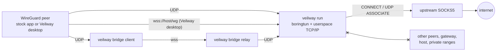
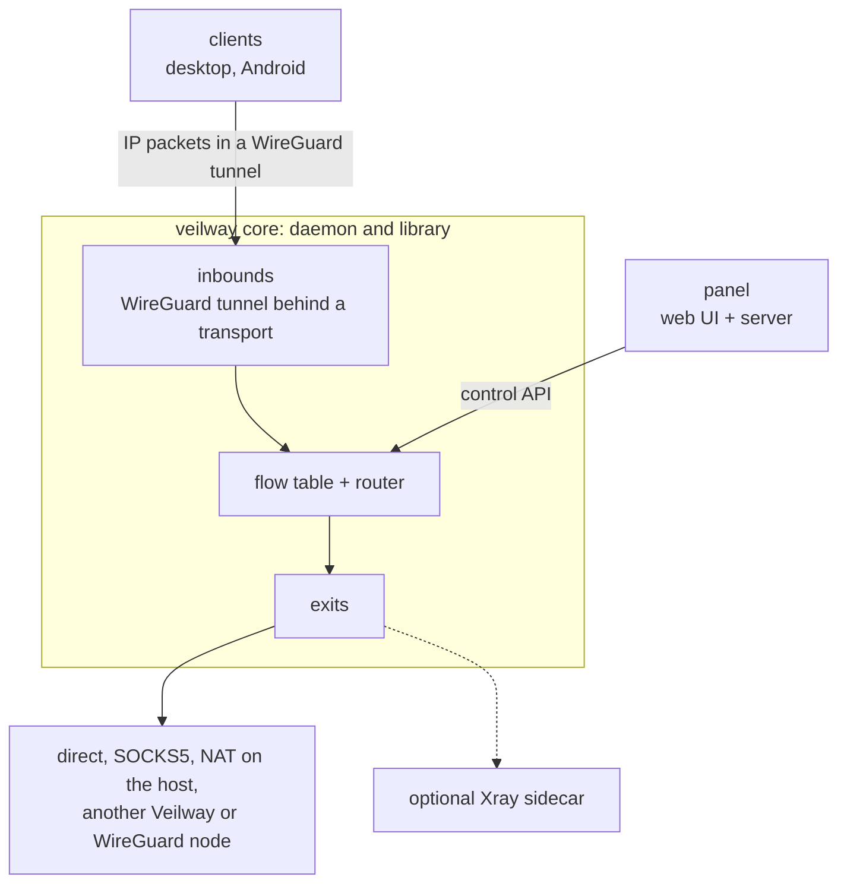

<p align="center">

</p>

<h1 align="center">Veilway</h1>

<p align="center">
A WireGuard-based VPN core in Rust with a web panel<br>
and first-party desktop and Android clients.
</p>

<p align="center">
<b>English</b> | <a href="README.fa.md">فارسی</a>
</p>

<p align="center">
<a href="https://github.com/veilway-project/veilway/actions/workflows/ci.yml"></a>
<a href="https://github.com/veilway-project/veilway/releases/latest"></a>
<a href="LICENSE"></a>
<a href="https://t.me/VeilwayGroup"></a>
</p>

<!-- SCREENSHOT SLOT 1 (hero): desktop client, connected state, dark mode, about 380px wide, centered. Produce it from the real UI. Do not add a mockup. -->

## What it is

Veilway is a layer 3 VPN. A client gets a virtual network interface. Whole IP packets travel inside an unchanged WireGuard tunnel, and the server decides where each flow leaves. The cryptography is WireGuard's own, through [boringtun](https://github.com/cloudflare/boringtun).

Veilway adds what sits around the tunnel. These are transports that carry it across networks where plain UDP is blocked, strict isolation between peers, and control over the exit.

The core also has a web panel, desktop and Android clients, and documentation in English and Persian. It is a Rust library too. The Status section says what works and what is tested.

## Who it is for

- People who run a VPN server for themselves or a small group, on a network that blocks or throttles UDP.
- Operators who want every peer to leave through one upstream proxy and nothing else. Peers cannot reach each other or the host.
- Developers who want a WireGuard server or client engine as a Rust library.

## Status

> **Alpha.** The current release is `v0.3.5-alpha`. The first was `v0.1.0-alpha`. Veilway has had no outside security review. The tunnel uses WireGuard's encryption, but nothing here has been tested against deep packet inspection or active probing. Every transport is rated Detectable. Plain WireGuard over UDP is easy to fingerprint. The other transports are harder to spot, but not invisible. Do not rely on it where a failure would put you at risk.

Tested so far:

- The alpha gate passes 55 checks. It installs a fresh systemd server with the script, then the panel, then a client connects.
- The Xray gate passes 119 checks.
- The Linux client passes a 70-point check in Docker against a real node.
- The Android app has run on a real phone.
- The Windows client passed a smoke test on a real Windows runner. It has never connected to a node.
- The macOS client has never run on a real Mac.

The [alpha page](https://veilway-project.github.io/veilway-docs/alpha/) has the full table and what is new in each release. Every release has notes on its [release page](https://github.com/veilway-project/veilway/releases).

### Works today

| Part | What it does |
|---|---|
| Server (`veilway run`) | Terminates WireGuard in userspace for many peers, over UDP and over WebSocket (one WireGuard datagram is one binary frame). Several inbounds run in one process. With `netstack` exits there is no TUN device, no kernel routing, and no root needed beyond binding a port below 1024. An `l3` exit (Linux) adds one TUN device and needs `CAP_NET_ADMIN`. |
| Egress | Each flow leaves through the exit that the routing rules choose. An exit re-dials TCP and UDP through its outbound: an upstream SOCKS5 (which may go through other proxies), or a direct connection from the node (which may leave through a named network interface of the server). For a Linux host, an exit can also hand every IP protocol to the kernel. DNS falls back to TCP when a SOCKS5 upstream has no UDP. |
| Peer isolation | A peer never reaches the gateway or the host. Routing rules decide whether it reaches other users and private ranges. The example config rejects both. |
| Config and reload | One versioned JSON config. `veilway check` validates it, and `veilway schema` prints its JSON Schema. On SIGHUP the node reads the config again. A broken file leaves the running config in force. A user who is disabled, removed or expired is cut off within a second. |
| Users and quotas | Per-user quotas over a period, and counters per user, inbound and exit. Usage is kept in a state file that survives reloads and restarts. `veilway usage reset` starts a user's count over. |
| Control API | HTTP and JSON on a unix socket on the node, with an OpenAPI schema. It covers status, config (read, validate, diff, apply), users, live stats, sessions, exits, links and an event stream. [packages/sdk](packages/sdk) is a TypeScript client generated from the schema. There is no remote access yet. |
| `veilway doctor` | Checks what a config needs from the host and the network: ports, certificates, DNS, every outbound, `l3`, the state and replay files, and the control socket. It changes nothing. |
| Native protocol, node side | A `veilway` inbound serves the control channel inside the tunnel. The channel handles exit choice per device, usage, notices and MTU. It also serves four native transports: `udp-obfs` (obfuscated UDP), `tls` (a direct TLS listener that hands every stranger to the operator's own web server), and `ws` and `fronted`, which arrive through the operator's own web server or a CDN. The stream transports speak HTTP/2 like Chrome. The node offers HTTP/2 only when `http2` is on. The apps reach a node over all five transports, `udp` included. The [alpha page](https://veilway-project.github.io/veilway-docs/alpha/) says what each one has been tested on. |
| Transport client library | `crates/veilway-transport` is the client side of the four native transports. Its tests run against the real node. The client engine uses it, and so do the apps. |
| Panel | The web panel ([veilway-panel](https://github.com/veilway-project/veilway-panel)) runs a node through the control API. One panel runs several nodes: other servers join through node links, each with its own address pool, and a user's usage is added up across them. It covers guided setup (an entry node, a reverse tunnel, relays), users, groups, inbounds (with a Generate button for their keys), outbounds, exits, per-user and default exits, routing, tunnels, notices, DNS, logs, admins, backup and restore. It also has buttons that update or restart the node and the panel. The node address may be a host name. The panel listens on loopback only, so a web server in front of it provides TLS. See the [panel manual](https://veilway-project.github.io/veilway-docs/manuals/panel/). |
| Subscriptions | A subscription link carries the provider's gateway key. Requests and answers are encrypted end to end (Oblivious HTTP over HPKE), so a relay mirror sees none of the content. Endpoints have names. They are reached at `sub_path/<endpoint name>`, and they are assigned per user and per group. A move between endpoints is signed. Static mirrors and relay mirrors (`veilway mirror`) keep a subscription reachable when the main address is blocked. The app asks before it uses backup update addresses. Plain `http://` endpoints work, with a warning. An offline bundle (`veilway bundle make` and `inspect`) carries app updates, subscription documents and notices in one signed file. The format is in the [subscription page](https://veilway-project.github.io/veilway-docs/protocol/subscription-format/). |
| Xray add-on | Optional. Lets stock VLESS and Trojan (with TLS) and Shadowsocks apps connect through a node, over TCP and UDP. They use the same users, quotas, rules and exits. It runs the official `xray` binary. `veilway.sh addon xray install` downloads it and checks it against a pinned SHA-256. VMess, Reality, and `l3` or `chain` exits for Xray users are not built. Veilway is a separate project, not a replacement for Xray. See the [Xray page](https://veilway-project.github.io/veilway-docs/manuals/xray/). |
| Upstream providers | A node can use another provider's Veilway subscription as the carrier for an exit. The panel's Other providers tab manages them. |
| Local proxies | The node takes `socks5`, `http` and `mixed` inbounds, so other software can use it as a plain proxy. The apps and `veilway connect` also run a local SOCKS5 and HTTP proxy, either alone or next to the VPN. |
| Node links | Joins two nodes, so users connect to one and their traffic leaves from the other, in either direction. The panel guides both operators through it. Or they pair with `veilway link offer` and `veilway link answer`, which exchange two codes and compare a fingerprint. `veilway link remove` takes a link out again. A node can also forward a TCP or UDP port through a link (tunnels). |
| Bridge (`veilway bridge`) | `client` gives a stock WireGuard app a local UDP endpoint, and carries it over `wss://`. `relay` accepts WebSocket and forwards to any WireGuard UDP port. |
| Desktop and Android apps | Subscriptions (by link, by file, including a sealed `.vwsealed` file protected by a password, and by QR code: a photo taken with the phone's camera on Android, a picture on desktop). Single profiles are also supported. The desktop app also takes Xray links: vless, vmess, trojan and ss. Other features: "Share subscription" (the link only), an exit picker that also works while disconnected, live stats, connection details, a kill switch, DNS pinned to the tunnel, and an in-app updater. The Android app uses less battery when the tunnel is idle. The desktop app runs on Linux, macOS and Windows. The Android app is an arm64 APK. See the [client manual](https://veilway-project.github.io/veilway-docs/manuals/client/) for each platform. |

Known limits: every transport is rated Detectable. macOS has never connected to a node on a real Mac. Windows passed a smoke test on a real runner but has not connected to a real node. HTTP/2 and the shapes of `fronted` have not run behind a real CDN. The borrowed-site mode is alpha, off by default, and rated Detectable. ICMP and other non-TCP/UDP protocols do not pass a SOCKS5 upstream. The node answers ping itself, and only an `l3` exit on Linux carries every IP protocol. The control API is local to the node, on a unix socket. The [alpha page](https://veilway-project.github.io/veilway-docs/alpha/) lists what each part has been tested on and what has not.

## Not built yet

- Desktop on a real Mac and a real Windows PC, and HTTP/2 and `fronted` behind a real CDN, are untested.
- Xray add-on: VMess, Reality, and `l3` or `chain` exits for Xray users.
- Planned next: Xray on Android, split tunneling and store builds. Later: opt-in bonded connections.

## Install

On a Linux server with systemd (x86_64 or aarch64), use the install script. It downloads the signed release. It checks the minisign signature and the tag inside it, and it refuses if either is wrong. It sets up systemd units and a dedicated user. The same script also updates, backs up and removes Veilway:

```
curl -fsSL https://raw.githubusercontent.com/veilway-project/veilway/main/scripts/veilway.sh | sudo bash
```

With no arguments it shows a menu. The same actions work as commands: `install node|panel|both|mirror|relay`, `update`, `status`, `logs`, `restart`, `check`, `doctor`, `backup [file]`, `restore <file>`, `uninstall`, `version`, `addon xray [install|remove|status]`, `panel-prefix [/new-path]`, `admin [list|reset <username>]` and `mirror-sync <folder>`. `install mirror` sets up a relay mirror of the panel's subscription endpoint. `admin reset` gives a locked-out panel admin a new password. Every `update` also replaces the saved installer with the signed one of the same release. `panel-prefix` moves the panel's admin pages to a new path. It picks a random path if you give none. The flags are `--dry-run` (it prints what would happen and changes nothing), `--yes` and `--version <tag>`. If you want, read the script before you run it as root. It is `scripts/veilway.sh`. The panel listens on loopback only, so put your own web server in front of it for TLS. The [getting started page](https://veilway-project.github.io/veilway-docs/getting-started/) walks through the setup. The guide [First inbound and user](https://veilway-project.github.io/veilway-docs/guides/first-user/) goes from the panel's first sign-in to a user's link.

## Quick start

This section builds from source and writes the config by hand. With the install script and the panel, you need none of it. The panel makes keys with its Generate buttons. To build, you need a stable Rust toolchain. An upstream SOCKS5 proxy is optional. An exit can also leave directly from the server.

### 1. Build (~5 min)

```
git clone https://github.com/veilway-project/veilway
cd veilway
cargo build --release --workspace
```

The binary is `target/release/veilway`. For a static Linux binary, install [cargo-zigbuild](https://github.com/rust-cross/cargo-zigbuild) and run:

```
cargo zigbuild --release --locked --target x86_64-unknown-linux-musl -p veilway --bin veilway
```

### 2. Make keys (~1 min)

```
./target/release/veilway genkey
```

It prints a `private_key` and its `public_key`. Run it once for the server and once for each peer. The panel does this for you with **Generate**.

### 3. Write the config (~2 min)

```
cp config.example.json config.json
```

Edit `config.json`:

- Put a key from `veilway genkey` in the `private_key` of every inbound you keep. The example keys are placeholders.
- In the `proxy` outbound, set `server` and the credentials to your SOCKS5 proxy. To leave without a proxy, point the `main` exit's `outbound` at `plain`, the direct outbound.
- Under `users`, put each device's public key in `public_key`. Add an `addresses` entry from the pool of its inbound.
- The `node` exit needs Linux with `CAP_NET_ADMIN` and the `ip` and `nft` programs (iproute2 and nftables). Anywhere else, remove it and everything that names it: the `staff-intranet` and `staff-ping` rules, alice's `"exit": "node"`, and `"node"` in bob's `exits`.
- The `ws` transport on port 443 needs certificate files at the `tls` paths, relative to the config directory. To start with UDP only, delete that transport.

`veilway run` refuses a config that the group or others can read. Restrict it, then validate it:

```
chmod 600 config.json
./target/release/veilway check --config config.json
```

`veilway doctor` then checks what the config needs from this host and the network. It changes nothing. It tries every listen address, every certificate, every DNS server over UDP and TCP, and every outbound. For a SOCKS5 proxy, it tests the connection, the handshake, a CONNECT and a UDP ASSOCIATE, each on its own line. It also checks the `l3` prerequisites, the state file and the control socket. It prints one line per check: `ok`, `warn`, `fail` or `skipped`. It never prints a key, a password, or the address of a proxy or a DNS server.

```
./target/release/veilway doctor --config config.json
```

It takes `--allow-readable-config`, `--state`, `--api` and `--no-api`, like `run`. It also takes `--json` for one JSON document, and `--timeout <seconds>` for each network step. The default is 5 seconds, and the maximum is 10. All steps together get 45 seconds. After that, whatever is left is `skipped`. A taken listen address is `ok` only when the node on the control socket confirms that it holds it. The exit status is 0 when nothing failed, 1 when a check failed, and 2 when the config file could not be read.

### 4. Run the server

```
./target/release/veilway run --config config.json
```

The server logs its public key on startup. `RUST_LOG=debug` gives more detail.

Each user's usage is kept in `veilway-state.json`, next to the config file, so quotas survive restarts. `--state <file>` puts it somewhere else. `veilway usage reset --user <name>` starts a user's quota count over on the running node, so a user who ran out of quota can connect again. `--totals` also zeroes their lifetime counters.

### 5. Connect a peer

With any WireGuard app, over UDP:

```
[Interface]
PrivateKey = <peer private key>
Address = 10.7.0.2/32
DNS = 1.1.1.1

[Peer]
PublicKey = <server public key>
Endpoint = 203.0.113.10:51820
AllowedIPs = 0.0.0.0/0
PersistentKeepalive = 25
```

Where UDP is blocked, run the bridge next to the WireGuard app, and set `Endpoint = 127.0.0.1:51820` instead. This needs a `ws` transport with a certificate for your domain on the server (step 3), or a `veilway bridge relay` in front of it (see [WebSocket relay](#websocket-relay)). Replace `vpn.example.com` with your host.

```
veilway bridge client --listen 127.0.0.1:51820 --url wss://vpn.example.com/wg
```

`--insecure` skips certificate verification. Use it only to test a self-signed relay.

## Run with Docker

The install script is the recommended way. Docker is an option. Images for linux/amd64 and linux/arm64 are published to `ghcr.io/veilway-project/veilway` on each `v*` tag. The container runs as a non-root user. Its config and state live in volumes.

Put `config.json` in the config volume first. It must be owned by uid 65532 with mode 600. The commands are in [deploy/compose](deploy/compose/README.md). Then:

```
docker run -d --name veilway --restart unless-stopped \
  -v veilway-config:/etc/veilway -v veilway-data:/var/lib/veilway \
  -p 51820:51820/udp ghcr.io/veilway-project/veilway:latest
```

A non-root process cannot bind ports below 1024. Set the port in the config above 1023, and publish it under the port you want, for example `-p 443:8443`.

An `l3` exit needs the TUN device and NET_ADMIN, and its process must run as root. Add `--user 0 --cap-add NET_ADMIN --device /dev/net/tun`. Netstack exits need none of these.

[deploy/compose](deploy/compose/README.md) runs the node and the [panel](https://github.com/veilway-project/veilway-panel) together.

## Server config

`config.json` is one versioned JSON document (`"version": 1`). `veilway check` validates it. Unknown keys are errors.

| Section | Meaning |
|---|---|
| `log` | Log level. Whether destinations may appear in logs (off by default). |
| `dns` | Upstream resolvers. Whether the node answers every DNS query from a tunnel. |
| `groups` | Group names that users and rules may refer to. |
| `inbounds` | WireGuard tunnels, each with a key, an address pool and one or more transports (`udp`, `ws`). A `veilway` inbound adds the control channel and the native transports (`udp-obfs`, `tls`, `ws`, `fronted`). |
| `outbounds` | Ways to open flows: `direct` (optionally out of a named network interface) or `socks5` (optionally `via` other proxies). |
| `exits` | Named ways out. Each has a backend: `netstack`, `l3`, `block`, or `chain` through node links. |
| `routing` | The default exit, and an ordered list of rules on inbound, group, destination, domain and protocol. |
| `users` | Users with groups, allowed exits, an optional expiry and quota, and devices (public key, addresses, transport secrets). |
| `notices` | Plain text the operator sends to every device on the control channel. Optional. |
| `replay` | Where the obfuscated transports keep their replay memory. Optional. |
| `links` | Node links to other nodes. Optional. |
| `tunnels` | TCP or UDP ports forwarded through a node link. Optional. |
| `public_addresses` | Host names or IP addresses that this node's profiles carry, with no port. Optional. |
| `xray` | The optional Xray add-on: Xray inbounds that carry the users listed in their `clients`. Off when absent. |

Every key, default and validation rule is in the [config reference](https://veilway-project.github.io/veilway-docs/reference/config/). A full example is in [config.example.json](config.example.json).

## WebSocket relay

A `ws` transport on an inbound lets the server accept WebSocket itself. `veilway bridge relay` is the standalone version. It terminates WebSocket and forwards to any WireGuard UDP port, including the kernel's. Each connection gets its own local UDP socket. So roaming works, and several clients behind one NAT work too.

With its own certificate:

```
veilway bridge relay --listen 0.0.0.0:443 --path /wg --target 127.0.0.1:51820 \
  --cert /etc/letsencrypt/live/vpn.example.com/fullchain.pem \
  --key /etc/letsencrypt/live/vpn.example.com/privkey.pem
```

Behind a reverse proxy that owns the certificate and serves a normal site on the same host:

```
veilway bridge relay --listen 127.0.0.1:8443 --path /wg --target 127.0.0.1:51820
```

`--max-conns` (default 1024) caps concurrent relay connections.

## Desktop app

`apps/desktop` is a Tauri 2 app for Linux, macOS and Windows. It imports a subscription or a single profile, and it updates itself from the release. It runs the tunnel in a privileged helper that needs administrator rights. The app uses the client engine in `crates/veilway-engine`. `apps/android` is the Android app.

<!-- SCREENSHOT SLOT 2: desktop client, profile list and disconnected state, dark mode, two images side by side. Produce them from the real UI. -->

`wintun.dll` is not in the repository. Fetch it, then check that the app compiles:

```
apps/desktop/scripts/fetch-wintun.sh
cd apps/desktop/src-tauri && cargo check
```

The installer itself builds on Windows, from the same directory:

```
npx --yes @tauri-apps/cli@^2 build
```

<!-- SCREENSHOT SLOT 3: web panel dashboard, dark mode, full width. The panel lives in veilway-panel. Add it here once it is captured from the real UI. -->

## Architecture

The data path today:



The server decrypts each packet and checks that its source address belongs to that device. Then it routes the packet by the rules. For a `netstack` exit, the packet goes to a userspace TCP/IP stack. That stack opens one connection or association per flow, through the exit's outbound. No TUN device is involved. For an `l3` exit, the packet is written to a TUN device, and the kernel forwards it. Flows are capped at 65536 in total, 1024 per user and 512 per device.

The whole shape. The Xray sidecar is an optional add-on:



## Repository layout

```
crates/
  veilway             the only binary: run, check, schema, genkey, gensecret, doctor, usage, replay, link, bridge, bundle, mirror, xray-host, and the client's connect, disconnect and status
  veilway-core        server engine: config v1 and reload, inbounds, routing rules, flow table, exits, quotas, the control channel, the native transports, node links
  veilway-wg          multi-peer WireGuard wrapper (handshake routing, cookies, timers, roaming) and the WebSocket relay
  veilway-client      older single-peer client library; the apps use veilway-engine instead
  veilway-engine      client engine without an OS layer
  veilway-linux       client layer for Linux
  veilway-macos       client layer for macOS
  veilway-windows     client layer for Windows
  veilway-proto       wire formats of the native protocol and the subscription format, no IO
  veilway-transport   client side of the native transports, as a library
  veilway-api         control API server and OpenAPI schema
  veilway-xray        the Xray add-on on the client: pinned install, supervisor and the legacy profile path
  veilway-ffi         uniffi bindings (empty skeleton)
packages/
  sdk                 TypeScript client for the control API, generated from its schema
apps/
  desktop             Tauri 2 desktop client, outside the cargo workspace
  android             Android client
deploy/compose        Docker Compose for the node and the panel
scripts/              the install script (veilway.sh) and the test gates
fuzz/                 cargo-fuzz targets, outside the workspace
vendor/
  ipstack             patched userspace TCP/IP stack
```

The panel is in [veilway-panel](https://github.com/veilway-project/veilway-panel). The design system and translations are in [veilway-ui](https://github.com/veilway-project/veilway-ui).

## Repositories

- [veilway](https://github.com/veilway-project/veilway): this repository. It holds the core, the control API and its SDK, and the desktop app.
- [veilway-ui](https://github.com/veilway-project/veilway-ui): the design system, and the English and Persian translations for the panel and the apps.
- [veilway-panel](https://github.com/veilway-project/veilway-panel): the web panel for running a node.
- [veilway-project.github.io](https://github.com/veilway-project/veilway-project.github.io): the landing page at [veilway-project.github.io](https://veilway-project.github.io/).
- [veilway-docs](https://github.com/veilway-project/veilway-docs): the source of the documentation site, at [veilway-project.github.io/veilway-docs](https://veilway-project.github.io/veilway-docs/).

## Documentation

- [The documentation site](https://veilway-project.github.io/veilway-docs/) ([source](https://github.com/veilway-project/veilway-docs)). It has the protocol spec, the config reference, the control API reference and the manuals, in English and Persian. Some Persian pages are still stubs.
- [Threat model](https://veilway-project.github.io/veilway-docs/security/threat-model/): who Veilway defends against, and what it does not cover.

## Contributing

Questions and help with setup go to [GitHub Discussions](https://github.com/veilway-project/veilway/discussions), in English or Persian. Issues are for bugs and concrete feature requests.

Changes are welcome, small ones included. [CONTRIBUTING.md](CONTRIBUTING.md) ([فارسی](CONTRIBUTING.fa.md)) explains how to build, test and send a change, and what the code style is. Two things to know first. Do not run `rustfmt`, `cargo fmt` or prettier on this code. And your first pull request asks you to sign the [CLA](CLA.md) once.

```
cargo test --workspace
```

Everyone who lands a change is listed on the [contributors page](https://github.com/veilway-project/veilway/graphs/contributors) and in the release notes.

## Security

Report vulnerabilities privately, as described in [SECURITY.md](SECURITY.md). Please do not open a public issue for one.

## License and credit

Apache-2.0. See [LICENSE](LICENSE) and [NOTICE](NOTICE). Copyright The Veilway Authors. The license does not cover the name. Forks need their own name and logo. See [TRADEMARKS.md](TRADEMARKS.md).

Veilway builds on [boringtun](https://github.com/cloudflare/boringtun) for the WireGuard protocol, [ipstack](https://github.com/narrowlink/ipstack) for userspace TCP/IP (patched in `vendor/ipstack`), [Wintun](https://www.wintun.net) for the Windows adapter, and [Tauri](https://tauri.app) for the desktop shell. WireGuard is a registered trademark of Jason A. Donenfeld.
