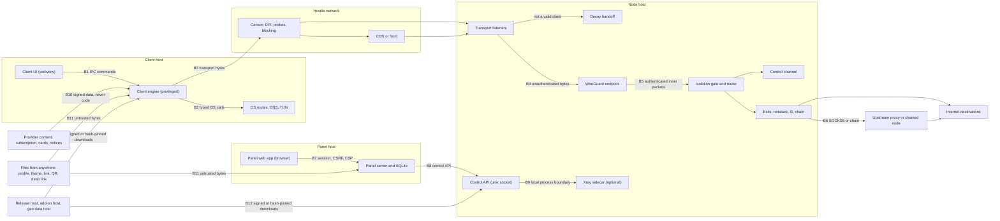

# Veilway threat model

This document is binding. Protocol, panel and client code is reviewed against it, and a change that breaks an invariant in section 7 is a bug even if every test passes. It is written before the native protocol, the panel and the multi-platform client exist, so most of it describes requirements, not results.

## 1. How to read this

**Status labels.** Every mechanism carries one of four labels.

| Label | Meaning |
|---|---|
| Built | Exists in the current code. If a test covers it, the test is named. If no test covers it, the text says "read from code, not tested". |
| Partial | Exists but is known to be incomplete. The gap is listed in section 8. |
| Not built | Required by this document, absent from the code, and either absent from `PLAN.md` or contradicted by a dependency's default. Listed in section 8 where current code is affected. |
| Planned | Described in `PLAN.md`, not written yet. Nothing planned is a security property until it is built and its test in this document passes. |

**What "tested" means here.** The current test suite (42 tests, `cargo test --workspace`, all passing when this document was written) covers the WireGuard endpoint wrapper, the isolation gate, SOCKS5 egress, the WebSocket relay and the client engine on loopback. There are no fuzz targets yet, no probe-resistance measurements, no traffic-analysis measurements and no external review. The tunnel cryptography is WireGuard as implemented by boringtun and is not re-verified by this project.

**Code references** name a function or a test, not a line number, and place it in the crate from the `PLAN.md` repository layout (`veilway-wg`, `veilway-core`, `veilway-client`, `apps/desktop`). Search for the symbol if a path has moved.

**Addresses** in examples come from RFC 5737 (`192.0.2.0/24`, `198.51.100.0/24`, `203.0.113.0/24`) and `example.com`.

## 2. System summary

Built today: a WireGuard endpoint in userspace (boringtun) reachable over UDP or over WebSocket (one WireGuard datagram per binary frame), a userspace TCP/IP stack that terminates the inner packets, and per-flow egress through an upstream SOCKS5 proxy with no TUN device and no kernel routing on the server. A Windows desktop client drives a Wintun adapter, routes and DNS policy.

Planned (`PLAN.md` "Core design", "The native protocol", "Transports"): the `veilway` inbound (WireGuard tunnel, pluggable transport, control channel inside the tunnel), transports `udp-obfs`, `tls`, `faketls`, `fronted` and later `quic`, exits `l3`, `chain`, `netstack` and `block`, a flow table and router with GeoIP and domain rules, a control API, a web panel, signed subscriptions with provider cards and themes, the optional Xray sidecar, and clients for Windows, macOS, Linux and Android.

## 3. Assets

| Id | Asset | Why it matters |
|---|---|---|
| AS1 | Fact of use: that a given network address runs or uses Veilway | On a censored network this is the first thing an adversary wants, and it is enough to block a node or single out a user. |
| AS2 | Reachability of a node: its addresses, names and fronts staying unblocked | A blocked node is a lost node for every user on it. |
| AS3 | Tunnel content: inner IP packets | Confidentiality and integrity between client and node. |
| AS4 | Tunnel metadata: destinations, DNS names, volume, timing, client address | Visible to the node by design, must not be visible to the path. |
| AS5 | Long-term keys: user WireGuard private keys, node static keys, preshared keys, transport authentication secrets | Impersonation and, for transport secrets, retrospective detection. |
| AS6 | Provider signing key (Ed25519) and subscription URLs | Whoever holds the key can reconfigure every subscribed client. A subscription URL is a bearer secret. |
| AS7 | Panel credentials, sessions, TOTP seeds, database, audit log | Full control of users, nodes and exits. |
| AS8 | Upstream credentials (SOCKS5, chained nodes) | Abuse of someone else's proxy, and traffic interception. |
| AS9 | Client host integrity: routes, DNS policy, the privileged process, local files | The client changes system networking with administrator rights. |
| AS10 | Node host integrity and resources | Other users of the node, and anything else on that machine. |
| AS11 | Release signing keys, updater key, add-on hash list, CI | Whoever controls these controls every installation. |
| AS12 | Isolation between users of one node | One user must not see, reach or degrade another. |

## 4. Trust boundaries

| Boundary | Crossing | Trust rule |
|---|---|---|
| B1 | Webview to client engine | The webview is less trusted than the engine. The engine validates every command argument. Provider strings reach the webview only as text. |
| B2 | Engine to OS configuration | Only typed values (addresses, prefixes, integers) and constants reach a command line or system API. |
| B3 | Client to path | Everything on the path is hostile. The path sees transport bytes only. |
| B4 | Path to transport listener | All input is unauthenticated until WireGuard, or the transport's own proof, accepts it. No identifying answer before that. |
| B5 | Tunnel to engine | The peer is authenticated and still hostile (section 5.6). |
| B6 | Exit to upstream | The upstream is semi-trusted for delivery and untrusted for content, replies and addresses it returns. |
| B7 | Browser to panel server | An authenticated session is not proof of intent. State changes need a CSRF token, sensitive ones need recent re-authentication. |
| B8 | Panel to core | The core authorises every call by token scope or socket ownership. It does not trust the panel database. |
| B9 | Core to sidecar | The sidecar is a separate OS process with a generated config, reachable on loopback only. Its stats output is untrusted input. |
| B10 | Provider to client | Provider content is authenticated data from a party that may be malicious (section 5.2). |
| B11 | Files to any parser | Attacker-controlled bytes. Section 6 lists every parser. |
| B12 | Download hosts to installer | Transport security is not relied on. Signature or pinned hash decides. |

## 5. Adversaries

Each subsection lists the assets at stake, the adversary's capabilities, what the design does with the mechanism that provides it, what is not defended, and how the defence is tested.

### 5.1 Censor with DPI and active probing

**Assets:** AS1, AS2, AS4.

**Capabilities:** observes every packet between client and node, including sizes, timing and direction; keeps flow records for later analysis; injects, drops, delays and resets packets; connects to any address and port it has seen and sends anything (active probing); replays bytes captured from real clients; blocks by address, port, SNI, DNS answer, protocol signature or behaviour; can obtain subscriptions and client binaries the same way a user does, so it knows the software, node public keys from leaked subscriptions and the front lists in them; may hold a CA that client operating systems trust; may throttle everything it cannot classify, or allow only what it can.

| Technique | Design response | Mechanism | Status |
|---|---|---|---|
| Passive protocol fingerprint of plain WireGuard (message type byte 1 to 4, three reserved zero bytes, sizes 148, 92, 64 and 32 + 16n) | Plain `udp` is rated Detectable and never presented as resistant. Obfuscated transports wrap every datagram. | "Security rating shown to users"; transports `udp-obfs`, `tls`, `ws`, `faketls`, `fronted` | Rating planned. `udp` and `ws` built. Others planned. |
| Length and timing fingerprint through TLS | Framing adds a length field and padding so WireGuard's sizes do not show through record lengths. | "The native protocol", layer 2 | Planned. The built `ws` transport maps one datagram to one frame with no padding (G14). |
| Active probing of a TCP listener | Anything that is not a valid client is handed to a decoy: a real site or a reverse proxy to one. To a prober the node answers with the decoy's bytes and close behaviour. Timing cannot be identical: a splice or reverse proxy adds the hop from node to origin, and invariant 3 bounds and publishes that residual. | "Rules for building it", first rule; Phase 2 step 3 | Planned. The built `ws` listener identifies itself (G1). |
| Active probing of a UDP listener | No reply to anything that fails WireGuard's `mac1`, and no reply to a handshake from an unknown static key. | `Wg::recv_from_network` in `veilway-wg` (boringtun `verify_packet`, then `parse_handshake_anon` and a key lookup, all returning without output on failure) | Built, read from code, not tested as a probe. `mac1` needs only the node's public key. The handshake limit is one global counter, not per source: once the node has seen more than 100 `mac1`-valid handshake messages in the current second from anyone, real clients included, every further `mac1`-valid probe gets a cookie reply, which confirms WireGuard (Q14). |
| Replay of a captured client handshake | A WireGuard initiation carries a TAI64N timestamp, and one that is not newer than the last accepted from that key draws no response. Planned transports must have their own replay rule (invariant 2). | boringtun; spec for `udp-obfs`, `faketls` and `fronted` | WireGuard part holds while the node process lives, built upstream, not tested here. The timestamp memory is not persisted: after a restart a replayed initiation is answered, which confirms a WireGuard node to the replayer, and moves that peer's stored endpoint to the replayer until the real client speaks (G18). Transport part planned and open (Q3). |
| Blocking by node address | Front candidates: several address and SNI pairs per profile, probed by the client, re-chosen when one dies, updated through the subscription. CDN-backed `ws` and `fronted`. | "Domain fronting, built in" | Planned |
| Blocking by SNI | Separate dial address, SNI and `Host`; Encrypted Client Hello where the CDN supports it; SNI-less connections where accepted; `faketls` borrows a third-party site's handshake. | "Domain fronting, built in"; `faketls` | Planned |
| DNS poisoning or observation of the node name | Profiles can carry addresses, so no lookup is needed. A poisoned answer cannot impersonate a node because WireGuard authenticates the node's static key. It can block, and on the built client it also selects the address that is exempted from the tunnel (section 5.10). | Front candidate list; WireGuard | Partial. The client resolves host names through the system resolver before the tunnel is up (`resolve_endpoint` in `veilway-client`), in clear, and pins the answer outside the tunnel (G12). |
| Client TLS fingerprint (JA4, extension set and order, GREASE, key shares, ALPN, HTTP/2 settings) | Client TLS built on BoringSSL configured to match a current browser, measured by JA4 and a full ClientHello diff against that browser. If the spike fails, the docs say so. | "Transports", last paragraph; Phase 2 step 5 | Planned. The built client uses rustls, which does not look like a browser. |
| Server TLS fingerprint and certificate inspection | `tls` uses a real certificate for a real name (ACME). `faketls` presents the third-party site's own handshake. | Transports table | Planned |
| Behavioural blocking (one long-lived connection, high volume to one address, upload-heavy ratio, TCP-in-TCP retransmission pattern) | Parallel connections, datagram transports first, no second retransmission layer. | "Rules for building it", second rule | Planned, and only reduces the signal (section 9). |
| Machine-in-the-middle with a trusted CA | Confidentiality and node authentication hold, because they come from WireGuard and not from TLS. Detection does not hold: a censor that terminates `tls`, `ws` or `fronted` with a certificate the client accepts sees WireGuard framing inside (type byte, reserved zeros, fixed sizes), classifies the flow and blocks the node. It can also rewrite an unsigned legacy subscription and the first fetch of a native one. Response: the client pins the node certificate or SPKI carried in the signed profile for `tls` and own-certificate `ws` (invariant 5a), and the inner framing is keyed so that stripped TLS does not show WireGuard's type bytes (invariant 5). | WireGuard Noise IK; profile pin; "The native protocol", layer 2 | Confidentiality and authentication built upstream. Pin and keyed framing planned; neither is in `PLAN.md` yet. The built `ws` client has no pin. |
| `faketls`: destination address does not belong to the borrowed site | None that removes the signal. The borrowed site is chosen so that the node's network is plausible for it (same hosting provider or a CDN the site uses), and the profile says which check it fails. | `faketls`; Q19 | Planned. Listed under Not defended. |
| `faketls`: server first flight of an authenticated session differs from the borrowed site's (certificate message size, number and size of session tickets), visible in record lengths | The authenticated server flight is shaped to the record lengths measured from the borrowed site, re-measured when the site changes. | `faketls`; Q19 | Planned, mechanism open |
| `faketls` and decoy handoff: the node forwards anyone's bytes to the borrowed site or decoy origin | Unauthenticated splices are rate limited per source address and capped in bytes and duration, at limits a real visitor of the decoy would not reach. The limit itself must not be a probe signal below those bounds. | Decoy handoff; invariant 19 | Planned |
| WireGuard timer fingerprint through an obfuscated transport: a fixed first exchange (initiation up, response down, then data), a handshake pair every 120 s, keepalives at 10 s and at the configured persistent interval (commonly 25 s) on an idle tunnel, constant full-MTU records under bulk transfer | Padding and jitter for the first records, the rekey exchange and keepalives, so that none of them is a fixed size at a fixed period. | "The native protocol", layer 2; Q5; invariant 7 | Planned, policy open |
| Encapsulated TLS handshake fingerprint: the size and direction sequence of an inner TLS handshake seen through any tunnel (Xue et al., USENIX Security 2024) | None at v1. | None | Not defended |
| A weaker listener on the same address: a plain `wireguard` inbound, an Xray inbound, a panel, a subscription endpoint or an ACME responder identifies the address whatever the strongest transport on it does | The rating of every profile on an address is capped at its weakest listener, and the panel warns when one is added (invariant 7a). | "Security rating shown to users" | Planned. `PLAN.md` does not state the cap (Q21). |

**Not defended:**

- A censor that blocks everything it cannot classify, or allows only a list of addresses. If no front in the list is reachable, Veilway does not work there.
- Address blocking of a node that has no CDN or front. Changing the address is the only remedy.
- Statistical traffic analysis: flow correlation, website fingerprinting from sizes and timing, volume profiling. Padding raises the cost and proves nothing.
- A censor holding any valid subscription. It knows every address, key and front in it, can confirm each node by connecting as a client, and for a transport whose secret is node-wide can passively recognise every user of that node and pass the proof when probing (invariant 5b).
- A censor that blocks a whole CDN.
- Fingerprints going stale. A browser-matching ClientHello is correct for one browser release. Section 9 covers this.
- Throttling or packet loss that makes stream transports unusable.
- `faketls`: a censor that checks whether the destination address belongs to the SNI's published addresses or ASN, and a censor that compares TCP-handshake round-trip time with TLS-handshake round-trip time to detect a relay hop.
- CDN-terminated transports (`fronted`, `ws` behind a CDN): the CDN sees the inner framing and the client's address, and so does anyone the CDN answers to.
- The encapsulated TLS handshake fingerprint, at v1.
- Residual timing of WireGuard's handshake and keepalive timers after padding and jitter. The measurement in the testing list bounds it and does not remove it.
- Enumeration of `tls` node names through Certificate Transparency logs, which publish every ACME-issued certificate, and a node name that hosts nothing but a decoy.

**Testing (all planned unless marked):**

- Probe differential: a corpus of probes (random bytes, truncated and malformed ClientHellos, valid ClientHellos without the proof, replayed valid ClientHellos, plain HTTP requests, HTTP/2 prefaces, slow sends, immediate close) is sent to a node and to its decoy origin from the same vantage point. Response bytes and close behaviour must match the origin. On the node, the reject path and the path of a valid TLS client with no proof must have the same response time distribution. Against the origin, the node's response time may differ by the node-to-origin hop and no more; that residual, and the TCP-handshake against TLS-handshake round-trip gap, are published per transport as known signals. Phase 2 gate: "an active probe gets only the decoy".
- UDP silence test: random datagrams, datagrams with a valid message type byte, and handshakes with a valid `mac1` from an unknown key must produce zero replies while the node as a whole is below the handshake limit. A second run measures what the same probes get while another source holds the node above the limit, and the result is published (today: a cookie reply).
- Restart replay test: capture a valid initiation, restart the node, replay it from another address. No response and no endpoint change is the pass criterion. Fails today (G18).
- Length and timing distribution: capture each obfuscated transport under fixed workloads (idle, browsing, bulk transfer) and check that record or datagram lengths show no peak at the WireGuard sizes, and that a classifier trained on plain-WireGuard timing (first exchange, 120 s rekey pair, keepalive cadence) does no better on the capture than on the transport's cover profile. Captures and results published per transport.
- JA4 and a full ClientHello diff (extension set, GREASE, key shares including the post-quantum share, ALPN, record size) per platform the client claims to be, against the browser release it claims to match, re-run on every dependency update of the TLS stack. JA3 is recorded but is not a pass criterion, because current browsers randomise extension order.
- Pin test: a `tls` or own-certificate `ws` profile with a pin, served a chain that validates under the system store but does not match, must fail closed.
- Shared-address rating test: adding a plain `wireguard` inbound, an Xray inbound, a panel or a subscription endpoint to an address lowers the computed rating of every profile on it.
- Fuzz targets `fuzz_frame_decode`, `fuzz_udp_obfs`, `fuzz_faketls_clienthello`, `fuzz_fronted` (section 6).
- A fronted connection through a real CDN (Phase 2 gate). This shows that it works on that CDN on that day and nothing more.

### 5.2 Malicious provider

A provider runs a panel and nodes and hands subscriptions to users. Users choose a provider. A provider is not trusted with the user's device.

**Assets:** AS9, AS5 (the user's keys for other providers), the integrity of the client UI, and the user's traffic while not connected to that provider.

**Capabilities:** signs any subscription content with its own key; controls every node the profile points at, so it sends arbitrary control channel messages, arbitrary inner IP packets towards the client, and arbitrary DNS answers; chooses names, notices, cards, links, logos, exit catalogue, update interval and transport hints; can serve different content to different users; sees the address and timing of every subscription refresh.

| Risk | Design response | Mechanism | Status |
|---|---|---|---|
| Code execution or markup injection through content | Provider content is data. Cards are a closed set of four types, plain text, no HTML, no markdown, no remote images, at most 6, capped strings. | "Provider cards" | Planned |
| Hostile logo image | One embedded raster under 64 KB, decoded and re-encoded by the client before display, with dimension limits. | "Provider cards" | Planned |
| Phishing through links | `https` only, the domain is shown, opening needs a confirmation. | "Provider cards" | Planned |
| Passing itself off as the application | Provider content is visibly separated from the app's own UI and can be hidden. One accent colour, clamped for contrast, built-in icons only. | "Provider cards" | Planned |
| Lying about how safe a profile is | The rating is computed by the core from the effective settings. No profile, subscription or control channel field can set it. A disabled certificate check rates Unsafe. | "Security rating shown to users" | Planned. Today a profile can set `InsecureTls` with no warning (G9). |
| Hostile control channel values (addresses, DNS, MTU, hints, notices) | The client validates every value against bounds and never lets a server message weaken the kill switch, DNS pinning or rating (invariant 23). | Control channel spec | Planned, details open (Q6) |
| Command injection into the privileged client | Only typed values reach `netsh`, `route` and PowerShell. | `win::open` in `veilway-client` takes `IpAddr`, `IpNet`, `u16` and a constant adapter name | Built, read from code, not fuzzed |
| Silent takeover of another provider's subscription | Each subscription pins its own Ed25519 key on first import. A key change warns. | "Subscriptions" | Planned |
| Pushing a binary | Providers cannot ship code. Updates come only from the project's signed release. The Xray add-on is verified against hashes shipped with Veilway, not with the subscription. | "Xray add-on"; "Security requirements" 5 | Planned for the add-on. Updater signature check built (section 5.8). |

**Not defended:**

- The provider reads and can modify everything the user sends through its nodes that is not protected end to end by the application (TLS inside the tunnel is the user's protection). It sees destinations, DNS names, volume, timing and the client's address. Veilway is not an anonymity system against the provider.
- The provider answers DNS. It can lie.
- The provider can reach services on the client that listen on the tunnel interface, because it can inject any inner packet. The built client adds no inbound filter (Q7).
- The provider can use the refresh interval and per-user URLs as a presence beacon.
- Trust on first use. The first key a client sees for a provider is accepted.

**Testing (planned):** fuzz targets `fuzz_subscription`, `fuzz_cards`, `fuzz_card_logo`, `fuzz_control_client`; UI tests that render a hostile corpus (markup, script, bidi overrides, zero-width characters, very long strings, homoglyph domains) and assert text-only output and visible truncation; a test that no control channel message changes the rating, kill switch or DNS pinning state; a test that a profile with certificate verification disabled is rated Unsafe.

### 5.3 Malicious subscription, theme file, link or provider card

The attacker here is anyone who can put bytes in front of a parser: a link in a chat, a QR code on a wall, a web page that triggers the `veilway://` handler, a clipboard, a shared theme file, a community locale pack or rule set.

**Assets:** AS9, AS5, AS1 (a client that auto-connects to an attacker's node reveals itself).

**Capabilities:** full control of the bytes; can trigger a deep link without the user typing anything; controls a web server the client will fetch from, so it controls headers, redirects, response size and timing; can craft a file that is valid under the schema and hostile in meaning.

| Risk | Design response | Mechanism | Status |
|---|---|---|---|
| Parser memory corruption, panic or resource exhaustion | Rust without `unsafe` in parsers, size limits before allocation, a fuzz target per parser. | "Security requirements" 2 and 3; section 6 | Planned. No fuzz targets exist yet (G8). |
| Drive-by import through `veilway://` | A deep link never imports, connects or replaces anything without a confirmation that shows the source domain and key fingerprint (invariant 21). | "Subscriptions" | Planned |
| Hostile theme | Colour tokens plus glass tint and blur strength, nothing else: no URLs, fonts, CSS strings or images. Schema validation, 16 KB limit, contrast check with refuse or auto-correct. | "Themes" | Planned. Phase 3 gate: a hand-written hostile theme is rejected. |
| Oversized or endless HTTP response | Body size cap after decompression, redirect cap, `https` only with no downgrade on redirect, total time limit. | Subscription fetcher | Planned |
| Legacy link formats (`vless://`, `vmess://`, `trojan://`, `ss://`, base64 lists, headers) | Parsed to a typed profile, rated by the core, marked as unsigned. Connecting needs the add-on. | "Subscriptions"; "Xray add-on" | Planned |
| Legacy link fields reaching the sidecar config | The sidecar config is generated from typed, allow-listed fields. No link or subscription field is copied into it as raw JSON, a path or a URL (invariant 20a). | "Xray add-on" | Planned |
| Display spoofing (right-to-left override, homoglyphs in a domain) | Control and bidi override characters are stripped from provider strings; domains are shown in their ASCII form. | Invariant 25 | Planned |
| Hostile WireGuard profile text | `parse_conf` in `veilway-client` rejects unknown sections and malformed lines and yields typed values only. | Tests `full_conf_parses`, `missing_and_broken_keys_are_rejected`, `endpoints_pick_their_transport` | Built. Tested for expected input, not fuzzed. |
| Hostile GeoIP, geosite or rule set file | Verified against a pinned hash or signature before parsing, previous file kept on failure. The parsers are still fuzzed because a signed file can be wrong. | "GeoIP and geosite" | Planned |
| Hostile locale pack | Messages are rendered as text only. | "Decisions already made", Languages | Planned |

**Not defended:** a user who confirms the import of a hostile subscription gets a hostile provider (section 5.2); a QR code or link that looks like one provider and belongs to another, beyond showing the real domain and key fingerprint; denial of service by a file within the size limits that is merely useless.

**Testing (planned):** fuzz targets `fuzz_subscription`, `fuzz_links`, `fuzz_sub_headers`, `fuzz_deeplink`, `fuzz_theme`, `fuzz_cards`, `fuzz_card_logo`, `fuzz_wg_conf`, `fuzz_endpoint_url`, `fuzz_mmdb`, `fuzz_geodat`, `fuzz_ruleset`, `fuzz_locale`; a committed corpus of hostile files that must be rejected with a specific error; an HTTP test server that serves a compression bomb, an endless body, a redirect loop and an `https` to `http` redirect.

### 5.4 Stolen panel session

**Assets:** AS7, AS5, AS6, AS8, AS10.

**Capabilities:** holds a valid session cookie or token (malware on the admin's machine, a shared browser, cross-site scripting, a proxy log), or can make the admin's browser send requests (cross-site request forgery) without holding the cookie. Can also be any internet host reaching the public subscription endpoint, or a web page open in the admin's browser that targets a panel bound to localhost. Does not hold the password or the TOTP seed.

Everything in the panel is planned. Requirements, from `PLAN.md` "Panel features" 1 and "Security requirements" 4:

| Risk | Design response |
|---|---|
| Panel reachable by anyone | Binds to localhost by default, random base path generated at install. The subscription endpoint is the one part that must be public, and is kept apart (next row). |
| Public subscription endpoint (`PLAN.md` "Panel features" 4): a probe target that identifies a panel (AS1), a token-guessing and user-enumeration oracle, a parser of path, query and `User-Agent` | A separate listener or route prefix with no session cookie. An unknown token is answered exactly as any unknown path is (same bytes, same timing). Rate limited per source. Tokens carry at least 128 bits from a CSPRNG and are compared in constant time. It exposes nothing else. A URL issued as native never serves the legacy format (invariants 27 and 21a). |
| First install | No default credentials. A one-time random password is printed at install and must be changed at first login. A TOTP code is accepted once. |
| Guessing or stuffing credentials | Argon2id, TOTP, rate limiting per account and per source address. |
| Cross-site request forgery | CSRF token on every state-changing request, cookies `HttpOnly`, `Secure`, `SameSite=Strict`. |
| Cross-site scripting, including stored | Strict CSP with no inline script and no `eval`; every string that came from a user, a client, a node or a log line is rendered as text. Log lines contain attacker-chosen bytes (SNI, host names, user agents). |
| A stolen session living forever | Idle and absolute expiry, a session list with revoke, all sessions revoked on password or TOTP change. |
| A stolen session doing irreversible damage | Recent re-authentication (password and TOTP) for: exporting any secret, changing admin credentials or TOTP, exporting or replacing the subscription signing key, creating API tokens, switching an exit to `direct` or `via`, adding or changing any outbound, upstream or exit backend, setting `allow_private`, and publishing changes to subscription content (profiles, cards, links). The last three matter because the panel signs online: without them a stolen session reroutes every user through an attacker's proxy, or has the panel sign hostile profiles and links for every user, without touching a key. |
| Server-side request forgery through any URL the panel or core fetches (geo data sources, outbound health checks, `doctor`, exit address and country lookup, webhooks, ACME) | The name is resolved once and the connection goes to that address. Loopback, private, link-local, the tunnel subnet and the node's own addresses are refused, and redirects into those ranges are not followed. Response size and time are capped. |
| DNS rebinding against a panel or control API bound to localhost | The panel and the remote control API accept only configured `Host` values, and check `Origin` on every state change and on SSE and WebSocket upgrades. |
| Clickjacking | `frame-ancestors 'none'` in the CSP. |
| Spoofing the source address that rate limits and the audit log use | The client address comes from the socket. `X-Forwarded-For` and similar headers are read only when the socket's peer is a configured trusted proxy. |
| Covering tracks | Append-only audit log that a session cannot edit or truncate. |
| Reading secrets from a copied database | Secrets encrypted at rest with a key that is not in the database file. |
| Panel compromise becoming node compromise | The panel runs as its own least-privilege process and reaches the core only through the control API. |

**Not defended:** inside its lifetime, a stolen session can do everything that does not require re-authentication: create users, read the user list and usage, change routing rules, disable users. A session stolen inside a re-authentication window can do the sensitive actions too. A leaked subscription URL gives its holder that user's profile until the token is rotated. An attacker with code execution on the panel host, or on the admin's machine with a keylogger, is endpoint compromise (section 9). Encryption at rest does not help against an attacker who can read the running process.

**Testing (planned):** an authorisation matrix test that enumerates every route from the OpenAPI schema and asserts that only login, static assets and the subscription endpoint answer without authentication; a subscription endpoint test that an unknown token and an unknown path get identical bytes and the same response time distribution, that no session cookie is read or set there, and that the per-source limit holds; `fuzz_sub_request`; a CSRF test per state-changing route; cookie attribute and CSP header assertions including `frame-ancestors`; a stored XSS corpus pushed through every writable field and through log lines, rendered in a browser test; session expiry and revocation tests; rate-limit tests, including one that a forged `X-Forwarded-For` from an untrusted peer does not change the counted source; a re-authentication test for each sensitive action; an SSRF test that points every fetchable URL at loopback, a private address, the node's own address, a name that resolves to them and a redirect to them; a rebinding test (wrong `Host`, cross-site `Origin` on a state change, on SSE and on WebSocket); a first-install test (no default login works, the one-time password stops working after first use) and a TOTP reuse test; an audit log test that every state-changing route writes exactly one entry and no route deletes entries.

### 5.5 Compromised node

**Assets:** AS3, AS4, AS5, AS6, AS7 (through the node's link to a panel), AS9.

**Capabilities:** root on a node. Reads the node's static private key, every user public key and preshared key on that node, transport secrets, upstream credentials, the config and logs. Sees and modifies all traffic through the node. Sends anything to connected clients and to the panel that manages it.

| Risk | Design response | Mechanism | Status |
|---|---|---|---|
| Decrypting traffic recorded before the compromise | WireGuard session keys are ephemeral, so the static key alone does not decrypt past sessions. | WireGuard Noise IK, property of the protocol | Built upstream, not tested here |
| Impersonating users elsewhere | A node holds user public keys only. User private keys do not exist on nodes (invariant 30). | User model | Built for the current config format (`PeerConfig` has `public_key` only). Planned for the panel, see Q9. |
| Signing subscriptions | The provider signing key is not stored on a node that only runs the core. | "Subscriptions" | Planned, see Q9 |
| One node's key exposing another node | Each node has its own static key and its own transport secrets. | Config model | Planned |
| Attacking clients | A compromised node is a malicious provider to its clients. Section 5.2 applies unchanged. | Client-side validation | Planned |
| Attacking the panel | Everything a node reports (stats, health, logs, exit country) is untrusted input to the panel. | B8, section 6 | Planned, relevant once one panel manages several nodes |
| Unprivileged core limiting what a code execution bug yields | The core runs unprivileged where the OS allows. `netstack` needs no privileges; `l3` needs `CAP_NET_ADMIN` only. | "Inbounds and outbounds"; "Security requirements" | `netstack` built. `l3` planned. |

**Not defended:** all traffic through the node while it is compromised; the mapping of user key to client address and destinations; the node's identity until its key is rotated by hand; retrospective detection, because whoever holds a transport's authentication secret can test recorded handshakes for it (Q4); a panel hosted on the same machine as a compromised node.

**Testing (planned):** a test that no API response, log line or config written by the core contains a user private key; fuzz targets for everything the panel parses from a node (`fuzz_api_events`); the client-side tests of section 5.2.

### 5.6 Hostile peer inside the tunnel

A peer holds a valid key. It is a paying user, a stolen key or an attacker who subscribed on purpose.

**Assets:** AS12, AS10, AS8, and the provider's private networks behind the node.

**Capabilities:** sends arbitrary inner IP packets: spoofed sources, any destination, any protocol, fragments, malformed headers, IP options; opens many flows; floods; sends any control channel request; chooses the DNS names it asks for.

| Risk | Design response | Mechanism | Status |
|---|---|---|---|
| Spoofing another peer's source address | A decrypted packet is dropped unless its source belongs to the peer that sent it. | `peer_for` check in the receive loop of `start` in `veilway-core`; `Config::validate` refuses overlapping allowed sets and sets outside the tunnel subnet. Tests `rejects_bad_peer_subnets`, `longest_prefix_wins` | Built |
| Reaching another peer, the gateway or the node host | Destination gate: tunnel subnet, loopback, link-local, multicast, broadcast and unspecified are always refused; private, shared and reserved ranges are refused unless `allow_private` is set. A refused TCP SYN gets a reset. | `allowed_dst`, `tcp_rst` in `veilway-core`. Tests `isolation_blocks_the_tunnel_and_the_host`, `private_ranges_need_the_opt_in`, `isolation_follows_the_configured_subnet`, `peers_cannot_reach_each_other_or_the_gateway` | Partial. The range list has gaps (G4). |
| Receiving another peer's replies | Packets from the stack are delivered only to the peer that owns the destination address. | Second task in `start` | Built, read from code, covered indirectly by the end-to-end tests |
| Leaving through anything but the configured exit | The `netstack` exit opens sockets only to its upstream. | `dial`, `associate` in `veilway-core`. Tests `egress_never_dials_directly` (source scan), `nothing_gets_through_when_the_socks5_is_down` | Partial (G5). TCP egress built and tested. The UDP relay socket goes wherever the upstream's ASSOCIATE reply says. |
| Stealing a peer's session by spoofing its transport address | The stored endpoint moves only after a packet authenticated under that peer's keys. | `Wg::recv_from_network`. Tests `a_forged_flood_cannot_steal_an_endpoint`, `a_forged_handshake_flood_cannot_steal_the_endpoint` | Built against forgery. A replayed initiation after a node restart still moves it (G18). |
| Exhausting the node | 4096 flows in total, 512 per peer, bounded queues that drop when full, idle timeouts for TCP and UDP. | `MAX_FLOWS`, `MAX_FLOWS_PER_PEER`, `QUEUE`, `FlowGuard` | Partial. Queues are shared, so one peer's flood drops other peers' packets (G7). |
| Acting as another user on the control channel | Identity is the authenticated tunnel peer, never a request field. Exit selection is checked against that user's entitlement. | "Exits", first bullet | Planned |
| Other software on the client device, including web pages in the user's browser, reaching the control channel through the tunnel (cross-site requests to the gateway address, DNS rebinding to read replies): switching the exit, reading usage and quota, pulling transport hints | A request is accepted only with a credential that the client engine alone can produce, on a framing a browser cannot emit, and any request carrying an `Origin`, or a `Host` that is not the gateway literal, is refused (invariant 13a). | Control channel spec | Planned. `PLAN.md` identifies the peer only, which on the client device is every local process (Q6). |
| Steering another user's routing through DNS | The name-to-address memory behind domain rules is kept per peer (invariant 15). | "GeoIP and geosite", last paragraph | Planned, and the plan does not state the per-peer rule yet (Q8) |
| Second line of defence with a kernel exit | `l3` repeats the engine's policy in nftables. | "Inbounds and outbounds" | Planned |
| Evading quotas | Every byte accepted from a peer is counted before the routing decision, including traffic answered locally or rejected. | Users and stats | Planned |

**Not defended:** abuse of the exit against third parties (scanning, spam) beyond rate limits and whatever the provider adds; peers inferring that other users exist from shared load; a peer consuming its own flow and bandwidth allowance to degrade its own service.

**Testing:** the built tests named above. Planned: `fuzz_inner_ip` (the gate must never pass a packet whose parsed destination is refused, for any byte string), `fuzz_netstack` (arbitrary packet sequences into the stack: no panic, bounded memory), `fuzz_control_server`; a browser test in which a page loaded inside the tunnel tries simple, preflighted, WebSocket and rebinding requests against the gateway and can neither change the exit nor read any response; a fairness test (one flooding peer, one normal peer, the normal peer's loss stays under a stated bound); a fragment and IP-option test against every exit backend; a property test that generates random pairs of peers and addresses and asserts no delivery across peers; the Phase 1 gate ("a peer still cannot reach another peer") repeated for every exit backend.

### 5.7 Hostile upstream proxy

The upstream is the SOCKS5 proxy behind a `netstack` exit today, and later a chained node or a sidecar outbound.

**Assets:** AS3, AS4, AS10, AS8.

**Capabilities:** sees every destination and every byte that is not protected end to end; drops, delays, modifies and injects; answers SOCKS5 with anything, including a bound address of its choice, oversized or malformed UDP datagrams, forged DNS answers; holds connections open forever; flaps between working and failing.

| Risk | Design response | Mechanism | Status |
|---|---|---|---|
| Malformed UDP relay datagrams | Length-checked header parse; fragments and unknown address types dropped. | `unwrap_udp`. Tests `udp_headers_round_trip`, `replies_from_elsewhere_are_accepted` | Built, not fuzzed |
| Oversized replies | UDP replies over the tunnel MTU are dropped; DNS answers over it are truncated with the TC bit set. | `udp_relay`, `dns_over_tcp` | Built, read from code |
| Hanging the node | 10 s dial, 10 s ASSOCIATE, 5 s DNS exchange, idle teardown, association ends with its control connection. | `DIAL_TIMEOUT`, `ASSOCIATE_TIMEOUT`, `DNS_TIMEOUT`, `udp_relay`. Test `an_idle_tcp_flow_lives_exactly_as_long_as_tcp_idle_secs` | Built |
| A transient failure latching forever | A failed UDP ASSOCIATE marks the upstream TCP-only for 60 s, then it is tried again. | `NO_UDP`, `UDP_RETRY`. Tests `a_refused_association_drops_the_datagram`, `port_53_falls_back_to_tcp_when_the_proxy_refuses_udp` | Partial (G17). The expiry is built. The state is logged on the first failure per upstream only, recovery is never logged, and a timed-out ASSOCIATE does not set it. |
| Pointing the node's UDP at a third party | The relay address returned by the upstream must be the upstream's own address. | `associate` | Not built. The returned address is used as given (G5). |
| Carrying traffic the upstream cannot carry | Per-exit policy `reject`, `drop`, `local`, `direct`, `via`, with `direct` and `via` confirmed and labelled as no longer proxy-only. | "Inbounds and outbounds" policy table | Planned |

**Not defended:** the upstream sees and can alter everything not protected end to end, and can forge DNS answers; SOCKS5 has no encryption, so a network attacker between node and upstream sees the same plus the RFC 1929 credentials; the upstream learns the node's address; an upstream that accepts and then silently drops is indistinguishable from a slow destination.

**Testing:** the built tests named above. Planned: `fuzz_socks5_udp`, `fuzz_socks5_reply`; a hostile SOCKS5 fixture in the end-to-end suite that returns a relay address on another host (must be refused), never answers, answers one byte per second, and sends datagrams of 65507 bytes; a test that the UDP failure state is set by a refusal and by a timeout, clears after `UDP_RETRY`, and logs on every change in both directions.

### 5.8 Network attacker on the update and add-on download path

**Assets:** AS9, AS10, AS11.

**Capabilities:** intercepts, blocks, delays and replays HTTPS downloads, possibly with a certificate the client trusts; serves old but validly signed files; serves any unsigned metadata it likes, in particular the update manifest, next to an old signed artifact; replays an older signed subscription; serves very large files. Does not hold a signing key.

| Download | Design response | Mechanism | Status |
|---|---|---|---|
| Desktop app update | The artifact's signature is verified against a public key embedded in the app before install. | Tauri updater plugin configuration in `apps/desktop`; commands `check_update`, `install_update` | Built. Signature rejection is the plugin's behaviour and is not tested by this project. |
| Rollback to an older signed release | The version an update installs is taken from signed data (a signed manifest, or the version read from the verified artifact and compared before install) and is strictly greater than the running one. | None yet | Not built (G16). The plugin compares the `version` field of `latest.json` with the running version, and that file is not signed; the signature covers the artifact bytes only. Metadata claiming a higher version with the URL and signature of an old signed artifact installs a downgrade. Read from the source of `tauri-plugin-updater` 2.11.0, the locked version; not reproduced in a test. |
| Xray add-on binary | Downloaded from the official release, checked against a SHA-256 list that ships inside the signed Veilway release, before it is unpacked or run. | "Xray add-on"; "Security requirements" 5 | Planned |
| GeoIP and geosite data | Each file checked against a pinned hash or signature; the previous file is kept if the download fails or does not verify. | "GeoIP and geosite" | Planned (Q10) |
| Wintun driver library at build time | Fixed version, SHA-256 checked before unpacking, in the fetch script and in the release workflow. | `scripts/fetch-wintun.sh`, release workflow | Built |
| Subscription refresh | Signature under the pinned provider key over an envelope that carries a sequence number and an expiry. A lower sequence than the last accepted is refused, an expired one warns, and a subscription imported as native never accepts unsigned or legacy content from the same URL (invariant 21a). | "Subscriptions" | Planned. `PLAN.md` states the signature only; sequence, expiry and the format lock are requirements of this document. |
| One-line installer | Must verify a signature on what it downloads, not only use HTTPS. | Phase 8 | Planned (Q11) |

**Not defended:** freezing. An attacker who blocks the update host keeps a client on a vulnerable version. The client can only show how old its last successful check is. Also not defended: the release host learning the address and version of every client that checks; theft of the signing key (section 5.9); an add-on vulnerability between an upstream Xray release and the Veilway release that pins its hash.

**Testing (planned):** an updater test with a tampered artifact, a tampered signature, metadata that names an older version, and metadata that names a higher version while pointing at an older validly signed artifact, which must be refused; subscription tests in which a replay of an older signed subscription and a swap from native to legacy content on the same URL are both refused; add-on install tests with a wrong hash, a truncated file, an oversized file, an archive with a path outside the target directory, and an `https` to `http` redirect; a geo data test where a bad file leaves the previous one in place and logs the failure; `fuzz_update_manifest`.

### 5.9 Supply chain

**Assets:** AS11, and through it everything else.

**Capabilities:** publishes or takes over a dependency (Rust crate, npm package, GitHub Action, build tool); alters a tag that a workflow references; compromises a build runner; submits a contribution with a hidden flaw; registers look-alike package names.

| Risk | Design response | Mechanism | Status |
|---|---|---|---|
| Dependency drift between review and build | Lockfiles committed, release builds use `--locked`. | `Cargo.lock` (workspace and desktop app), release workflow | Built for the Rust release builds |
| Known-vulnerable or unwanted dependencies | `cargo-deny` (advisories, licences, sources, bans) and `cargo-audit` in CI. | "Security requirements" 5; Phase 0 step 4 | Planned (G8) |
| Tampered release artifact | Release artifacts signed; the updater verifies. | "Security requirements" 5 | Updater artifacts built. Signing of server binaries planned. |
| Hostile code in a vendored dependency | `vendor/ipstack` keeps upstream style, and every local change carries a comment naming the patch, so a diff against the upstream tag shows only marked hunks. | Repository convention | Built as a convention, no automated check |
| Memory-unsafe first-party code | No `unsafe` outside vetted FFI and platform layers, each use commented. | "Security requirements" 2 | Built: one use, loading the Wintun library in `veilway-client`. No lint enforces it yet. |
| Copying incompatible or unreviewed code | Xray is run as a separate official binary. No code from it is copied. | "Xray add-on" | Planned |
| Mutable references in CI | Actions pinned to a commit hash, build tools pinned to an exact version, signing secrets visible only to the step that signs. | Section 7, invariant 37 | Not built. Workflows reference actions by tag and run a build tool from a version range in the job that holds the signing key (G8). |

**Not defended:** a malicious release of a dependency that no advisory covers yet; a compromised compiler, toolchain or CI provider; a signing key taken from CI secrets; build scripts and procedural macros of dependencies, which run with the build's privileges; reproducible builds, which are not planned (Q12).

**Testing (planned):** `cargo deny check` and `cargo audit` as required CI jobs; a CI check that fails on any workflow `uses:` reference that is not a 40-character commit hash; a script that diffs `vendor/ipstack` against its upstream tag and fails on unmarked hunks; `#![forbid(unsafe_code)]` in every crate that has no FFI.

### 5.10 Local network attacker (rogue access point, DHCP, ARP, local DNS)

The network the client is attached to: a public or rogue access point, another device on the same LAN, a compromised home router. It is a weaker position than the censor's on the path and a stronger one over the client's own network configuration.

**Assets:** AS3, AS4, AS9, AS1.

**Capabilities:** assigns the client's address, subnet, gateway and resolver; pushes classless static routes (DHCP option 121) and IPv6 router advertisements, at connect time and at any renewal after it; forges DNS answers before the tunnel is up; spoofs ARP and neighbour discovery; sees and alters everything that leaves outside the tunnel. Does not hold any key.

| Risk | Design response | Mechanism | Status |
|---|---|---|---|
| A forged answer for the node name creates a clear-text bypass (TunnelCrack ServerIP): the client adds a host route outside the tunnel for whatever address the lookup returned, so the attacker picks an address (a bank, a mail server) and all traffic to it leaves in clear for the whole session | The bypass is limited to the transport's own socket (bound to the physical interface, or a firewall rule by process and port), never a host route. Names are resolved only to addresses carried in the signed profile. | Front candidate list; invariant 24 | Not built (G12). `win::open` adds a /32 route for the address `resolve_endpoint` returned. |
| Routes pushed by DHCP that are more specific than the tunnel's (TunnelVision, CVE-2024-3661). The tunnel's default is two /1 halves, so any pushed prefix longer than /1 wins | A route-based kill switch cannot stop this, because the attacker's routes are valid routes. Non-transport traffic is bound to the tunnel interface by firewall rules, and routes that appear after connect do not move traffic out of the tunnel. | Kill switch, invariant 24 | Not built on any OS |
| Public ranges announced as on-link (TunnelCrack LocalNet): the attacker hands out a subnet that covers the addresses it wants to see | On a full tunnel the physical link's on-link subnets are re-routed through the adapter. | `parse_routes`, `win::open` | Partial. Done once at connect time on Windows, IPv4 only. A lease change after connect is not handled. Read from code, not tested against a hostile DHCP server. |
| The gateway exception used as a channel | The local gateway is reachable for ARP, neighbour discovery and DHCP only, not as an IP destination for application traffic. | Invariant 24 | Not built. The built client adds a host route to the gateway. |
| Forged DNS or interception of the first subscription fetch | Native subscriptions are signed, so a forged answer blocks or serves stale content, and staleness is bounded by invariant 21a. | "Subscriptions" | Planned (Q15) |
| IPv6 router advertisements adding a route or resolver outside the tunnel | IPv6 from the client is dropped today. Once IPv6 is tunnelled, the same firewall rule as for IPv4 applies. | Client engine | Dropping built (test `ipv6_packets_never_reach_the_server`). Tunnelled IPv6 planned. |

**Not defended:** blocking, which this attacker can always do; everything the client sends before it connects (captive portal checks, the lookup of a node name where the profile carries a name and no address); the local network learning that the device runs a VPN and to which address; a platform whose VPN API offers no firewall binding, where the profile is rated accordingly.

**Testing (planned):** a test network with a hostile DHCP server and resolver, with a packet capture on the physical interface, covering: a forged answer for the node name pointing at a third-party address (no packet to that address outside the transport socket), option 121 routes for a /2 and for a /32 pushed at connect and at renewal (no packet leaves outside the tunnel), a lease that declares a public /8 on-link (same), and application traffic addressed to the gateway (dropped). Run on every OS the client ships for.

## 6. Parsers of untrusted input

Every row needs a `cargo-fuzz` target that lands in the same change as the parser (`PLAN.md` "Security requirements" 3). A target must show: no panic, no allocation above a stated cap, no input that takes longer than a stated bound, and for every codec a round-trip property (`decode(encode(x)) == x`, and `encode(decode(b))` accepted). Corpora are committed. None of these targets exists yet.

| # | Input | Source | Parser | Fuzz target | Parser status |
|---|---|---|---|---|---|
| 1 | WireGuard datagram | Unauthenticated network | `Wg::recv_from_network` (boringtun `verify_packet`, `parse_handshake_anon`, `decapsulate`) | `fuzz_wg_datagram` | Built |
| 2 | WebSocket upgrade and frames, node side | Unauthenticated network | `relay_conn` in `veilway-wg` (tungstenite, rustls) | `fuzz_ws_relay` | Built |
| 3 | Transport frame: length, padding | Unauthenticated network | `veilway-proto` | `fuzz_frame_decode` | Planned |
| 4 | `udp-obfs` header and junk packets | Unauthenticated network | `veilway-transport` | `fuzz_udp_obfs` | Planned |
| 5 | `faketls` ClientHello and client proof | Unauthenticated network | `veilway-transport` | `fuzz_faketls_clienthello` | Planned |
| 6 | `fronted` HTTP requests and responses | Unauthenticated network, CDN | `veilway-transport` | `fuzz_fronted` | Planned |
| 7 | Inner IP packet at the gate | Authenticated peer | `src_address`, `dst_address`, `allowed_dst`, `tcp_rst` | `fuzz_inner_ip` | Built |
| 8 | Inner packet sequences in the userspace stack | Authenticated peer | `vendor/ipstack` | `fuzz_netstack` | Built |
| 9 | Control channel request | Authenticated peer | `veilway-proto`, `veilway-core` | `fuzz_control_server` | Planned |
| 10 | Control channel response | Node (possibly hostile) | `veilway-proto`, `veilway-client` | `fuzz_control_client` | Planned |
| 11 | DNS messages (resolver, answer watching, TCP length framing) | Peer, upstream, internet | `dns_over_tcp` today, DNS module planned | `fuzz_dns` | Partial |
| 12 | SOCKS5 UDP relay datagram | Upstream | `unwrap_udp` | `fuzz_socks5_udp` | Built |
| 13 | SOCKS5 method, auth and ASSOCIATE replies | Upstream | `associate`, `tokio-socks` | `fuzz_socks5_reply` | Built |
| 14 | Core config | File, control API | `Config` and `Config::validate` today, config v1 planned | `fuzz_config` | Built, v1 planned |
| 15 | Upstream URL | Config | `parse_upstream`, `percent_decode` | `fuzz_upstream_url` | Built |
| 16 | WireGuard profile text | File, clipboard, subscription | `parse_conf` | `fuzz_wg_conf` | Built |
| 17 | Endpoint URL | Profile | `resolve_endpoint` | `fuzz_endpoint_url` | Built |
| 18 | `route print` output | Local OS, locale dependent | `parse_routes` | `fuzz_route_print` | Built |
| 19 | Native subscription: envelope, signature, JSON | Provider, network | `veilway-proto` | `fuzz_subscription` | Planned |
| 20 | Legacy links and base64 link lists | Anyone | `veilway-proto` | `fuzz_links` | Planned |
| 21 | Legacy subscription headers | Network | `veilway-proto` | `fuzz_sub_headers` | Planned |
| 22 | `veilway://` deep link | Any web page or app | `veilway-proto` | `fuzz_deeplink` | Planned |
| 23 | QR payload | Camera, image | Decoder library, then rows 19, 20, 22 | covered by 19, 20, 22 | Planned |
| 24 | Theme file | Anyone | `packages/ui` validator and its Rust twin | `fuzz_theme` | Planned |
| 25 | Provider cards | Provider | `veilway-proto` | `fuzz_cards` | Planned |
| 26 | Provider logo image | Provider | Image decode and re-encode | `fuzz_card_logo` | Planned |
| 27 | `.mmdb` | Download | GeoIP reader | `fuzz_mmdb` | Planned |
| 28 | `geoip.dat`, `geosite.dat` | Download | Geo data reader | `fuzz_geodat` | Planned |
| 29 | Rule set file | Community | Router | `fuzz_ruleset` | Planned |
| 30 | Locale pack | Community | `packages/i18n` loader | `fuzz_locale` | Planned |
| 31 | Add-on archive and hash list | Download | `veilway-xray` | `fuzz_addon_archive` | Planned |
| 32 | Sidecar stats output | Local process | `veilway-xray` | `fuzz_xray_stats` | Planned |
| 33 | Control API request bodies | Panel, third-party tools | `veilway-api` | `fuzz_api_request` | Planned |
| 34 | Events and stats from a managed node | Node (possibly compromised) | Panel server | `fuzz_api_events` | Planned |
| 35 | Panel backup file on restore | Admin, anyone with a file | Panel server | `fuzz_backup` | Planned, later |
| 36 | Transport responses on the client: TLS, HTTP 101 upgrade, WebSocket frames, `fronted` responses | Node, front, path | `client_peer` in `veilway-wg` today, `veilway-transport` planned | `fuzz_ws_client`, `fuzz_fronted_client` | Built for `ws`, others planned |
| 37 | WireGuard datagram on the client | Path, anyone who can reach the client's UDP socket | Client engine in `veilway-client` (boringtun) | `fuzz_wg_client_datagram` | Built |
| 38 | Forwarded client address headers | CDN, anyone who can reach the origin | Transport listeners, panel server | `fuzz_forwarded` (the header is used only when the connection's source is a configured proxy) | Planned |
| 39 | Update manifest `latest.json` | Release host, path | Updater plugin | `fuzz_update_manifest` | Built upstream |
| 40 | ACME responses | CA, path | ACME library | library, driven through our entry | Planned |
| 41 | HTTP passing through the decoy reverse proxy (request smuggling towards the origin) | Unauthenticated network | `veilway-transport` | `fuzz_decoy_http` | Planned, only if Q1 chooses a reverse proxy |
| 42 | ICMP errors from an `l3` exit that are synthesised towards clients | Internet | `veilway-core` | `fuzz_icmp_in` | Planned |
| 43 | WireGuard datagrams from a chained node | Upstream node | `chain` exit | covered by row 37's target on the chain entry | Planned |
| 44 | IPC command arguments (B1) | Webview | Commands in `apps/desktop` | `fuzz_ipc` | Built, grows with the client |
| 45 | Subscription request: path token, query, `User-Agent` | Unauthenticated network | Panel server | `fuzz_sub_request` | Planned |
| 46 | Legacy link fields into the generated sidecar config | Anyone | `veilway-xray` | `fuzz_xray_config` (output parses, and contains only allow-listed keys and typed values, for any link) | Planned |

Rows 2, 8, 13, 23, 36, 37, 39 and 40 lean on third-party parsers. The fuzz target drives them through Veilway's own entry point, so the limits Veilway sets (frame size, MTU, timeouts) are part of what is fuzzed.

## 7. Security invariants

Code review holds every change to these. Each has a test or measurement that decides it. "Planned" means the code it constrains does not exist yet; the invariant applies from the first commit of that code.

**Wire and probing**

1. A listener sends no byte to a peer that has not authenticated, except bytes the decoy itself would send (stream transports) or nothing (datagram transports). Test: probe differential and UDP silence test, section 5.1. Planned; violated today by `ws` (G1).
2. A client proof accepted once is not accepted again, including across a restart of the node: WireGuard initiations, `udp-obfs` headers, `faketls` proofs, `fronted` request tokens. Test: replay of captured valid handshakes, before and after a restart, gets the decoy or silence. Planned for the transports. Partial for WireGuard: holds within one process lifetime only (G18).
3. On one node, the reject path and the path taken by a valid TLS client with no proof are indistinguishable in bytes and timing, and proof comparison is constant time. Against the decoy origin measured from the same vantage point the node differs by no more than the added hop, and that residual is published per transport as a known signal. Test: timing distribution in the probe differential. Planned.
4. No cryptographic primitive is implemented in this repository. Any keyed construction in a transport uses an existing reviewed implementation and is written in the spec before it is coded. Test: review; a dependency allow-list in `cargo-deny`. Planned.
5. Transport keys are independent of WireGuard keys. Removing the transport's outer layer (TLS terminated by a CDN or by a trusted-CA interceptor) exposes bytes that are not recognisable as WireGuard without the transport key. Test: review of key derivation against the spec; a classifier for WireGuard's type byte, reserved bytes and sizes run on the inner stream of each transport. Planned.
   - 5a. A TLS-based transport with a pin in the profile fails closed on a chain that validates but does not match the pin. Test: pin test, section 5.1. Planned.
   - 5b. Transport secrets are per user, derived so that one user's subscription does not let its holder recognise or de-obfuscate another user's traffic, and are revocable per user. Where a transport cannot do this, the profile says that any subscriber can detect all users of the node, and the rating reflects it. Test: with user A's full subscription, a passive classifier does no better on user B's capture than without it, and A's secret fails the proof after A is revoked. Planned.
6. A peer's stored endpoint changes only after a packet authenticated under that peer's keys and not a replay. Test: `a_forged_flood_cannot_steal_an_endpoint`, `a_forged_handshake_flood_cannot_steal_the_endpoint`, restart replay test. Partial: built against forgery, replay after a restart moves it (G18).
7. On an obfuscated transport, on-wire lengths show no peak at WireGuard's sizes, and the first N records of a connection, the rekey exchange and keepalives are not distinguishable by size or fixed period from the transport's cover profile. N is set in the spec. Test: length and timing measurement with a classifier trained on plain-WireGuard timing, capture published. Planned.
   - 7a. The rating of a profile is capped at Detectable unless its transport has passed the probe differential and fingerprint tests on that release, and is capped at the weakest listener sharing the node's address: a plain `wireguard` inbound, an Xray inbound, a panel or a subscription endpoint on the same address lowers every profile on it. The panel warns when an inbound is added to an address that carries a stronger one. Test: shared-address rating test, and a release check that refuses a Protected rating for a transport with no recorded test result. Planned.

**Isolation**

8. Every decrypted inner packet is checked for a source address owned by the sending peer before anything else looks at it. Test: `fuzz_inner_ip`, end-to-end spoofing test. Built, fuzz planned.
9. The destination gate runs before any exit backend and refuses the tunnel subnet, the gateway (except the control channel's own address and ports), every address of the node host, loopback, link-local, multicast, broadcast and unspecified always, and private, shared, reserved and address-embedding ranges unless the config opts in. Test: `isolation_blocks_the_tunnel_and_the_host`, `private_ranges_need_the_opt_in`, plus a table test over the IANA special-purpose registries. Partial (G4).
10. A packet coming back from an exit is delivered only to the peer that owns its destination address. Test: cross-peer property test. Built, test planned.
11. Allowed address sets of two peers never overlap, at load, on hot reload and on every control API apply. Test: `rejects_bad_peer_subnets`. Built for load, planned for reload.
12. An exit labelled proxy-only opens no socket to anything but its upstream. Test: `egress_never_dials_directly`, `nothing_gets_through_when_the_socks5_is_down`, hostile SOCKS5 fixture. Partial (G5): TCP egress built and tested; the UDP relay socket goes wherever the upstream says.
13. Control channel identity is the authenticated tunnel peer. No request field names a user, and an exit the user is not entitled to is refused. Test: `fuzz_control_server` plus an entitlement test. Planned.
   - 13a. A control channel request is accepted only with a credential that the client engine alone can produce (derived from the user's WireGuard key and the session, never sent by a browser), on a framing a browser cannot emit. A request carrying an `Origin`, or a `Host` that is not the gateway literal, is refused. Test: a browser page inside the tunnel cannot change the exit or read any response. Planned.
14. Per-peer state is bounded (flows, queue share, DNS memory, control channel rate), and one peer at its limit does not change another peer's loss beyond a stated bound. Test: fairness test. Partial (G7).
15. The name-to-address memory used by domain rules is keyed by peer. Test: two peers resolve the same address under different names and each is routed by its own. Planned.
16. Every "this upstream cannot do X" state has an expiry, is set by every kind of failure including a timeout, and logs at info on every change in both directions. Test: UDP failure state test. Partial (G17): expiry built for UDP ASSOCIATE; the state logs once per upstream per process, not on every change, and a timeout does not set it.

**Parsers and resources**

17. Every parser in section 6 has a fuzz target added in the same change. Parsers return errors and do not panic: no `unwrap`, `expect` or unchecked indexing on untrusted data. Test: the fuzz targets, run in CI for a fixed budget. Planned.
18. Every length taken from untrusted input is compared with a named constant before it sizes an allocation or a read. Test: fuzz targets under a memory cap. Partial: built for the WebSocket frame limit (`MAX_DATAGRAM`) and the SOCKS5 parsers; the DNS-over-TCP answer is bounded only by its 16-bit length prefix.
19. Every wait on an unauthenticated or semi-trusted party has a timeout and counts against a connection cap. Test: slow-client tests per listener. Partial (G2).

**Client**

20. Provider and file content is never interpreted as code, markup, a file path or a command line. Only typed values and constants reach OS commands. Test: `fuzz_wg_conf` asserting the character set of every generated argument; UI corpus test. Built for the Windows layer, tests planned.
   - 20a. The sidecar config is generated from typed, allow-listed fields; no link or subscription field is copied into it as raw JSON, a path or a URL. Node-side command lines and nftables rules follow the same typed-values rule as invariant 20. Test: `fuzz_xray_config`; a character-set assertion on every generated node-side argument and rule. Planned.
21. A native subscription's signature is verified before any field is used. A key change, and any import started by a deep link, needs an explicit confirmation that shows the source domain and key fingerprint. Test: `fuzz_subscription`, import flow tests. Planned.
   - 21a. The signed envelope carries a monotonically increasing sequence number and an expiry. A client refuses a sequence lower than the last accepted one and warns on an expired one. A subscription imported as native never accepts unsigned or legacy content from the same URL. Test: replay and format-swap tests, section 5.8. Planned.
22. The security rating is computed by the core from effective settings and cannot be supplied by a profile, a subscription or the control channel. Disabled certificate verification rates Unsafe. Test: rating unit tests over a profile matrix. Planned (G9).
23. No message from a node weakens the kill switch, DNS pinning or the rating, or adds routes beyond what the profile and the user accepted. Test: `fuzz_control_client` with state assertions. Planned.
24. While connected with the kill switch on, no packet leaves the physical interface except from the engine's own transport socket to the selected node or front address and port. The local gateway is reachable for ARP, neighbour discovery and DHCP only. DNS goes only to the tunnel resolver. Routes installed by DHCP or router advertisements after connect do not move traffic out of the tunnel. This holds through reconnects, transport fallback and a crash of the client process. Test: packet capture on the physical interface on each OS during connect, reconnect, fallback and a forced kill, and the hostile DHCP and DNS test of section 5.10. Partial (G10, G12).
25. Links open only `https` URLs, after a confirmation that shows the domain. Provider text is rendered as plain text with control and bidi override characters removed. Test: UI corpus test. Planned.
26. A theme changes colour tokens and two material parameters and nothing else. Test: `fuzz_theme`, the Phase 3 hostile theme gate. Planned.

**Panel and control API**

27. Every panel and control API route requires authentication, except login, static assets and the subscription endpoint. The subscription endpoint is a separate listener or route prefix with no session cookie, answers an unknown token exactly as it answers any unknown path (same bytes, same timing), is rate limited per source, and exposes nothing else. Test: authorisation matrix generated from the OpenAPI schema; subscription endpoint test, section 5.4. Planned.
   - 27a. The panel and the remote control API accept only configured `Host` values, check `Origin` on state changes, SSE and WebSocket, and send `frame-ancestors 'none'`. The source address used for rate limits and the audit log is the socket's unless a trusted proxy is configured. Test: rebinding, framing and forged-header tests, section 5.4. Planned.
   - 27b. Every URL the panel or core fetches is resolved once and refused if the address is loopback, private, link-local, in the tunnel subnet or the node's own, and redirects into those ranges are not followed. Test: SSRF test, section 5.4. Planned.
28. State-changing requests carry a CSRF token. Session cookies are `HttpOnly`, `Secure`, `SameSite=Strict`. Test: per-route CSRF test, cookie assertions. Planned.
29. No inline script and no `eval`. The CSP has neither `unsafe-inline` nor `unsafe-eval` for scripts. Untrusted strings reach the DOM as text nodes only. Test: header assertion, stored XSS corpus in a browser test. Built for the desktop client's CSP, planned for the panel.
30. Secrets (private keys, preshared keys, upstream credentials, TOTP seeds, tokens, subscription tokens) do not appear in logs, error messages, the audit log, or any API response that does not exist to deliver them. User private keys are not stored on nodes. Test: a log and response scan with canary secrets in every secret field. Partial (G6, G11).
31. The panel process holds no privilege the control API scope does not grant, and the core does not read the panel database. Test: the panel runs under a separate user in the integration environment. Planned.
32. The sensitive actions listed in section 5.4 require re-authentication within a short window. The list includes adding or changing any outbound, upstream or exit backend, setting `allow_private`, and publishing changes to subscription content (profiles, cards, links). There are no default credentials, and a TOTP code is accepted once. Test: per-action test, first-install test, TOTP reuse test. Planned.

**Updates, add-ons, supply chain**

33. No downloaded binary is unpacked, loaded or executed before its signature or pinned hash has been verified over the exact bytes on disk. Extraction refuses paths outside its target directory. Test: section 5.8 tests. Built for Wintun at build time and for app updates, planned for the add-on.
34. The version an update installs is taken from signed data (a signed manifest, or the version read from the verified artifact and compared before install), and is strictly greater than the running one. Test: updater test with a higher version in the metadata and an older signed artifact. Not built (G16).
35. No telemetry. The only connections not caused by user traffic are the ones in a documented list: update check, subscription refresh, geo data refresh, add-on install, ACME, outbound health checks, and the lookup of an exit's public address and country. Each can be switched off, and each fetch obeys invariant 27b. Test: a run in an isolated network namespace with every destination logged and compared with the list. Planned.
36. `unsafe` appears only in FFI and platform layers, each use with a comment that says why it is sound. Test: `#![forbid(unsafe_code)]` in every other crate. Built as practice, enforcement planned.
37. Release builds use committed lockfiles. CI references actions by commit hash and tools by exact version. Signing secrets are exposed only to the signing step. Test: workflow lint in CI. Partial (G8).

## 8. Known gaps in the current code

Found by reading the code while writing this document. Each is read from code unless a test is named. They are listed so that nobody mistakes the current state for the target.

| Id | Gap | Where | Effect | Resolution |
|---|---|---|---|---|
| G1 | The WebSocket listener answers probes as itself: a wrong path gets a 404 with a fixed body, the right path gets a 101 upgrade for anyone who knows it, with no proof of a key. | `relay_conn` | An active prober confirms the service. Breaks invariant 1. | Decoy handoff, Phase 2 step 3. |
| G2 | No timeout on the TLS accept or on the WebSocket upgrade. The 300 s idle timer starts only after the upgrade. | `serve_limited`, `relay_conn` | 1024 idle TCP connections hold every relay slot with no data sent. | Handshake deadline, invariant 19. |
| G3 | Every WebSocket client reaches the WireGuard socket from a loopback address. | `relay_conn`, `Wg::recv_from_network` | The cookie mechanism cannot tell WebSocket clients apart by address. Needs a test to state the exact effect. | Rate-limit in the transport, keyed by the TCP peer address. A forwarded-address header is used only when the TCP peer is a configured proxy, because anyone who reaches the origin can forge it (section 6, row 38). |
| G4 | The destination gate does not cover: `192.0.2.0/24`, `198.51.100.0/24`, `203.0.113.0/24`, `192.88.99.0/24`; IPv6 `64:ff9b::/96` and `64:ff9b:1::/48` (NAT64), `2002::/16` (6to4), `2001::/32` (Teredo), IPv4-compatible `::/96`, `fec0::/10`, `2001:db8::/32`, `100::/64`. It has no notion of "the node's own addresses". | `allowed_dst` | Address-embedding IPv6 ranges can name a private IPv4 destination if the egress translates them. The node's own address matters as soon as a `direct` or `l3` exit exists. | Table from the IANA special-purpose registries, invariant 9. |
| G5 | The UDP relay address returned by the upstream is used as given. | `associate` | A hostile upstream directs the node's UDP, carrying peer payloads, at any address the node can reach, including loopback. | Require the upstream's own address, section 5.7. |
| G6 | Errors from upstream URL parsing quote the whole URL, including credentials. | `parse_upstream` | Credentials in startup output and logs. Breaks invariant 30. | Redact before formatting. |
| G7 | The packet queues between tunnel and stack are shared by all peers. | `QUEUE`, `to_stack.try_send` | One peer's flood drops other peers' packets. | Per-peer accounting, invariant 14. |
| G8 | No fuzz targets. Most workflow steps reference actions by tag (only the CLA action is pinned by commit), and the release job runs a build tool from a version range while holding the signing key. `cargo-deny` and `cargo-audit` run in CI since Phase 0. | Workflows, repository | Sections 5.9 and 6 are partly unmet. | Invariants 17 and 37. |
| G9 | A profile can disable TLS certificate verification for the WebSocket transport with no warning. | `parse_conf` (`InsecureTls`), `NoVerify` | The tunnel stays authenticated by WireGuard, but anyone on the path can terminate the TLS layer and see WireGuard framing. | Rating Unsafe and an explicit confirmation, invariant 22. |
| G10 | The Windows kill switch is made of routes that exist only while the adapter exists. | `win::open`, `Adapter::drop` | If the client process dies, the adapter and its routes go and traffic returns to the physical interface. Not verified on a Windows machine for this document. | Firewall-based kill switch, invariant 24. |
| G11 | Private keys and upstream credentials sit in plain JSON: client profiles in the app config directory, the server config file. File permissions are not checked. | `save_profile`, `Config::load` | Any process running as the same user reads them. | OS keystore on clients, permission check on the server, "secrets encrypted at rest" for the panel. |
| G12 | The client resolves the node's host name with the system resolver before the tunnel is up, then adds a host route for the answer through the physical gateway. | `resolve_endpoint`, `win::open` | The name is visible to the local network. A forged answer makes the client pin an attacker-chosen address outside the tunnel; traffic to that address leaves in clear for the whole session. Breaks invariant 24. | The bypass rule is limited to the transport's own socket (per-socket bind or firewall rule by process and port), never a host route; names are resolved only to addresses carried in the signed profile. Section 5.10. |
| G13 | IPv6 from the client is dropped, not tunnelled. Test `ipv6_packets_never_reach_the_server`. | Client engine, `win::open` | No leak, no IPv6 service. | IPv6 in the tunnel, Phase 2 step 4. |
| G14 | One WireGuard datagram is one WebSocket frame, unpadded. | `relay_conn`, `client_peer` | WireGuard's sizes are visible through TLS record lengths. | Framing with padding, Phase 2 step 2. |
| G15 | The client's queues between tunnel and adapter are unbounded. | `Tunnel::connect_to` | A node that sends faster than the adapter drains grows the client's memory. | Bounded queues that drop. |
| G16 | The update check trusts the version in unsigned metadata. | Updater plugin (`release.version > current_version` on the parsed `latest.json`, signature verified over the downloaded bytes only) | Whoever controls the manifest in transit or on the release host installs any older validly signed build by labelling it with a higher version. Read from the plugin source at the locked version, not reproduced. Breaks invariant 34. | Signed manifest, or compare the version embedded in the verified artifact before install. |
| G17 | `NO_UDP` logs the first failure per upstream only (entries are never removed, so later failures log at debug) and never logs recovery. An ASSOCIATE timeout is not recorded. | `udp_relay` | An operator cannot see the state flip after the first time. Against an upstream that hangs instead of refusing, every UDP flow, DNS included, waits the full 10 s before falling back. Breaks invariant 16. | Record timeouts, log each transition in both directions. |
| G18 | The last handshake timestamp per peer lives in memory only. | boringtun `Tunn`, `Wg::recv_from_network` | After a node restart a captured initiation is accepted once: the node sends a handshake response to the replayer, which confirms a WireGuard node (AS1), and moves that peer's endpoint there until the real client speaks. No session keys are exposed. Read from code, not tested. Breaks invariants 2 and 6. | Persist the last timestamp per peer, or refuse initiations older than a short window after start. |

## 9. Non-goals

Stated so that nobody assumes otherwise. Docs and UI must not imply any of these are provided.

1. **Global passive adversary.** An observer who sees both the client's link and the node's egress can correlate flows by timing and volume. Veilway adds no mixing, batching or cover traffic and does not attempt to defeat this.
2. **Endpoint compromise.** Malware or an attacker with code execution on the client device, the node host or the panel host is out of scope. Keys in memory, the plaintext of traffic and the admin's session are all exposed. The measures in sections 5.4 and 5.5 limit how far one compromise spreads; they do not protect the compromised machine.
3. **Anonymity from the provider.** The node terminates the tunnel. The provider sees the client's address, the user's key, every destination, every DNS name, volume and timing, and the plaintext of anything not encrypted end to end. Veilway is a VPN, not an anonymity network. Chaining exits moves this trust to another operator without removing it.
4. **Unlinkability of a user across sessions.** The user's WireGuard key is the identity, and a node recognises it on every handshake.
5. **Performance of IP over TCP.** `tls`, `ws`, `faketls` and `fronted` carry IP packets inside a TCP stream. One lost segment stalls every inner flow behind it, and inner TCP retransmits on top of outer TCP. This cannot be designed away. The mitigations (datagram transports first, automatic fallback, a few parallel connections, no second retransmission layer) reduce it. It is also a behavioural signature a censor can look for. Measurements are published per transport; no throughput claim is made without one.
6. **Durability of fronting and fake TLS.** Domain fronting works only on CDNs that still permit an SNI and `Host` mismatch, and that list shrinks. A `faketls` setup depends on the borrowed site keeping its TLS behaviour and on the client's fingerprint matching a current browser, which changes with every browser release. Both are correct on the day they are measured and can stop working without any change in Veilway. They are shipped as lists the client probes and as fingerprints that can be updated, labelled "experimental, not externally reviewed" until someone outside the project has reviewed them.
7. **Proof of undetectability.** No obfuscated transport is claimed to be undetectable. The claim available is: these specific probes and these specific classifiers, on this date, did not distinguish it.
8. **Abuse prevention.** Veilway does not inspect user traffic to stop misuse of an exit. Rate and flow limits protect the node, not third parties.
9. **Protection of legacy protocols.** VLESS, VMess, Trojan and Shadowsocks run in an unmodified third-party sidecar. Their security is whatever that software provides. Veilway rates the profile and verifies the binary's hash, and nothing more.
10. **Denial of service by a well-resourced attacker.** Caps and timeouts stop cheap exhaustion. A volumetric attack on a node's address is out of scope.
11. **Physical access and coercion.** A seized, unlocked device exposes profiles and keys.

## 10. Open questions for the protocol spec

The spec for transports and the control channel must answer these before implementation. Each answer goes into the spec and, where it creates a rule, into section 7.

- **Q1. Decoy fidelity.** Is the decoy a reverse proxy to a real origin or a TCP splice to it? A reverse proxy terminates TLS with the node's own stack and certificate, which is a fingerprint; a splice needs the decision made from the ClientHello alone. What happens to bytes already read when the decision is "not a client"?
- **Q2. Where the client proof lives per transport.** For `tls` and `ws` with an own certificate, is WireGuard's handshake the only proof, and if so what does a valid TLS client that never sends a valid WireGuard initiation see, and after how long? Invariant 1 has to hold during that wait.
- **Q3. Replay protection for `udp-obfs`, `faketls` and `fronted`.** Timestamp window, server-side replay cache, or both? What is the cache bound, and what does a node do after a restart, when the cache is empty? The same restart question applies to WireGuard's own timestamp memory (G18).
- **Q4. Transport secrets and retrospective detection.** If the `faketls` proof is keyed by a secret the node holds, a node compromise lets the attacker test recorded handshakes. Can the proof be keyed per user, or be made forward secure with a short-lived server key published through the subscription? How are these secrets rotated? Invariant 5b requires per-user secrets; which transports cannot meet it, and what does their profile say?
- **Q5. Padding policy.** Target length distribution, who pays the overhead, and whether padding is negotiated on the control channel. How are the first exchange, the 120 s rekey pair and keepalives padded and jittered, and what is N in invariant 7? What measurement decides that a policy is good enough for invariant 7?
- **Q6. Control channel authority.** Exactly which client settings a node may set (address, DNS, MTU, exit list, notices, hints) and the bounds on each. May a node push routes? May a transport hint point the client at an address that was not in the signed subscription, and how is that rated? What is the request credential and framing that keeps other software on the client device, web pages included, from using the channel (invariant 13a)?
- **Q7. Inbound filtering on the client.** Should the client drop inner packets that do not belong to a flow it opened, so that a node cannot reach services listening on the tunnel interface? What does that cost applications that expect inbound connections?
- **Q8. DNS memory.** Per-peer keying (invariant 15), entry lifetime, bound per peer, and behaviour when two names share an address. How are domain rules evaluated for a flow whose address was never resolved through the tunnel?
- **Q9. Key custody.** Does the panel generate and store user private keys in order to render subscriptions, or does the client generate its key and register only the public half? Where does the provider's Ed25519 signing key live when panel and node share a host? How does a client learn of a legitimate signing key rotation?
- **Q10. Geo data verification.** A pinned hash cannot cover a file that is refreshed on a schedule. Which signature scheme and whose key, for sources this project does not control?
- **Q11. First install.** How is the first download of a client or server binary verified where the release host is blocked or impersonated, and what does the one-line installer check?
- **Q12. Reproducible builds.** Are they a goal, so that a signed artifact can be checked against the source?
- **Q13. Parallel connections.** How are WireGuard datagrams spread across several stream connections without reordering beyond WireGuard's replay window, and does the set of parallel connections itself form a recognisable pattern?
- **Q14. Cookie replies.** Under load a WireGuard endpoint answers anyone who can compute `mac1`, which needs only the node's public key. Should obfuscated transports suppress cookie replies and rate-limit in the transport instead?
- **Q15. Subscription fetch.** The first fetch happens outside any tunnel, to a provider URL the censor may know. Does it use the same fronting options as the transports, and may later refreshes be forced through the tunnel?
- **Q16. Front probing.** Probing many front candidates in a burst is itself a behaviour. What pacing and order does the client use, and does a failed probe leak the profile's SNI list to the path?
- **Q17. `direct` and `via` policies.** When ICMP or other protocols leave from the node's own address, which destination gate applies, and how is invariant 12 expressed for an exit that is no longer proxy-only?
- **Q18. Source-country filtering on inbounds.** Refusing clients by source country happens before authentication. What does a refused client see, given invariant 1?
- **Q19. `faketls` fidelity.** How does the authenticated `faketls` server flight match the borrowed site's record lengths, and how is the borrowed site chosen so the node's ASN is plausible for it? What caps apply to unauthenticated splices so that the node is not an open forwarder?
- **Q20. `udp-obfs`.** Key source, header randomisation, junk packet schedule and replay rule. What does a prober holding the node public key but no user secret see, and what does a holder of another user's subscription see?
- **Q21. Rating definition.** `PLAN.md` rates "verified TLS or fake TLS around an encrypted protocol" as Protected. Under that wording the built `ws` transport rates Protected, while section 5.1 shows it is detectable by its ClientHello and by probing (G1), and the label reads as a claim that non-goal 7 rules out. The definition must be rewritten to match invariant 7a before Phase 2: a rating follows from recorded test results per release and from the weakest listener on the address, not from the transport's name.
- **Q22. Certificate pinning and CDNs.** Invariant 5a covers `tls` and own-certificate `ws`. What does a profile carry for CDN-terminated transports, where the certificate is the CDN's and rotates?

## 11. Keeping this document true

- A change that adds a parser adds its row to section 6 and its fuzz target in the same change.
- A change that builds a planned mechanism updates its status label and names the test that covers it. A status never moves to Built on the strength of code alone if the row names a test.
- A change that closes a gap in section 8 removes the row and names the test in the relevant subsection of section 5.
- A new transport, exit backend, file format or network-facing endpoint is not merged without an entry in sections 5, 6 and 7.
- Nothing in user-facing docs or UI describes a security property that this document marks as planned, partial or not defended.
