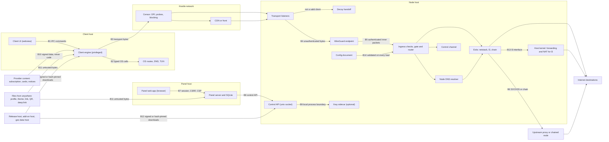

# Veilway threat model

This document is binding. Protocol, panel and client code is reviewed against it, and a change that breaks an invariant in section 7 is a bug even if every test passes. It was first written before any of the new design existed. The core engine of `PLAN.md` Phase 1 is now built up to live reload (config v1, several inbounds, routing rules, the `netstack` and `l3` exits, the node's resolver), and the parts about it describe code. The native protocol, the panel and the multi-platform client do not exist yet, so the rest still describes requirements, not results.

## 1. How to read this

**Status labels.** Every mechanism carries one of four labels.

| Label | Meaning |
|---|---|
| Built | Exists in the current code. If a test covers it, the test is named. If no test covers it, the text says "read from code, not tested". |
| Partial | Exists but is known to be incomplete. The gap is listed in section 8. |
| Not built | Required by this document, absent from the code, and either absent from `PLAN.md` or contradicted by a dependency's default. Listed in section 8 where current code is affected. |
| Planned | Described in `PLAN.md`, not written yet. Nothing planned is a security property until it is built and its test in this document passes. |

**What "tested" means here.** The test suite has 194 test functions (`cargo test --workspace`). They were counted in the source for this revision, which was made by reading code and tests and not by a new run. They cover the WireGuard endpoint wrapper, the WebSocket relay and its limits, config v1 (parser, validation, reload store), the engine end to end on loopback (ingress checks, the destination gate, routing rules, the flow table, the node's resolver, ICMP errors, the `unsupported` policies, live reload and cut-off) and the client engine. Three of them drive the `l3` exit against a real kernel. Those run only with `VEILWAY_TEST_L3=1` in a container that has `CAP_NET_ADMIN`, as the header of `crates/veilway-core/tests/l3.rs` says, and are not part of the CI run. There are three fuzz targets (`config`, `packet`, `dns`, section 6), run by hand and not in CI. There are no probe-resistance measurements, no traffic-analysis measurements and no external review. The tunnel cryptography is WireGuard as implemented by boringtun and is not re-verified by this project.

**Code references** name a function or a test, not a line number, and place it in the crate from the `PLAN.md` repository layout (`veilway-wg`, `veilway-core`, `veilway-client`, `apps/desktop`). Search for the symbol if a path has moved.

**Addresses** in examples come from RFC 5737 (`192.0.2.0/24`, `198.51.100.0/24`, `203.0.113.0/24`) and `example.com`.

## 2. System summary

Built today: a core that runs one JSON config (version 1) with several inbounds. Each inbound is one WireGuard tunnel in userspace (boringtun) with its own key and address pool, reachable over UDP or over WebSocket (one WireGuard datagram per binary frame). Users have devices, and a device is a public key with fixed tunnel addresses. Every decrypted inner packet passes a source check and a fixed destination gate. Routing rules then decide per flow: an exit, delivery to another device inside the node, or refusal, and a bounded flow table keeps the decision. An exit has one of three backends: `netstack` (a userspace TCP/IP stack that re-dials each flow through a SOCKS5 proxy or directly from the node, with no TUN device, no kernel routing and no privilege), `l3` (Linux only: one TUN device, kernel forwarding and source NAT, `CAP_NET_ADMIN`) and `block`. The node answers tunnel DNS itself and remembers names per user for `domain` rules. The config is reloaded on `SIGHUP`, and a user who is disabled, removed or expired is cut off while connected. A Windows desktop client drives a Wintun adapter, routes and DNS policy.

One thing is different from the first version of this document and matters everywhere below: isolation between users and access to private networks are no longer fixed properties of the server. Routing rules decide both. Section 5.6 states what is still enforced whatever the rules say and what is now the operator's responsibility.

Built since: quotas with usage kept in a state file, and the control API on a unix socket (`veilway-api`). Built since as well: the node's side of the control channel on `veilway` inbounds (`engine/control.rs`, over the wire formats of `veilway-proto`), which carry the `udp` and `udp-obfs` transports. Built since as well: the node's side of `udp-obfs` (`engine/obfs.rs`) and the replay memory with its file that every obfuscated transport will share (`engine/replay.rs`), both over the wire formats and the replay rule of `veilway-proto`. No client speaks `udp-obfs` yet, and neither part has been reviewed. Built since as well: the node's side of `tls` and the stream listener for a direct peer (`engine/stream.rs`), with the limits per device and per source that every native transport is held to together (`engine/limits.rs`). No client speaks `tls` yet, the listener has not been reviewed, and `tls` is rated Detectable whatever its tests show. Not built in the core yet: remote access to the control API, the client's side of the control channel and of every transport, the other stream transports of the native protocol (its own `ws`, `fronted`) with the proxy path of the stream listener, GeoIP beyond the name `geoip:private`, and the `chain` exit.

Planned (`PLAN.md` "Core design", "The native protocol", "Transports"): the `veilway` inbound (WireGuard tunnel, pluggable transport, control channel inside the tunnel), transports `udp-obfs`, `tls`, `faketls`, `fronted` and later `quic`, the `chain` exit, GeoIP and geosite rules, quotas, a control API, a web panel, signed subscriptions with provider cards and themes, the optional Xray sidecar, and clients for Windows, macOS, Linux and Android.

## 3. Assets

| Id | Asset | Why it matters |
|---|---|---|
| AS1 | Fact of use: that a given network address runs or uses Veilway | On a censored network this is the first thing an adversary wants, and it is enough to block a node or single out a user. |
| AS2 | Reachability of a node: its addresses, names and fronts staying unblocked | A blocked node is a lost node for every user on it. |
| AS3 | Tunnel content: inner IP packets | Confidentiality and integrity between client and node. |
| AS4 | Tunnel metadata: destinations, DNS names, volume, timing, client address | Visible to the node by design, must not be visible to the path. |
| AS5 | Long-term keys: user WireGuard private keys, node static keys, preshared keys, transport authentication secrets | Impersonation and, for transport secrets, retrospective detection. |
| AS6 | Provider signing key (Ed25519) and subscription URLs | Whoever holds the key can reconfigure every subscribed client. A subscription URL is a bearer secret. |
| AS7 | Panel credentials, sessions, TOTP seeds, database, audit log | Full control of users, nodes and exits. |
| AS8 | Upstream credentials (SOCKS5, chained nodes) | Abuse of someone else's proxy, and traffic interception. |
| AS9 | Client host integrity: routes, DNS policy, the privileged process, local files | The client changes system networking with administrator rights. |
| AS10 | Node host integrity and resources | Other users of the node, and anything else on that machine. |
| AS11 | Release signing keys, updater key, add-on hash list, CI | Whoever controls these controls every installation. |
| AS12 | Isolation between users of one node | One user must not see, reach or degrade another. |

## 4. Trust boundaries

| Boundary | Crossing | Trust rule |
|---|---|---|
| B1 | Webview to client engine | The webview is less trusted than the engine. The engine validates every command argument. Provider strings reach the webview only as text. |
| B2 | Engine to OS configuration | Only typed values (addresses, prefixes, integers) and constants reach a command line or system API. |
| B3 | Client to path | Everything on the path is hostile. The path sees transport bytes only. |
| B4 | Path to transport listener | All input is unauthenticated until WireGuard, or the transport's own proof, accepts it. No identifying answer before that. |
| B5 | Tunnel to engine | The peer is authenticated and still hostile (section 5.6). |
| B6 | Exit to upstream | The upstream is semi-trusted for delivery and untrusted for content, replies and addresses it returns. The DNS servers the node's resolver asks through an exit are untrusted in the same way. |
| B7 | Browser to panel server | An authenticated session is not proof of intent. State changes need a CSRF token, sensitive ones need recent re-authentication. |
| B8 | Panel to core | The core authorises every call by token scope or socket ownership. It does not trust the panel database. |
| B9 | Core to sidecar | The sidecar is a separate OS process with a generated config, reachable on loopback only. Its stats output is untrusted input. |
| B10 | Provider to client | Provider content is authenticated data from a party that may be malicious (section 5.2). |
| B11 | Files to any parser | Attacker-controlled bytes. Section 6 lists every parser. |
| B12 | Download hosts to installer | Transport security is not relied on. Signature or pinned hash decides. |
| B13 | `l3` exit to host kernel | The kernel forwards what the engine writes to the interface. Whatever the host routes into the interface is untrusted input and is delivered only as the answer to a live flow. The node changes host state only with typed values and fixed argument lists (section 5.11). |
| B14 | Config document to core | The core validates every document itself, at start and on every reload, and keeps the running config whole when one is refused. A valid document is trusted completely: it decides isolation, exits, entitlement and what is logged. Today it comes from a file, later also from the control API. |

## 5. Adversaries

Each subsection lists the assets at stake, the adversary's capabilities, what the design does with the mechanism that provides it, what is not defended, and how the defence is tested.

### 5.1 Censor with DPI and active probing

**Assets:** AS1, AS2, AS4.

**Capabilities:** observes every packet between client and node, including sizes, timing and direction; keeps flow records for later analysis; injects, drops, delays and resets packets; connects to any address and port it has seen and sends anything (active probing); replays bytes captured from real clients; blocks by address, port, SNI, DNS answer, protocol signature or behaviour; can obtain subscriptions and client binaries the same way a user does, so it knows the software, node public keys from leaked subscriptions and the front lists in them; may hold a CA that client operating systems trust; may throttle everything it cannot classify, or allow only what it can.

| Technique | Design response | Mechanism | Status |
|---|---|---|---|
| Passive protocol fingerprint of plain WireGuard (message type byte 1 to 4, three reserved zero bytes, sizes 148, 92, 64 and 32 + 16n) | Plain `udp` is rated Detectable and never presented as resistant. Obfuscated transports wrap every datagram. | "Security rating shown to users"; transports `udp-obfs`, `tls`, `ws`, `faketls`, `fronted` | Rating planned. `udp` and `ws` built. Others planned. |
| Length and timing fingerprint through TLS | Framing adds a length field and padding so WireGuard's sizes do not show through record lengths. | "The native protocol", layer 2 | Planned. The built `ws` transport maps one datagram to one frame with no padding (G14). |
| Active probing of a TCP listener | Anything that is not a valid client is handed to the decoy origin: the operator's own web server, with no third-party decoy in version 1. To a prober the node answers with the decoy's bytes and close behaviour, except that on `tls` the TLS handshake is the node's own (invariant 1). Timing cannot be identical: a splice or reverse proxy adds the hop from node to origin, and invariant 3 bounds and publishes that residual. | "Rules for building it", first rule; Phase 2 step 3. `engine/stream.rs`: `conn` (the accept state machine of a direct peer), `prove` (steps 1 to 7 of the proof), `relay` (the handoff) | Built on the node for `tls`, for a direct peer. A connection is decided at the end of its request line or at the first byte that cannot belong to one. Everything that is no accepted proof goes to the configured origin with every byte the peer sent, unchanged, and both directions are relayed blindly from there: the node composes no byte for such a peer. The connection to the origin is started before anything is read and only waited for at that step, so an origin that is down never touches a user. Once it is open it is watched: an origin that says something or closes while the request line is not complete decides the connection at that moment, as it decides a direct visitor's, and a line that is complete is always evaluated first. What the origin sends is written out to the peer at once, the peer is closed only when it was given all of it, and an origin's reset is a reset for the peer. Test `whoever_is_not_a_user_gets_from_the_node_exactly_what_the_origin_gives` sends 28 kinds of request (a browser's, garbage, slow, unfinished, at and over the node's limits, a body announced with `Expect`, a body in chunks, the HTTP/2 preface, a changed proof alone and with a second request behind it, a spent proof, the proof of a removed device, a half-closed connection) once to a real HTTP server and once through the node and holds the bytes and the end of each connection to be the same. Tests `every_refusal_takes_the_decoy_path`, `a_spent_proof_stays_spent_across_restarts`, `a_decoy_that_is_down_closes_strangers_and_never_touches_a_user`, `an_origin_that_is_slow_closes_early_or_loops_back_harms_no_user`, fuzz target `tls_listener`. What is not built or not shown: the proxy path, the native `ws` and `fronted`, any measurement of timing (G49), and a comparison against more than one web server (G50). The built `ws` listener of a `wireguard` inbound identifies itself (G1). |
| Holding a stream listener's places without authenticating | Every listener caps its connections, bounds the time a peer may take before it has proven anything, and bounds unfinished handshakes per source. | `relay_served`, `relay_conn` in `veilway-wg`: 1024 connections per listen address (`MAX_CONNS`), one 10 s deadline for TLS and the WebSocket upgrade together (`UPGRADE_TIMEOUT`), 64 unfinished upgrades per IPv4 address or IPv6 /64 (`MAX_PENDING_PER_SOURCE`), frames capped at 65535 bytes, 300 s idle. Counters `ws_stalled` and `ws_refused`. Tests `silent_connections_do_not_hold_the_relay_forever`, `unfinished_upgrades_are_bounded_per_source` | Partial (G2, G26). Built and tested up to the upgrade. The upgrade itself proves nothing (G1), and an upgraded connection keeps its place through 300 s of silence with no cap per source. Behind a reverse proxy or CDN every connection has one source, so the per-source cap is one cap for everybody. Built for the `tls` listener (`engine/stream.rs`): three of the four pools of invariant 19, undecided (512, and 64 for a source, by default), relayed (1,024) and session (16,384), each a config value, with 10 s for the TLS handshake, 10 s and 4,096 bytes for the request line and 10 s and 16,384 bytes for a user's request head. A full undecided pool, or a source at its share, decides its oldest connection as not a user at once, and one still inside its handshake is closed. A full relayed pool closes the connection that was idle longest. A full session pool refuses new proofs. A listener takes a connection from the system only while it has a place for one in some state, and never closes one at accept. Tests `pressure_from_strangers_lands_on_strangers`, `the_relayed_connection_that_was_idle_longest_makes_room`, `every_refusal_takes_the_decoy_path`. The proxy pool is planned with the proxy path. |
| Active probing of a UDP listener | No reply to anything that fails WireGuard's `mac1`, and no reply to a handshake from a static key that is not a peer. The devices of a disabled, expired or removed user are not peers, so a prober cannot tell such a user from an unknown key. | `Wg::recv_authenticated` in `veilway-wg` (boringtun `verify_packet`, then `parse_handshake_anon` and a key lookup, all returning without output on failure). Tests `a_removed_peer_is_refused_and_the_others_keep_their_place`, `a_disabled_or_expired_user_cannot_complete_a_handshake` | Built. The silence for a key that is not a peer is tested below the handshake limit, the rest is read from code and not tested as a probe. `mac1` needs only the inbound's public key. The handshake limit is one counter per inbound, not per source: once an inbound has seen more than 100 `mac1`-valid handshake messages in the current second from anyone, real clients included, every further `mac1`-valid probe gets a cookie reply, which confirms WireGuard (Q14). On `udp-obfs` (built on the node, `engine/obfs.rs`): no reply to anything that is no data packet of a session at its source and no opening packet of a device in the tag table, which costs one HMAC and one lookup, and no reply to an opening packet the replay rule or a limit refuses. A session is answered only once a WireGuard packet of its own device has authenticated on it, and no cookie reply is ever sent there: its handshakes are not counted against the inbound's handshake limit, which a flood on a plain socket therefore cannot use to shut `udp-obfs` devices out. Tests `whatever_is_no_valid_packet_for_the_node_gets_silence`, `a_bound_session_is_not_held_to_the_load_limit_and_gets_no_cookie`, `a_listener_answers_its_device_once_and_nobody_else`, fuzz target `obfs_listener`. The one reply the specification allows to somebody without a secret, the raced opening packet of invariant 1, is not tested. |
| Replay of a captured client handshake | A WireGuard initiation carries a TAI64N timestamp, and one that is not newer than the last accepted from that key draws no response. Planned transports must have their own replay rule (invariant 2). | boringtun; spec for `udp-obfs`, `faketls` and `fronted` | WireGuard part holds while the node process lives, built upstream, not tested here. The timestamp memory is not persisted: after a restart a replayed initiation is answered, which confirms a WireGuard node to the replayer, and moves that peer's stored endpoint to the replayer until the real client speaks (G18). The same memory is lost for one device when a reload drops its sessions, and for a whole inbound when a reload restarts its tunnel. Transport part: built on the node for `udp-obfs`, where an opening packet is accepted once, also across a clean stop and a kill (tests `an_opening_packet_is_accepted_once_across_a_clean_stop_and_across_a_kill`, `a_node_without_a_usable_replay_file_refuses_every_proof_for_the_window`, `a_node_that_cannot_write_its_replay_file_opens_no_new_session_and_says_so`, and the tests of `engine/replay.rs`). There G18 does not reach: a WireGuard initiation is read only inside a session whose opening packet passed that rule, and only from the device the packet named (test `a_session_carries_the_tunnel_of_the_device_that_opened_it_and_of_no_other`). Specified and not built for `tls`, `ws` and `fronted` (invariant 2), open for `faketls` (Q3). |
| Blocking by node address | Front candidates: several address and SNI pairs per profile, probed by the client, re-chosen when one dies, updated through the subscription. CDN-backed `ws` and `fronted`. | "Domain fronting, built in" | Planned |
| Blocking by SNI | Separate dial address, SNI and `Host`; Encrypted Client Hello where the CDN supports it; SNI-less connections where accepted; `faketls` borrows a third-party site's handshake. | "Domain fronting, built in"; `faketls` | Planned |
| DNS poisoning or observation of the node name | Profiles can carry addresses, so no lookup is needed. A poisoned answer cannot impersonate a node because WireGuard authenticates the node's static key. It can block, and on the built client it also selects the address that is exempted from the tunnel (section 5.10). | Front candidate list; WireGuard | Partial. The client resolves host names through the system resolver before the tunnel is up (`resolve_endpoint` in `veilway-client`), in clear, and pins the answer outside the tunnel (G12). |
| Client TLS fingerprint (JA4, extension set and order, GREASE, key shares, ALPN, HTTP/2 settings) | Client TLS built on BoringSSL configured to match a current browser, measured by JA4 and a full ClientHello diff against that browser. If the spike fails, the docs say so. | "Transports", last paragraph; Phase 2 step 5 | Planned. The built client uses rustls, which does not look like a browser. |
| Server TLS fingerprint and certificate inspection | `tls` uses a real certificate for a name the operator owns, supplied as files in version 1. Built-in issuance is to be specified, because a challenge answered on the listener's own port is a probe surface. The handshake on `tls` is still the node's own and does not match the site behind it, so `tls` is capped at Detectable (invariant 1). On `ws` the operator's web server or a CDN ends TLS. `faketls` presents the third-party site's own handshake. | Transports table. `ws::load` in `veilway-wg` (rustls), used by `Host::prepare` for a `tls` transport | Built for `tls` with files: the chain and the key are read at start and at every reload, a file that cannot be used refuses the reload, and a key file group or others can read is a warning (test `a_new_certificate_is_served_from_the_next_reload_and_no_session_ends_for_it`). The node's handshake is what its TLS library does by default (TLS 1.2 and 1.3, `http/1.1`, its own tickets), has been compared with no web server, and is the reason for the cap (G49). A proof under TLS 1.2 is never accepted. Issuance, `ws` behind a web server and `faketls` are planned. |
| Behavioural blocking (one long-lived connection, high volume to one address, upload-heavy ratio, TCP-in-TCP retransmission pattern) | Parallel connections where the profile allows them (1 by default), no second retransmission layer, and an order of transports that the profile and the user choose: datagram transports perform better and are easier to recognise. | "Rules for building it", second rule | Planned, and only reduces the signal (section 9). |
| Machine-in-the-middle with a trusted CA | Confidentiality and node authentication hold, because they come from WireGuard and not from TLS. Detection does not hold: a censor that terminates `tls`, `ws` or `fronted` with a certificate the client accepts sees WireGuard framing inside (type byte, reserved zeros, fixed sizes), classifies the flow and blocks the node. It can also rewrite an unsigned legacy subscription and the first fetch of a native one. Response: the client pins the node certificate or SPKI carried in the signed profile for `tls` and own-certificate `ws` (invariant 5a), and the inner framing is keyed so that stripped TLS does not show WireGuard's type bytes (invariant 5). | WireGuard Noise IK; profile pin; "The native protocol", layer 2 | Confidentiality and authentication built upstream. Pin and keyed framing planned; neither is in `PLAN.md` yet. The built `ws` client has no pin. |
| `faketls`: destination address does not belong to the borrowed site | None that removes the signal. The borrowed site is chosen so that the node's network is plausible for it (same hosting provider or a CDN the site uses), and the profile says which check it fails. | `faketls`; Q19 | Planned. Listed under Not defended. |
| `faketls`: server first flight of an authenticated session differs from the borrowed site's (certificate message size, number and size of session tickets), visible in record lengths | The authenticated server flight is shaped to the record lengths measured from the borrowed site, re-measured when the site changes. | `faketls`; Q19 | Planned, mechanism open |
| `faketls` and decoy handoff: the node forwards anyone's bytes to the borrowed site or decoy origin | For `tls`, `ws` and `fronted` the decoy origin is the operator's own web server and the only place a stranger's bytes go, so no third party is loaded, the node is not an open relay, and it sends a stranger only what the origin answered. Relayed connections of direct peers have a pool of their own and no cap per source, in bytes or in duration: the origin's own limits decide, and when the pool is full the relayed connection that has been idle longest is closed. Behind a trusted proxy, where the source is known from the forwarded-address header, one source may have 16 requests in flight to the decoy. For `faketls`, which relays to a third party and is not specified, caps per source and in total stay a requirement, and such a limit must not itself be a probe signal. | Decoy handoff; invariant 19. `engine/stream.rs` (`Origin::dial`, `relay`), validation of `decoy.origin` | Built for direct peers of a `tls` listener. The origin is one address of the config, resolved at start and at every reload, and no byte of a peer chooses where a connection goes: the one place in the engine that dials for a stranger, and the one place that says where it dials, are held to that by test `egress_never_dials_directly`, which counts both. Validation refuses an origin that is a listen address of the node, and `prepare` refuses a name that resolves to one, by one rule (`config::loops`). `veilway doctor` warns when the origin redirects to `https://`, which behind the node's TLS never ends. An origin that sends everything back to the node ends at the node's own TLS handshake after one turn (test `an_origin_that_is_slow_closes_early_or_loops_back_harms_no_user`). With `decoy.proxy_protocol` the origin is told the stranger's address (test `the_origin_is_told_the_address_of_the_stranger`). The origin is reached over plain HTTP only (G48). The proxy path and its cap of 16 requests per source are planned. |
| WireGuard timer fingerprint through an obfuscated transport: a fixed first exchange (initiation up, response down, then data), a handshake pair every 120 s, keepalives at 10 s and at the configured persistent interval (commonly 25 s) on an idle tunnel, constant full-MTU records under bulk transfer | Padding and jitter for the first records, the rekey exchange and keepalives, so that none of them is a fixed size at a fixed period. | "The native protocol", layer 2; Q5; invariant 7 | Planned, policy open |
| Encapsulated TLS handshake fingerprint: the size and direction sequence of an inner TLS handshake seen through any tunnel (Xue et al., USENIX Security 2024) | None at v1. | None | Not defended |
| A weaker listener on the same address: a plain `wireguard` inbound, an Xray inbound, a panel, a subscription endpoint or an ACME responder identifies the address whatever the strongest transport on it does | The rating of every profile on an address is capped at its weakest listener, and the panel warns when one is added (invariant 7a). | "Security rating shown to users" | Planned. `PLAN.md` does not state the cap (Q21). Config v1 already lets `udp` and `ws` transports of several inbounds share one address, and nothing rates it or warns. |

**Not defended:**

- A censor that blocks everything it cannot classify, or allows only a list of addresses. If no front in the list is reachable, Veilway does not work there.
- Address blocking of a node that has no CDN or front. Changing the address is the only remedy.
- Statistical traffic analysis: flow correlation, website fingerprinting from sizes and timing, volume profiling. Padding raises the cost and proves nothing.
- A censor holding any valid subscription. It knows every address, key and front in it, can confirm each node by connecting as a client, and for a transport whose secret is node-wide can passively recognise every user of that node and pass the proof when probing (invariant 5b).
- A censor that blocks a whole CDN.
- Fingerprints going stale. A browser-matching ClientHello is correct for one browser release. Section 9 covers this.
- Throttling or packet loss that makes stream transports unusable.
- `faketls`: a censor that checks whether the destination address belongs to the SNI's published addresses or ASN, and a censor that compares TCP-handshake round-trip time with TLS-handshake round-trip time to detect a relay hop.
- CDN-terminated transports (`fronted`, `ws` behind a CDN): the CDN sees the inner framing and the client's address, and so does anyone the CDN answers to.
- The encapsulated TLS handshake fingerprint, at v1.
- Residual timing of WireGuard's handshake and keepalive timers after padding and jitter. The measurement in the testing list bounds it and does not remove it.
- Enumeration of `tls` node names through Certificate Transparency logs, which publish every ACME-issued certificate, and a node name that hosts nothing but a decoy.

**Testing (all planned unless marked):**

- Probe differential: a corpus of probes (random bytes, truncated and malformed ClientHellos, valid ClientHellos without the proof, replayed valid ClientHellos, plain HTTP requests, HTTP/2 prefaces, slow sends, immediate close) is sent to a node and to its decoy origin from the same vantage point. Response bytes and close behaviour must match the origin. On the node, the reject path and the path of a valid TLS client with no proof must have the same response time distribution. Against the origin, the node's response time may differ by the node-to-origin hop and no more; that residual, and the TCP-handshake against TLS-handshake round-trip gap, are published per transport as known signals. Phase 2 gate: "an active probe gets only the decoy".
- Built from the probe differential, for `tls`: the response bytes and the close behaviour, in `whoever_is_not_a_user_gets_from_the_node_exactly_what_the_origin_gives` (`crates/veilway-core/tests/tls.rs`), against one HTTP server on the loopback and over the decrypted stream, with the HTTP/2 preface inside TLS among its requests. Next to it, against an origin written by hand: the moment a connection that sends nothing or never finishes its line is closed (`an_origin_that_gives_a_connection_up_decides_it_at_that_moment`, within 300 ms of the origin's own), answers of many sizes to peers that read late or slowly (`the_end_of_an_answer_never_stays_in_the_node`, `an_answer_the_origin_closed_behind_reaches_a_peer_that_reads_late`), and an upgrade of the origin's own, a reset and an early answer to an upload (`what_an_origin_does_to_a_connection_is_what_the_peer_gets`). Not built from it: malformed and truncated ClientHellos and a client that offers only `h2`, which meet the node's TLS library and not the origin, any response time distribution, and the published residuals (G49, G50).
- Built: `silent_connections_do_not_hold_the_relay_forever` and `unfinished_upgrades_are_bounded_per_source` for the stream listener limits. `a_removed_peer_is_refused_and_the_others_keep_their_place` and `a_disabled_or_expired_user_cannot_complete_a_handshake` show that a handshake from a key that is not a peer gets no reply below the handshake limit.
- UDP silence test: random datagrams, datagrams with a valid message type byte, and handshakes with a valid `mac1` from an unknown key must produce zero replies while the inbound as a whole is below the handshake limit. A second run measures what the same probes get while another source holds the inbound above the limit, and the result is published (today: a cookie reply). The two built tests above cover the unknown key case only.
- Restart replay test: capture a valid initiation, restart the node, replay it from another address. No response and no endpoint change is the pass criterion. Fails today on plain `udp` and legacy `ws` (G18). Built for `udp-obfs`: `an_opening_packet_is_accepted_once_across_a_clean_stop_and_across_a_kill` replays an accepted opening packet from another address after a clean restart and after a kill, and gets silence both times.
- Built for `udp-obfs`: `whatever_is_no_valid_packet_for_the_node_gets_silence` sends random datagrams of every size around the limits, a plain WireGuard initiation, a real opening packet changed in every part or cut, opening packets under an unknown secret and for another inbound, replayed opening and data packets and timestamps outside the window, and no socket gets a reply.
- Length and timing distribution: capture each obfuscated transport under fixed workloads (idle, browsing, bulk transfer) and check that record or datagram lengths show no peak at the WireGuard sizes, and that a classifier trained on plain-WireGuard timing (first exchange, 120 s rekey pair, keepalive cadence) does no better on the capture than on the transport's cover profile. The capture includes the first two records of each direction of a connection. Captures and results published per transport.
- Server TLS comparison: what answers a TLS handshake on a stream listener's address (versions, protocols offered, tickets, alerts) is compared with ordinary web servers, per release. The spec lists it among the things to measure and defines no more than that. Required by invariant 7a for a rating above Detectable.
- JA4 and a full ClientHello diff (extension set, GREASE, key shares including the post-quantum share, ALPN, record size) per platform the client claims to be, against the browser release it claims to match, re-run on every dependency update of the TLS stack. JA3 is recorded but is not a pass criterion, because current browsers randomise extension order.
- Pin test: a `tls` or own-certificate `ws` profile with a pin, served a chain that validates under the system store but does not match, must fail closed.
- Shared-address rating test: adding a `udp-obfs`, `udp` or legacy `ws` transport, a plain `wireguard` inbound, an Xray inbound, a panel or a subscription endpoint to an address lowers the computed rating of every profile on it.
- Fuzz targets `fuzz_frame_decode`, `fuzz_udp_obfs`, `fuzz_faketls_clienthello`, `fuzz_fronted` (section 6).
- A fronted connection through a real CDN (Phase 2 gate). This shows that it works on that CDN on that day and nothing more.

### 5.2 Malicious provider

A provider runs a panel and nodes and hands subscriptions to users. Users choose a provider. A provider is not trusted with the user's device.

**Assets:** AS9, AS5 (the user's keys for other providers), the integrity of the client UI, and the user's traffic while not connected to that provider.

**Capabilities:** signs any subscription content with its own key; controls every node the profile points at, so it sends arbitrary control channel messages, arbitrary inner IP packets towards the client, and arbitrary DNS answers; chooses names, notices, cards, links, logos, exit catalogue, update interval and transport hints; can serve different content to different users; sees the address and timing of every subscription refresh.

| Risk | Design response | Mechanism | Status |
|---|---|---|---|
| Code execution or markup injection through content | Provider content is data. Cards are a closed set of four types, plain text, no HTML, no markdown, no remote images, at most 6, capped strings. | "Provider cards" | Planned |
| Hostile logo image | One embedded raster under 64 KB, decoded and re-encoded by the client before display, with dimension limits. | "Provider cards" | Planned |
| Phishing through links | `https` only, the domain is shown, opening needs a confirmation. | "Provider cards" | Planned |
| Passing itself off as the application | Provider content is visibly separated from the app's own UI and can be hidden. One accent colour, clamped for contrast, built-in icons only. | "Provider cards" | Planned |
| Lying about how safe a profile is | The rating is computed by the core from the effective settings. No profile, subscription or control channel field can set it. A disabled certificate check rates Unsafe. | "Security rating shown to users" | Planned. Today a profile can set `InsecureTls` with no warning (G9). |
| Hostile control channel values (addresses, DNS, MTU, hints, notices) | The client validates every value against bounds and never lets a server message weaken the kill switch, DNS pinning or rating (invariant 23). | Control channel spec | Planned. The spec lists every value a client takes and its bound (Q6) |
| Command injection into the privileged client | Only typed values reach `netsh`, `route` and PowerShell. | `win::open` in `veilway-client` takes `IpAddr`, `IpNet`, `u16` and a constant adapter name | Built, read from code, not fuzzed |
| Silent takeover of another provider's subscription | A subscription is identified by its signing key and its signed subscription id together. A document replaces a stored subscription only when it verifies under a key held for that subscription and carries the same id. Another key is always another subscription, and the same key with another id is a second subscription beside the first. A document under a key that is not held is a failed refresh, with no way to accept it. | "Subscriptions"; invariants 21 and 21a | Planned |
| Pushing a binary | Providers cannot ship code. Updates come only from the project's signed release. The Xray add-on is verified against hashes shipped with Veilway, not with the subscription. | "Xray add-on"; "Security requirements" 5 | Planned for the add-on. Updater signature check built (section 5.8). |

**Not defended:**

- The provider reads and can modify everything the user sends through its nodes that is not protected end to end by the application (TLS inside the tunnel is the user's protection). It sees destinations, DNS names, volume, timing and the client's address. Veilway is not an anonymity system against the provider.
- The provider answers DNS. It can lie.
- The provider can reach services on the client that listen on the tunnel interface, because it can inject any inner packet. The built client adds no inbound filter (Q7).
- The provider can use the refresh interval and per-user URLs as a presence beacon.
- Whoever supplies the link supplies the key. The link carries the provider's signing key, so a link from a stranger is a complete, valid subscription to the stranger's provider. The app shows the host and the key's fingerprint before any request, and cannot tell the two apart.
- A stolen signing key cannot be revoked for clients that still hold it. The provider can only rotate, and get a document that drops the stolen key to each client before the thief gets one to it.
- The provider can point its profiles at any public address, which clients then dial when their users connect. With many users that can be a third party's address, which then receives their connection attempts. The provider also chooses the server name a client sends in clear.

**Testing (planned):** fuzz targets `fuzz_subscription`, `fuzz_cards`, `fuzz_card_logo`, `fuzz_control_client`; UI tests that render a hostile corpus (markup, script, bidi overrides, zero-width characters, very long strings, homoglyph domains) and assert text-only output and visible truncation; a test that no control channel message changes the rating, kill switch or DNS pinning state; a test that a profile with certificate verification disabled is rated Unsafe.

### 5.3 Malicious subscription, theme file, link or provider card

The attacker here is anyone who can put bytes in front of a parser: a link in a chat, a QR code on a wall, a web page that triggers the `veilway://` handler, a clipboard, a shared theme file, a community locale pack or rule set.

**Assets:** AS9, AS5, AS1 (a client that auto-connects to an attacker's node reveals itself).

**Capabilities:** full control of the bytes; can trigger a deep link without the user typing anything; controls a web server the client will fetch from, so it controls headers, redirects, response size and timing; can craft a file that is valid under the schema and hostile in meaning.

| Risk | Design response | Mechanism | Status |
|---|---|---|---|
| Parser memory corruption, panic or resource exhaustion | Rust without `unsafe` in parsers, size limits before allocation, a fuzz target per parser. | "Security requirements" 2 and 3; section 6 | Planned. The three fuzz targets that exist (`config`, `packet`, `dns`) belong to the core. None of the parsers in this subsection has one (G8). |
| Drive-by import through `veilway://` | A deep link, a QR code or a file can bring the user to the first import screen and can do nothing else. It cannot cause a request, an enrolment or a used device place, and nothing is imported, connected or replaced without the steps of invariant 21. | "Subscriptions" | Planned |
| Another app claims the `veilway` scheme | None on a platform that lets another app claim it: that app receives the key and the token of a tapped link, and could enrol a device, which the user would see in the device list. The app says so in its help. Pasting the link or scanning the code inside the app are the ways in that no other app sees. | "Subscriptions" | Not defended |
| The `https` form of a link is tapped and handled by a browser | Providers hand out the `veilway` form, the app is never tied to the `https` host by an app link, the fragment with the key and the token is never sent to the endpoint, and the endpoint answers a `GET` as an unknown path and serves no page. What is left: the browser looks up the host and requests the endpoint from the user's own network before the app has shown anything, and keeps the whole link in its history. | "Subscriptions" | Planned. What a browser or a messenger does with the link is not defended. |
| Hostile theme | Colour tokens plus glass tint and blur strength, nothing else: no URLs, fonts, CSS strings or images. Schema validation, 16 KB limit, contrast check with refuse or auto-correct. | "Themes" | Planned. Phase 3 gate: a hand-written hostile theme is rejected. |
| Oversized or endless HTTP response | Body size cap, no compressed answer accepted, no redirect followed, `https` only, total time limit. | Subscription fetcher | Planned |
| Legacy link formats (`vless://`, `vmess://`, `trojan://`, `ss://`, base64 lists, headers) | Parsed to a typed profile, rated by the core, marked as unsigned. Connecting needs the add-on. | "Subscriptions"; "Xray add-on" | Planned |
| Legacy link fields reaching the sidecar config | The sidecar config is generated from typed, allow-listed fields. No link or subscription field is copied into it as raw JSON, a path or a URL (invariant 20a). | "Xray add-on" | Planned |
| Display spoofing (right-to-left override, homoglyphs in a domain) | Control and bidi override characters are stripped from provider strings; domains are shown in their ASCII form. | Invariant 25 | Planned |
| Hostile WireGuard profile text | `parse_conf` in `veilway-client` rejects unknown sections and malformed lines and yields typed values only. | Tests `full_conf_parses`, `missing_and_broken_keys_are_rejected`, `endpoints_pick_their_transport` | Built. Tested for expected input, not fuzzed. |
| Hostile GeoIP, geosite or rule set file | Verified against a pinned hash or signature before parsing, previous file kept on failure. The parsers are still fuzzed because a signed file can be wrong. | "GeoIP and geosite" | Planned |
| Hostile locale pack | Messages are rendered as text only. | "Decisions already made", Languages | Planned |

**Not defended:** a user who confirms the import of a hostile subscription gets a hostile provider (section 5.2); a QR code or link that looks like one provider and belongs to another, beyond showing the real domain and key fingerprint; denial of service by a file within the size limits that is merely useless.

**Testing (planned):** fuzz targets `fuzz_subscription`, `fuzz_links`, `fuzz_sub_headers`, `fuzz_deeplink`, `fuzz_theme`, `fuzz_cards`, `fuzz_card_logo`, `fuzz_wg_conf`, `fuzz_endpoint_url`, `fuzz_mmdb`, `fuzz_geodat`, `fuzz_ruleset`, `fuzz_locale`; a committed corpus of hostile files that must be rejected with a specific error; an HTTP test server that serves a compression bomb, an endless body, a redirect loop and an `https` to `http` redirect.

### 5.4 Stolen panel session

**Assets:** AS7, AS5, AS6, AS8, AS10.

**Capabilities:** holds a valid session cookie or token (malware on the admin's machine, a shared browser, cross-site scripting, a proxy log), or can make the admin's browser send requests (cross-site request forgery) without holding the cookie. Can also be any internet host reaching the public subscription endpoint, or a web page open in the admin's browser that targets a panel bound to localhost. Does not hold the password or the TOTP seed.

Everything in the panel is planned. Requirements, from `PLAN.md` "Panel features" 1 and "Security requirements" 4:

| Risk | Design response |
|---|---|
| Panel reachable by anyone | Binds to localhost by default, random base path generated at install. The subscription endpoint is the one part that must be public, and is kept apart (next row). |
| Public subscription endpoint (`PLAN.md` "Panel features" 4): a probe target that identifies a panel (AS1), a token-guessing and user-enumeration oracle, a parser of the request body | One path behind the operator's own web server, with no session cookie. A fetch is a `POST` with the token in the body, never in the URL. An unknown or reset token, a body that is not the request object, a `GET` and a source over its limit all get exactly what the web server answers on a path it does not serve (same bytes, same timing), and a valid token always gets a signed answer: the document, or a signed refusal. Limits per source are the web server's, on every path alike. An enrolled device has its own allowance, and device keys the endpoint has not seen share a separate, tighter one, so a holder of the link cannot use up the user's refreshes. Tokens carry at least 128 bits from a CSPRNG, and the token and the device secret are compared in constant time. It exposes nothing else. A native link never gets the legacy format, which is served at a different URL (invariants 27 and 21a). |
| First install | No default credentials. A one-time random password is printed at install and must be changed at first login. A TOTP code is accepted once. |
| Guessing or stuffing credentials | Argon2id, TOTP, rate limiting per account and per source address. |
| Cross-site request forgery | CSRF token on every state-changing request, cookies `HttpOnly`, `Secure`, `SameSite=Strict`. |
| Cross-site scripting, including stored | Strict CSP with no inline script and no `eval`; every string that came from a user, a client, a node or a log line is rendered as text. Log lines contain attacker-chosen bytes (SNI, host names, user agents). |
| A stolen session living forever | Idle and absolute expiry, a session list with revoke, all sessions revoked on password or TOTP change. |
| A stolen session doing irreversible damage | Recent re-authentication (password and TOTP) for: exporting any secret, changing admin credentials or TOTP, exporting or replacing the subscription signing key, creating API tokens, switching an exit to `direct` or `via`, adding or changing any outbound, upstream or exit backend, removing, disabling or reordering a routing rule that isolates users or refuses private networks (the rules on `tunnel:users` and `geoip:private`, which replaced the old `allow_private` switch), and publishing changes to subscription content (profiles, cards, links). The last three matter because the panel signs online and because routing rules are now what isolates users: without them a stolen session reroutes every user through an attacker's proxy, opens every user's devices and the networks behind the exits to every other user, or has the panel sign hostile profiles and links for every user, without touching a key. |
| Server-side request forgery through any URL the panel or core fetches (geo data sources, outbound health checks, `doctor`, exit address and country lookup, webhooks, ACME) | The name is resolved once and the connection goes to that address. Loopback, private, link-local, the tunnel subnet and the node's own addresses are refused, and redirects into those ranges are not followed. Response size and time are capped. |
| DNS rebinding against a panel or control API bound to localhost | The panel and the remote control API accept only configured `Host` values, and check `Origin` on every state change and on SSE and WebSocket upgrades. |
| Clickjacking | `frame-ancestors 'none'` in the CSP. |
| Spoofing the source address that rate limits and the audit log use | The client address comes from the socket. `X-Forwarded-For` and similar headers are read only when the socket's peer is a configured trusted proxy. |
| Covering tracks | Append-only audit log that a session cannot edit or truncate. |
| Reading secrets from a copied database | Secrets encrypted at rest with a key that is not in the database file. |
| Panel compromise becoming node compromise | The panel runs as its own least-privilege process and reaches the core only through the control API. |

**Built on the core side (B14).** A config reaches the core as a file, at start and on `SIGHUP`, or through an apply on the control API, which is a unix socket of mode 600 and nothing else: there is no remote listener, no token and no mTLS yet, so whoever can open the socket is the operator. What a later panel will meet is already there:

- The core parses and validates every document itself: strict JSON, unknown keys refused, at most 64 MiB and 8,000,000 JSON values, fixed limits on every list. Tests `strict_json`, `limits`, `a_document_of_too_many_values_is_refused_before_it_is_held_in_memory`, `the_user_and_rule_limits_validate_quickly`, fuzz target `config`.
- A document that does not validate, and a reload whose prepare step fails, leave the running config whole. Tests `an_invalid_document_changes_nothing`, `a_failing_prepare_changes_nothing`, `a_reload_that_fails_leaves_the_running_config_whole`, `a_stale_base_revision_is_refused_unparsed`.
- Errors name field paths, tags and names, never a value of the document. Test `secrets_never_reach_a_diagnostic_or_debug_output` for validation. The prepare step is read from code.

Not defended on the core side: a document that validates is obeyed. Whoever can write the config can remove the isolating rules, add exits and outbounds, turn on `log.destinations`, or add an `l3` exit, which turns on forwarding for the whole host. A reload also holds the flow table locked while every live flow is decided again (G31).

**Not defended:** inside its lifetime, a stolen session can do everything that does not require re-authentication: create users, read the user list and usage, change routing rules, disable users. A session stolen inside a re-authentication window can do the sensitive actions too. A leaked subscription link lets its holder enrol a device of its own while a place is free, and with provider-issued keys gives it the user's own device document, until the link is reset and those devices are removed. An attacker with code execution on the panel host, or on the admin's machine with a keylogger, is endpoint compromise (section 9). Encryption at rest does not help against an attacker who can read the running process.

**Testing (planned):** an authorisation matrix test that enumerates every route from the OpenAPI schema and asserts that only login, static assets and the subscription endpoint answer without authentication; a subscription endpoint test that an unknown token and an unknown path get identical bytes and the same response time distribution, that no session cookie is read or set there, that a valid token always gets a signed answer, and that requests with device keys the endpoint has not seen cannot use up an enrolled device's allowance; `fuzz_sub_request`; a CSRF test per state-changing route; cookie attribute and CSP header assertions including `frame-ancestors`; a stored XSS corpus pushed through every writable field and through log lines, rendered in a browser test; session expiry and revocation tests; rate-limit tests, including one that a forged `X-Forwarded-For` from an untrusted peer does not change the counted source; a re-authentication test for each sensitive action; an SSRF test that points every fetchable URL at loopback, a private address, the node's own address, a name that resolves to them and a redirect to them; a rebinding test (wrong `Host`, cross-site `Origin` on a state change, on SSE and on WebSocket); a first-install test (no default login works, the one-time password stops working after first use) and a TOTP reuse test; an audit log test that every state-changing route writes exactly one entry and no route deletes entries.

### 5.5 Compromised node

**Assets:** AS3, AS4, AS5, AS6, AS7 (through the node's link to a panel), AS9.

**Capabilities:** root on a node. Reads the node's static private key, every user public key and preshared key on that node, transport secrets, upstream credentials, the config and logs. Sees and modifies all traffic through the node. Sends anything to connected clients and to the panel that manages it.

| Risk | Design response | Mechanism | Status |
|---|---|---|---|
| Decrypting traffic recorded before the compromise | WireGuard session keys are ephemeral, so the static key alone does not decrypt past sessions. | WireGuard Noise IK, property of the protocol | Built upstream, not tested here |
| Impersonating users elsewhere | A node holds user public keys only. User private keys do not exist on nodes (invariant 30). | User model | Built for config v1: a device in `users[].devices[]` has a `public_key` and no private key. An optional `preshared_key` is a secret the node does hold. Planned for the panel, see Q9. |
| Signing subscriptions | The provider signing key is not stored on a node that only runs the core. Enrolment needs a document signed for each device when it enrols, which pushes providers towards signing online, and a key that sits on the panel is as safe as the panel. A retired signing key is kept for 365 days, for the single purpose of signing the refusal that tells a late client it needs a new link, and is then destroyed. | "Subscriptions" | Planned, see Q9 |
| One node's key exposing another node | Each node has its own static key and its own transport secrets. | Config model | Planned |
| Attacking clients | A compromised node is a malicious provider to its clients. Section 5.2 applies unchanged. | Client-side validation | Planned |
| Attacking the panel | Everything a node reports (stats, health, logs, exit country) is untrusted input to the panel. | B8, section 6 | Planned, relevant once one panel manages several nodes |
| Unprivileged core limiting what a code execution bug yields | The core runs unprivileged where the OS allows. `netstack` needs no privileges; `l3` needs `CAP_NET_ADMIN` only. | "Inbounds and outbounds"; "Security requirements"; `l3` in `veilway-core` | Built. A node whose exits are all `netstack` or `block` needs no privilege. `"icmp_echo": "direct"` needs unprivileged ping sockets (on Linux the node's group inside `net.ipv4.ping_group_range`), checked at start and never a raw socket. An `l3` exit is the one place the node needs `CAP_NET_ADMIN`, and with `masquerade` it also has to be allowed to write the two forwarding sysctls when they are off (section 5.11). |
| Logs kept on a node, or shipped off it, recording what users reached (AS4) | Log lines at every level hide destinations and DNS names unless the config sets `log.destinations`. The userspace stack, whose own log lines name the addresses of every flow, is silenced when it is off. A reload that changes `log` changes the filter. | `Plan::show` in `veilway-core`, the filter in `main` of `veilway` | Built, read from code, not tested. Still logged whatever the setting: user and device names, inbound and exit tags, and the transport address of a client (at info for `ws`, at debug for a handshake). |
| Another account on the node host reading the config, which holds keys and proxy passwords (AS5, AS8) | On Unix `veilway run` refuses a config file that group or others can read unless started with `--allow-readable-config`, at start and on every `SIGHUP`. The mode is taken from the opened file, so the file cannot be swapped between the check and the read. `veilway check` warns. | `config::load`, `Store::reload_from`, `main` of `veilway`. Test `load_reads_a_file` | Partial (G11). The warning is tested, the refusals at start and on reload are read from code. Only the two read bits are checked: not the owner, not write bits, not the directory. The secrets are still plain text in the file. |

The last two rows are about a weaker position than root: whoever receives the node's logs, and another local account.

**Not defended:** all traffic through the node while it is compromised; the mapping of user key to client address and destinations; the node's identity until its key is rotated by hand; retrospective detection, as far as the spec states it (Q4): whoever holds a device's transport secret recognises and unwraps that device's recorded `udp-obfs` packets down to WireGuard, whoever holds a node transport key, current or retired, links the tokens of one device that it can get hold of on `tls`, `ws` and `fronted`, where a device secret alone cannot be tested against recorded traffic, and whoever holds the inbound's WireGuard private key reads which device started each recorded handshake on plain `udp` and the built `ws`; a panel hosted on the same machine as a compromised node.

**Testing (planned):** a test that no API response, log line or config written by the core contains a user private key; fuzz targets for everything the panel parses from a node (`fuzz_api_events`); the client-side tests of section 5.2.

### 5.6 Hostile peer inside the tunnel

A peer holds a valid key. It is a paying user, a stolen key or an attacker who subscribed on purpose. In config v1 a peer is a device of a user: the device has a public key and fixed tunnel addresses, and the user has groups, the list of exits it may leave through and optionally an expiry time.

**Assets:** AS12, AS10, AS8, and the provider's private networks behind the node.

**Capabilities:** sends arbitrary inner IP packets: spoofed sources, any destination, any protocol, fragments, malformed headers, IP options; opens many flows; floods; sends any control channel request; chooses the DNS names it asks for, and controls the answers for names in a zone it owns; keeps sending after its user was disabled or removed.

**Isolation is decided by rules now.** The first version of this document described one tunnel in which peers never reached each other, and never reached private ranges unless `allow_private` was set. That fixed property is gone. The node now does the following whatever the routing rules say, and leaves the rest to them.

Enforced whatever the rules say:

- A device sends only from its own addresses, in the tunnel the packet arrived through.
- A gateway address answers DNS on port 53 and nothing else, ping included. On a `veilway` inbound, and there only, the gateway of the inbound a packet came in through also answers the control channel on TCP port 47873 and takes that channel's MTU probes on UDP port 47873, before the routing rules the way gateway DNS is. The gateway of any other inbound stays a closed door (tests `the_channel_is_reached_from_the_device_s_own_address_on_its_own_inbound_and_from_nowhere_else`, `a_config_from_before_the_control_channel_is_served_as_before`).
- The destination gate: loopback, link-local (`169.254.0.0/16`, `fe80::/10`), multicast, broadcast, unspecified and `0.0.0.0/8` never leave through any exit. Neither does an IPv6 address that carries one of those as an embedded IPv4 address (IPv4-compatible, NAT64 `64:ff9b::/96`, 6to4, Teredo by its server and by its client address), nor any IPv4-mapped address (`::ffff:a.b.c.d`).
- The node's own addresses are refused as destinations, for every exit.
- An address inside an inbound pool never leaves through an exit. It is delivered inside the node or refused.
- Broadcast and multicast are not carried, between users or outwards, and fragments are dropped.
- A flow leaves only through an exit in its user's `exits`.
- An answer reaches only the device whose live flow it answers.

The operator's responsibility:

- Whether users reach each other's devices. Without a `block` or `reject` rule that matches it, a packet to an address in a pool is delivered to the device that holds the address, on the same inbound or another one. The names `tunnel:users` and `tunnel:<inbound tag>` exist for such rules.
- Whether users reach private and special-purpose ranges through an exit. They are ordinary destinations unless a rule refuses them, and the name `geoip:private` stands for them. Through a `direct` outbound or an `l3` exit that means the networks the node host can reach, through a SOCKS5 outbound the networks the proxy can reach.
- Rule order. The first matching rule decides, so a rule placed before the isolating rules opens whatever it matches.

The shipped `config.example.json` starts its rules with one deliberate opening (devices on the `gaming` inbound reach each other) followed by a rule that rejects `tunnel:users` and one that rejects `geoip:private`. `veilway check`, and `veilway run` at start, warn when no enabled `block` or `reject` rule has `tunnel:users` in `ip` and no other condition, and again for `geoip:private`. The node starts anyway (G21).

| Risk | Design response | Mechanism | Status |
|---|---|---|---|
| Spoofing another device's source address | A decrypted packet is dropped and counted unless its source is an address of the device that sent it, in the tunnel it arrived through. A device is known by its public key, never by a peer index, which a later device may be given. | `Shared::ingress`, `inbound::read` in `veilway-core`. Validation refuses an address that two devices use or that lies in no pool. Tests `a_spoofed_source_is_dropped_and_counted`, `users_and_devices` | Built |
| Reaching the gateway or the node host | A gateway address answers DNS and nothing else, and on a `veilway` inbound the control channel of that inbound (rows below). The node's own addresses are refused for every exit. With an `l3` exit the kernel is kept from taking tunnel traffic for the host as well (section 5.11). A refused TCP segment gets a reset, anything else an ICMP error. | `Shared::ingress`, `Shared::decide`, `gate::is_local`. Tests `the_gateway_answers_dns_and_nothing_else`, `a_direct_outbound_reaches_a_local_responder` (its first half is the refusal), `the_host_knows_its_own_addresses` | Built |
| Reaching a destination no exit may carry | The destination gate, one fixed list for every exit, asked for every packet before the flow table and the rules. | `gate::refused`, `gate::embedded`. Tests `the_tunnel_and_the_host_are_refused`, `embedded_ipv4_addresses_are_unwrapped`, `every_embedded_form_gives_up_its_ipv4_address`, `an_embedded_ipv4_address_does_not_get_past_the_ip_rules` | Built. A few special-purpose ranges are in neither the gate nor `geoip:private` (G4). |
| Reaching another user's device | A routing rule on `tunnel:users` or `tunnel:<inbound tag>` refuses it. Where a rule lets a flow through, its answer belongs to that flow whatever the rules say about the other direction, and for ICMP only an echo reply answers anything. | `route::evaluate`, `Decision::Deliver` in `Shared::decide` and `Shared::carry`. Tests `isolate_users_refuses_delivery_between_users`, `peers_cannot_reach_each_other_or_the_gateway`, `delivery_between_users_works_when_isolation_is_disabled`, `the_gaming_example_opens_one_tunnel_only`, `a_remembered_refusal_does_not_shut_out_the_answer_to_a_delivered_flow`, `an_icmp_rule_is_not_bypassed_by_another_type_sent_first`. Validation tests `traffic_between_users`, `one_tunnel_by_its_inbound_tag` | Built as a rule, not as a fixed property (G21) |
| Reaching private networks behind an exit | A routing rule on `geoip:private` refuses them. A network in a rule, and `geoip:private`, also match an IPv6 destination that embeds a matching IPv4 address. | `route::evaluate`. Tests `private_destinations_follow_the_no_private_rule`, `an_embedded_ipv4_address_does_not_get_past_the_ip_rules`. Validation test `private_networks_and_geoip` | Built as a rule, not as a fixed property (G21) |
| Receiving another device's replies | An answer from the userspace stack goes to the device that holds its destination address only when the flow it answers is live under the config in force and belongs to that device. A device without a live session is sent nothing, so nothing waits inside a peer for whoever shakes hands next. | Replies task in `inbound::serve`, `Flows::owned`, `Shared::send`. Tests `the_answers_to_a_flow_never_reach_whoever_takes_its_address`, `two_inbounds_serve_their_own_pools_and_keys` | Built. The cross-peer property test is still planned. |
| Leaving through an exit the user may not use | Whatever chose the exit (a rule, the user's own exit, the default, a `via`), it must be in the user's `exits`, or the flow is rejected. It never falls through to another rule. The same holds for each DNS query. | `Shared::decide`, `flows::run`, `resolver::answer`. Tests `a_user_is_never_sent_through_an_exit_outside_their_exits`, validation test `entitlement` | Built |
| Leaving a proxy-only exit around its proxy | A `netstack` exit on a SOCKS5 outbound is proxy-only unless the config says `"proxy_only": false`: TCP leaves through CONNECT, UDP through an association whose relay must be the proxy's own host, tunnel DNS through CONNECT, and a ping is answered by the node. The policies `direct` and `via` are a validation error on a proxy-only exit and a warning everywhere. A UDP flow the proxy has carried is never moved around it later. | `dial`, `associate`, `flows::run`, `lookup` in `veilway-core`, `Config::validate`. Tests `egress_never_dials_directly` (source scan), `nothing_gets_through_when_the_socks5_is_down`, `udp_goes_around_the_proxy_only_when_the_exit_is_not_proxy_only`, `a_udp_flow_the_proxy_has_carried_never_goes_around_it`, `a_rejected_udp_flow_stays_rejected`, validation test `unsupported_policies` | Built. The relay address check is read from code, not tested. The engine does not look at `proxy_only` itself: it relies on validation, which runs at start and on every reload. |
| Stealing a peer's session by spoofing its transport address | The stored endpoint, and the socket replies leave through, move only after a packet authenticated under that peer's keys. | `Wg::recv_authenticated`, `inbound::read`. Tests `a_forged_flood_cannot_steal_an_endpoint`, `a_forged_handshake_flood_cannot_steal_the_endpoint` | Built against forgery. A replayed initiation still moves it after a node restart, a tunnel restart or a cut-off that drops the device's sessions (G18). |
| Exhausting the node | The flow table holds 65536 flows, 1024 per user over all devices and 512 per device. Refusals are remembered apart from those (4096, the oldest gives way) and take no room from a flow. Packet queues are bounded (4096 packets per tunnel in each direction, and into the `l3` interface), drop when full and count the drop. Every flow has an idle time. Fragments are dropped. | `MAX_FLOWS`, `MAX_FLOWS_PER_USER`, `MAX_FLOWS_PER_DEVICE`, `MAX_REFUSALS` in `route`, `QUEUE`. Tests `the_table_is_bounded_per_device_per_user_and_in_total`, `a_refusal_takes_no_room_from_a_flow`, `one_user_cannot_fill_the_flow_table`, `a_flow_expires_when_idle_and_frees_its_slot`, `an_idle_tcp_flow_lives_exactly_as_long_as_tcp_idle_secs`, `unreadable_packets_and_fragments_are_dropped_and_counted` | Partial (G7). The shares of the flow table are built and tested. The packet queues are shared by all devices of an inbound, so one device's flood drops other devices' packets. |
| Exhausting the node's resolver | One user has at most 64 queries waiting for a server, over all devices, and more are answered SERVFAIL. A query is at most 1500 bytes, a TCP connection carries at most 128 queries, and an answered UDP flow frees its place within seconds. The name memory holds 4096 entries per user. | `resolver::serve`, `resolver::answer`, `Names::record`. Tests `an_answered_dns_flow_soon_frees_its_place_in_the_flow_table`, `dns_over_tcp_is_answered_query_by_query`, `the_memory_is_bounded_and_the_oldest_gives_way`, `a_full_memory_takes_large_answers_without_going_through_itself_for_each_address` | Built. The 64 query limit is read from code, not tested. A server that does not answer costs every user 5 s per query (G25). |
| Making the node write packets for it | An ICMP error goes only to the device that sent the offending packet, whose source was checked first. Each device is sent at most 20 at once and 10 more a second. None answers an ICMP error, a later fragment, or a packet to or from multicast, broadcast, the unspecified address or loopback. A TCP reset also goes only to the sender and never answers a reset. Direct pings are capped at 1024 in total, 32 per user and 16 per device. | `icmp::error`, `icmp::Limit`, `netstack::tcp_rst`, `MAX_PINGS` and its shares. Tests `a_reject_is_answered_with_the_icmp_error_that_matches`, `icmp_errors_are_rate_limited_per_device`, `an_icmp_error_is_never_answered`, `only_the_first_fragment_is_answered`, `multicast_broadcast_and_sources_that_name_nobody_are_never_answered`, `one_user_cannot_hold_every_direct_ping`, fuzz target `packet` | Built. TCP resets are not rate limited: one per refused segment. |
| Using tunnel DNS to get around the rules | The node answers every tunnel DNS query itself. A query is routed like a flow from that user to the configured server on port 53, with `domain` conditions matched against the name asked. A rule that blocks or rejects, the gate, a `block` exit or an exit outside the user's `exits` answers REFUSED. With `hijack` on, which is the default, port 53 traffic that is not DNS is dropped. | `resolver::answer`, `dns::query`. Tests `tunnel_dns_is_routed_like_a_flow_to_the_resolver`, `a_blocked_name_is_answered_refused`, `with_hijack_on_port_53_traffic_that_is_not_dns_is_dropped_and_counted`, fuzz target `dns` | Built |
| Steering another user's routing through DNS | The name-to-address memory behind `domain` rules is kept per user, and nothing in it is read for another user. It takes only answers the node's own resolver obtained to the question that was asked, under an id the node chose, and never an answer that holds an address no exit carries. | `UserState`, `Names` in `resolver`, `lookup`. Tests `a_domain_rule_matches_only_what_that_user_resolved_through_the_node`, `a_wildcard_domain_rule_matches_below_the_name_and_not_the_name`, `an_answer_that_points_into_the_tunnel_or_at_loopback_is_relayed_and_not_remembered`, `an_answer_under_the_id_the_client_chose_is_not_taken`, `an_answer_with_an_address_no_exit_carries_is_not_remembered` | Built (invariant 15). The memory is per user, not per device: the devices of one user share it. |
| Steering its own routing through DNS | None, by design. A `domain` rule is a routing convenience and never a security control. A user who controls any name that matches a pattern can point it at any address and get that rule's action for the address, and a user who resolves elsewhere (DNS over HTTPS or TLS, a hard-coded address) is not matched at all. The gate and the user's `exits` still apply to the result. | Validation warns when a `domain` rule with an exit action comes before a `block` or `reject` rule. Validation test `domain_rules_and_shadowed_rules` | Not defended, warned |
| Staying connected after being disabled, removed or expired, or after a device's key, addresses or preshared key changed | Within one second of the reload, or of the moment `expires_at` passes, the device's session keys are dropped, its flows end (the device is told once per flow, with a TCP reset or an ICMP error for UDP), direct pings stop and the user's DNS memory is cleared, and each cut-off is logged at info. A device that is no longer in the config is no peer, so its handshakes get no answer. Expiry is held against the clock every 250 ms and not only at a handshake, and a clock that steps back does not bring an expired user back while the node runs. | `Host::switch`, `Host::expire`, `Plan::new` in `veilway-core`, `Wg::remove_peer`, `Wg::drop_sessions` in `veilway-wg`. Tests `a_disabled_user_is_cut_off_within_a_second`, `a_removed_user_is_cut_off_within_a_second`, `a_device_whose_addresses_change_starts_over`, `a_user_whose_time_passes_while_connected_is_cut_off_without_a_reload`, `a_clock_that_steps_back_does_not_bring_an_expired_user_back`, `a_removed_peer_is_refused_and_the_others_keep_their_place`, `dropped_sessions_need_a_new_handshake` | Built. A changed preshared key and a key moved to another user are read from code, not tested. A user who crosses the quota is cut off the same way (test `a_user_who_crosses_the_quota_is_cut_off_within_a_second`, G28 is closed). What expired is remembered in memory only (G30). |
| Keeping a flow the new config would not allow | On every change of the config in force each live flow is decided again from its key. It ends unless the new config decides the same for it through an exit that is still the same exit, and one its user may still use. A handler that still holds the old config is turned away by the flow table. | `Flows::recheck` and the generation check in `route`, `Host::switch`. Tests `a_rule_change_resets_exactly_the_flows_it_decides_differently`, `changing_an_exits_outbound_resets_the_flows_through_it`, `a_user_who_loses_an_exit_loses_the_flows_through_it`, `a_new_plan_keeps_or_ends_each_flow_and_turns_away_whoever_holds_the_old_one`, `counters_and_flows_follow_their_names_when_a_reload_reorders_everything`, `a_storm_of_reloads_leaks_no_tasks_sockets_or_flows` | Built. Every packet waits while the table is locked for this (G31). |
| Acting as another user on the control channel | Identity is the device that holds the tunnel address the connection came from, in the tunnel it came through, never a request field. The credential is made for that device's and that inbound's keys. Exit selection is checked against that user's `exits`, a tag no exit has gets the same answer as one the user may not use, and the catalogue holds that user's exits only. | `control::serve`, `Plan::control`, `Plan::chosen`. Tests `whoever_does_not_prove_the_secret_of_the_device_in_the_tunnel_is_closed_on`, `the_channel_is_reached_from_the_device_s_own_address_on_its_own_inbound_and_from_nowhere_else` | Built |
| Flooding the control channel, or using it to make the node work or send | Four connections of a device that have not authenticated and two that have, the oldest giving way; 10 s for the opening; 10 messages at once and then one a second for a device, 3 `set_exit` and then one in 5 s; one MTU probe run a minute with at most 16 probes each way, a downstream probe only to the address the connection came from; one answer held per connection, and a write that waits 5 s ends it. A `set_exit` looks at that device's flows only, at most 512, outside the flow table's lock. | `control::serve`, `Flows::of`, `Flows::end`. Tests `the_pools_and_the_rate_limits_hold_and_leave_the_device_its_channel`, `an_opening_that_is_not_done_in_ten_seconds_is_closed`, `a_device_probes_its_mtu_sets_it_and_gets_nothing_larger_from_then_on`, `one_device_s_flows_are_found_and_ended_without_the_rest_of_the_table`, `ending_one_device_s_flows_wakes_no_other_device_s_handler` | Built. A loss measurement under load is not (G39). |
| Other software on the client device, including web pages in the user's browser, reaching the control channel through the tunnel (cross-site requests to the gateway address, DNS rebinding to read replies): switching the exit, reading usage and quota, pulling transport hints | A connection is accepted only after a mutual challenge and response under a key derived from the device transport secret, on a binary framing whose first byte no browser can send (invariant 13a). A program on the device that can read the stored profile holds that secret and is not kept out. | `veilway-proto` `opening.rs`, `control::serve`. Test `whoever_does_not_prove_the_secret_of_the_device_in_the_tunnel_is_closed_on` (an HTTP request line, a request before `hello`, each closed with no byte in answer) | Built on the node. The test with a real browser page inside the tunnel is not written (G39). |
| Second line of defence with a kernel exit | `l3` repeats the engine's policy in nftables. | "Inbounds and outbounds"; the table `veilway_<interface>` in `l3` | Partial. The node's own table keeps tunnel traffic away from the host itself and from going back out of the interface (section 5.11). It does not repeat the gate, the routing rules or entitlement: for those the engine is the only line. |
| Evading quotas | Every byte accepted from a peer is counted before the routing decision, including traffic answered locally or rejected. | `Shared::ingress`, `Traffic` in `veilway-core`. Test `counters_move_for_the_user_the_inbound_and_the_exit` | Built. A user over `quota_bytes` is cut off within a second and stays out until the period starts over or a reload raises the quota, and usage survives a restart through the state file. Tests `a_user_who_crosses_the_quota_is_cut_off_within_a_second`, `traffic_that_is_refused_or_answered_by_the_node_counts_against_the_quota`, `usage_survives_a_reload_and_a_restart_through_the_state_file`. Up to 10 s of usage is lost when the process is killed. |

**Not defended:** abuse of the exit against third parties (scanning, spam) beyond rate limits and whatever the provider adds; peers inferring that other users exist from shared load; a peer consuming its own flow and bandwidth allowance to degrade its own service; a config whose rules do not isolate users or do not refuse private networks, which the node warns about and then runs (G21); a rule placed before the isolating rules that opens more than its author meant, which no check finds; devices of one inbound degrading each other through the shared packet queues (G7); a user who owns a matching name steering its own flows through a `domain` rule.

**Testing:** the built tests named above, and the fuzz targets `packet` (the header parser every decrypted packet goes through, the same parser on the packet an ICMP error quotes, and the reset, echo reply and ICMP errors the node writes) and `dns` (both readers of the resolver). Planned: `fuzz_inner_ip` in the sense the built `packet` target does not cover (the gate must never pass a packet whose parsed destination is refused, for any byte string), `fuzz_netstack` (arbitrary packet sequences into the stack: no panic, bounded memory), `fuzz_control_server`; a test that a changed preshared key and a key moved to another user cut the device off; a test of the 64 query limit; a browser test in which a page loaded inside the tunnel tries simple, preflighted, WebSocket and rebinding requests against the gateway and can neither change the exit nor read any response; a fairness test (one flooding peer, one normal peer, the normal peer's loss stays under a stated bound); a fragment and IP-option test against every exit backend; a property test that generates random pairs of peers and addresses and asserts no delivery across peers; the Phase 1 gate ("a peer still cannot reach another peer") repeated for every exit backend.

### 5.7 Hostile upstream proxy

The upstream is the SOCKS5 proxy behind a `netstack` exit today, and later a chained node or a sidecar outbound. The DNS servers the node's resolver asks, through whichever exit the rules choose for the query, are upstreams in the same sense. For an `l3` exit the upstream is the host kernel and the network behind it (section 5.11).

**Assets:** AS3, AS4, AS10, AS8.

**Capabilities:** sees every destination and every byte that is not protected end to end; drops, delays, modifies and injects; answers SOCKS5 with anything, including a bound address of its choice, oversized or malformed UDP datagrams, forged DNS answers; holds connections open forever; flaps between working and failing.

| Risk | Design response | Mechanism | Status |
|---|---|---|---|
| Malformed UDP relay datagrams | Length-checked header parse; fragments and unknown address types dropped. | `unwrap_udp`. Tests `udp_headers_round_trip`, `replies_from_elsewhere_are_accepted` | Built, not fuzzed |
| Oversized replies | UDP replies over the tunnel MTU are dropped; DNS answers over it are cut with the TC bit set, so the client asks again over TCP. An answer the node takes over UDP is at most 4096 bytes, and one that fills that or is marked truncated is asked for again over TCP. | `udp_relay`, `dns_over_tcp`, `lookup`, `dns::clip`. Tests `an_answer_too_long_for_an_ipv6_datagram_is_marked_truncated`, `a_truncated_answer_is_asked_for_again_over_tcp`, `an_answer_over_the_limit_is_cut_and_marked_truncated` | Built. The drop of an oversized UDP reply is read from code. |
| Hanging the node | 10 s dial, 10 s ASSOCIATE, 5 s DNS exchange, idle teardown, association ends with its control connection. | `DIAL_TIMEOUT`, `ASSOCIATE_TIMEOUT`, `DNS_TIMEOUT`, `udp_relay`, `Flows::quiet`. Test `an_idle_tcp_flow_lives_exactly_as_long_as_tcp_idle_secs` | Built |
| A transient failure latching forever | A failed UDP ASSOCIATE marks the exit's upstream as having no UDP for 60 s, then it is tried again. Every switch between "relays UDP" and "does not", in either direction, is logged at info and counted per exit. The state belongs to the exit's tag across reloads and is forgotten when the exit is no longer the same exit. | `ExitState`, `UDP_RETRY`, `udp_relay`, `Engine::udp_flips`. Tests `a_refused_association_drops_the_datagram`, `port_53_falls_back_to_tcp_when_the_proxy_refuses_udp`, `udp_is_dropped_when_the_exit_says_so_and_the_proxy_has_none` | Partial (G17). Expiry, logging in both directions and the counter are built. The switch to "no UDP" is tested by its counter, the switch back is read from code. A timed-out ASSOCIATE still does not set the state. |
| Pointing the node's UDP at a third party | The relay address returned by the upstream must be the upstream's own address: only a wildcard address or the address the control connection reached is accepted, and the node always sends to the host it dialled. Any other answer counts as "no UDP". | `associate` | Built, read from code, not tested (G5). |
| Carrying traffic the upstream cannot carry | Per-exit `unsupported` policies for ping, UDP without ASSOCIATE and every other protocol: `local`, `reject`, `drop`, `direct`, `via`. `direct` and `via` need `"proxy_only": false` on the exit and are warned about at every use. The UDP policy is decided once per flow, and the flow never moves between the proxy and the other path afterwards. A destination sent around the proxy has passed the same gate, and a `via` target must be in the user's `exits`. | `Shared::decide`, `flows::run`, `Config::validate`. Tests `a_ping_is_rejected_or_dropped_as_the_exit_says`, `a_direct_ping_leaves_from_the_node_and_its_answer_comes_back`, `another_ip_protocol_is_rejected_or_dropped_as_the_exit_says`, `udp_goes_via_another_exit_when_the_proxy_has_none`, `udp_goes_around_the_proxy_only_when_the_exit_is_not_proxy_only`, `a_udp_flow_the_proxy_has_carried_never_goes_around_it`, `ping_is_answered_by_the_node`, validation test `unsupported_policies` | Built |
| Forged DNS answers, from a server or from anyone who can reach the node's socket | The node sends each query under an id it draws itself, on a UDP socket connected to the server or through the proxy's CONNECT, and takes only a response under that id. The id the tunnel client chose is known to that client, who could otherwise answer its own query from outside. What is remembered for `domain` rules must also repeat the question that was asked. | `lookup`, `resolver::answer`, `dns::response`. Tests `an_answer_under_the_id_the_client_chose_is_not_taken`, `a_record_count_that_lies_is_refused`, `compression_pointers_are_followed_within_bounds`, fuzz target `dns` | Built. A server, and the path to it, can still lie about any name: DNS is not authenticated. |
| A DNS server that stops answering | Servers are tried in order with 5 s each, and a server that fails three times in a row through an exit is logged at info, as is its recovery. | `resolver::answer`, `DOWN_AFTER`. Test `the_second_server_answers_when_the_first_is_silent` | Partial (G25). There is no hold-down: a server known to be dead is still asked first, so every query waits 5 s for each dead server ahead of a live one. |

**Not defended:** the upstream sees and can alter everything not protected end to end, and can forge DNS answers; SOCKS5 has no encryption, so a network attacker between node and upstream sees the same plus the RFC 1929 credentials; the upstream learns the node's address; an upstream that accepts and then silently drops is indistinguishable from a slow destination; a proxy given by name in the config is resolved by the node host's own resolver at each dial, in clear, and whoever forges that answer receives the flows and the credentials (G34).

**Testing:** the built tests named above. Planned: `fuzz_socks5_udp`, `fuzz_socks5_reply`; a hostile SOCKS5 fixture in the end-to-end suite that returns a relay address on another host (must be refused), never answers, answers one byte per second, and sends datagrams of 65507 bytes; a test that the UDP failure state is set by a refusal and by a timeout, clears after `UDP_RETRY`, and logs on every change in both directions; a test that a dead DNS server stops costing every query its timeout.

### 5.8 Network attacker on the update and add-on download path

**Assets:** AS9, AS10, AS11.

**Capabilities:** intercepts, blocks, delays and replays HTTPS downloads, possibly with a certificate the client trusts; serves old but validly signed files; serves any unsigned metadata it likes, in particular the update manifest, next to an old signed artifact; replays an older signed subscription; serves very large files. Does not hold a signing key.

| Download | Design response | Mechanism | Status |
|---|---|---|---|
| Desktop app update | The artifact's signature is verified against a public key embedded in the app before install. | Tauri updater plugin configuration in `apps/desktop`; commands `check_update`, `install_update` | Built. Signature rejection is the plugin's behaviour and is not tested by this project. |
| Rollback to an older signed release | The version an update installs is taken from signed data (a signed manifest, or the version read from the verified artifact and compared before install) and is strictly greater than the running one. | None yet | Not built (G16). The plugin compares the `version` field of `latest.json` with the running version, and that file is not signed; the signature covers the artifact bytes only. Metadata claiming a higher version with the URL and signature of an old signed artifact installs a downgrade. Read from the source of `tauri-plugin-updater` 2.11.0, the locked version; not reproduced in a test. |
| Xray add-on binary | Downloaded from the official release, checked against a SHA-256 list that ships inside the signed Veilway release, before it is unpacked or run. | "Xray add-on"; "Security requirements" 5 | Planned |
| GeoIP and geosite data | Each file checked against a pinned hash or signature; the previous file is kept if the download fails or does not verify. | "GeoIP and geosite" | Planned (Q10) |
| Wintun driver library at build time | Fixed version, SHA-256 checked before unpacking, in the fetch script and in the release workflow. | `scripts/fetch-wintun.sh`, release workflow | Built |
| Subscription refresh | Signature under a key held for the subscription, the first of which came in the link, over a document that carries a subscription id, a serial and an expiry. A lower serial than the last accepted is refused, a freshly fetched document that is already expired is refused, a stored one that has expired warns, and a native link never accepts unsigned or legacy content (invariant 21a). | "Subscriptions" | Planned. Specified on the subscription format page of the spec. |
| One-line installer | Must verify a signature on what it downloads, not only use HTTPS. | Phase 8 | Planned (Q11) |

**Not defended:** freezing. An attacker who blocks the update host keeps a client on a vulnerable version. The client can only show how old its last successful check is. Also not defended: the release host learning the address and version of every client that checks; theft of the signing key (section 5.9); an add-on vulnerability between an upstream Xray release and the Veilway release that pins its hash.

**Testing (planned):** an updater test with a tampered artifact, a tampered signature, metadata that names an older version, and metadata that names a higher version while pointing at an older validly signed artifact, which must be refused; subscription tests in which a replay of an older signed subscription and a swap from native to legacy content on the same URL are both refused; add-on install tests with a wrong hash, a truncated file, an oversized file, an archive with a path outside the target directory, and an `https` to `http` redirect; a geo data test where a bad file leaves the previous one in place and logs the failure; `fuzz_update_manifest`.

### 5.9 Supply chain

**Assets:** AS11, and through it everything else.

**Capabilities:** publishes or takes over a dependency (Rust crate, npm package, GitHub Action, build tool); alters a tag that a workflow references; compromises a build runner; submits a contribution with a hidden flaw; registers look-alike package names.

| Risk | Design response | Mechanism | Status |
|---|---|---|---|
| Dependency drift between review and build | Lockfiles committed, release builds use `--locked`. | `Cargo.lock` (workspace and desktop app), release workflow | Built for the Rust release builds |
| Known-vulnerable or unwanted dependencies | `cargo-deny` (advisories, licences, sources, bans) and `cargo-audit` in CI. | "Security requirements" 5; Phase 0 step 4; jobs in `ci.yml` | Built: both run in CI for the workspace and for the desktop app's lockfile. |
| Tampered release artifact | Release artifacts signed; the updater verifies. | "Security requirements" 5 | Updater artifacts built. Signing of server binaries planned. |
| Hostile code in a vendored dependency | `vendor/ipstack` keeps upstream style, and every local change carries a comment naming the patch, so a diff against the upstream tag shows only marked hunks. | Repository convention | Built as a convention, no automated check. The vendored stack sees every TCP and UDP packet of a `netstack` flow, has no fuzz target, and is known to misbehave when the runtime is torn down (G27). |
| Memory-unsafe first-party code | No `unsafe` outside vetted FFI and platform layers, each use commented. | "Security requirements" 2 | Built: two uses, loading the Wintun library in `veilway-client` and the one `ioctl` that creates the TUN device of an `l3` exit in `veilway-core`. The `ioctl` carries a comment that says why it is sound, the Wintun load does not. No lint enforces it yet. |
| Copying incompatible or unreviewed code | Xray is run as a separate official binary. No code from it is copied. | "Xray add-on" | Planned |
| Mutable references in CI | Actions pinned to a commit hash, build tools pinned to an exact version, signing secrets visible only to the step that signs. | Section 7, invariant 37 | Not built. Workflows reference actions by tag and run a build tool from a version range in the job that holds the signing key (G8). |

**Not defended:** a malicious release of a dependency that no advisory covers yet; a compromised compiler, toolchain or CI provider; a signing key taken from CI secrets; build scripts and procedural macros of dependencies, which run with the build's privileges; reproducible builds, which are not planned (Q12).

**Testing (planned):** `cargo deny check` and `cargo audit` as required CI jobs; a CI check that fails on any workflow `uses:` reference that is not a 40-character commit hash; a script that diffs `vendor/ipstack` against its upstream tag and fails on unmarked hunks; `#![forbid(unsafe_code)]` in every crate that has no FFI.

### 5.10 Local network attacker (rogue access point, DHCP, ARP, local DNS)

The network the client is attached to: a public or rogue access point, another device on the same LAN, a compromised home router. It is a weaker position than the censor's on the path and a stronger one over the client's own network configuration.

**Assets:** AS3, AS4, AS9, AS1.

**Capabilities:** assigns the client's address, subnet, gateway and resolver; pushes classless static routes (DHCP option 121) and IPv6 router advertisements, at connect time and at any renewal after it; forges DNS answers before the tunnel is up; spoofs ARP and neighbour discovery; sees and alters everything that leaves outside the tunnel. Does not hold any key.

| Risk | Design response | Mechanism | Status |
|---|---|---|---|
| A forged answer for the node name creates a clear-text bypass (TunnelCrack ServerIP): the client adds a host route outside the tunnel for whatever address the lookup returned, so the attacker picks an address (a bank, a mail server) and all traffic to it leaves in clear for the whole session | The bypass is limited to the transport's own socket (bound to the physical interface, or a firewall rule by process and port), never a host route. Names are resolved only to addresses carried in the signed profile. | Front candidate list; invariant 24 | Not built (G12). `win::open` adds a /32 route for the address `resolve_endpoint` returned. |
| Routes pushed by DHCP that are more specific than the tunnel's (TunnelVision, CVE-2024-3661). The tunnel's default is two /1 halves, so any pushed prefix longer than /1 wins | A route-based kill switch cannot stop this, because the attacker's routes are valid routes. Non-transport traffic is bound to the tunnel interface by firewall rules, and routes that appear after connect do not move traffic out of the tunnel. | Kill switch, invariant 24 | Not built on any OS |
| Public ranges announced as on-link (TunnelCrack LocalNet): the attacker hands out a subnet that covers the addresses it wants to see | On a full tunnel the physical link's on-link subnets are re-routed through the adapter. | `parse_routes`, `win::open` | Partial. Done once at connect time on Windows, IPv4 only. A lease change after connect is not handled. Read from code, not tested against a hostile DHCP server. |
| The gateway exception used as a channel | The local gateway is reachable for ARP, neighbour discovery and DHCP only, not as an IP destination for application traffic. | Invariant 24 | Not built. The built client adds a host route to the gateway. |
| Forged DNS or interception of the first subscription fetch | Native subscriptions are signed, so a forged answer blocks or serves stale content, and staleness is bounded by invariant 21a. | "Subscriptions" | Planned (Q15) |
| IPv6 router advertisements adding a route or resolver outside the tunnel | IPv6 from the client is dropped today. Once IPv6 is tunnelled, the same firewall rule as for IPv4 applies. | Client engine | Dropping built (test `ipv6_packets_never_reach_the_server`). Tunnelled IPv6 planned. |

**Not defended:** blocking, which this attacker can always do; everything the client sends before it connects (captive portal checks, the lookup of a node name where the profile carries a name and no address); the local network learning that the device runs a VPN and to which address; a platform whose VPN API offers no firewall binding, where the profile is rated accordingly.

**Testing (planned):** a test network with a hostile DHCP server and resolver, with a packet capture on the physical interface, covering: a forged answer for the node name pointing at a third-party address (no packet to that address outside the transport socket), option 121 routes for a /2 and for a /32 pushed at connect and at renewal (no packet leaves outside the tunnel), a lease that declares a public /8 on-link (same), and application traffic addressed to the gateway (dropped). Run on every OS the client ships for.

### 5.11 Neighbours of a node that runs an `l3` exit

An `l3` exit is the one backend that touches the host: a TUN device, routes, an nftables table and, with `masquerade`, two host-wide sysctls. This subsection is about what that exposes, to the tunnel's own users (section 5.6) and to hosts on any network the node host is attached to.

**Assets:** AS10, AS12, and the networks the node host can reach.

**Capabilities:** a tunnel user sends any IP protocol to any address through the interface. A neighbour sends packets to the node host on any attached network, addressed to the host, to a tunnel address or to anything else, with any source address its network lets it use, and can use the host as its next hop.

| Risk | Design response | Mechanism | Status |
|---|---|---|---|
| Privilege held by the node | An `l3` exit is the only place the node needs a privilege: `CAP_NET_ADMIN`, to create the TUN device and to run `ip` and `nft`. Without such an exit in the config none of this code runs. | `Running::start` in `l3`; one `unsafe` `ioctl` (`TUNSETIFF`) | Built. Linux only: on another system `run` refuses a config with an `l3` exit. |
| Command or rule injection through config values | The node runs the fixed programs `ip` and `nft` with argument lists, never through a shell. The interface name is limited to `[a-z][a-z0-9_-]{0,14}` by validation and checked again before it goes into a kernel request and an nftables rule. Pools are typed networks and the MTU an integer. | `run`, `Running::start` in `l3`, `Config::validate`. Validation test `exits_and_backends` | Built, read from code. No test asserts the character set of the generated arguments and rules (invariant 20a). Both programs are found through `PATH` (G24). |
| Tunnel traffic reaching the host itself: a service that listens on every address, the broadcast address of a network the host is on, an IPv6 anycast address | The engine refuses the host's own unicast addresses, which is all it can know. The node's own table `veilway_<interface>` drops everything that comes in on the interface for the host, with or without `masquerade`. | `gate::is_local`, the `input` chain written in `Running::start`. Test `without_masquerade_a_device_still_reaches_nothing_on_the_host_and_a_dropped_engine_cleans_up` | Built |
| Tunnel traffic leaving the interface back into it, around the engine's rules between users | The same table drops anything forwarded from the interface to the interface. | The `forward` chain written in `Running::start` | Built, read from code. The test above checks that the table holds its drop rules, not this path. |
| Packets aimed at a tunnel address from outside | What the kernel routes into the interface is delivered only to the device that holds the destination address, and only as the answer to a live flow of that device that left through this exit under the config in force: the flow's own reverse, or an ICMP error that quotes a packet of the flow. Everything else is counted (`NoFlow`) and dropped. | `Shared::returned`, `netstack::quoted`. Test `the_l3_exit_carries_every_protocol_through_the_kernel_and_cleans_up`, fuzz target `packet` | Built. The match is by addresses, protocol and ports. A neighbour that can route to the interface and knows or guesses those of a live flow can inject into that flow. |
| Host-wide forwarding | None that removes it. With `masquerade` the node turns on IPv4 and IPv6 forwarding for the whole host when they are off, says so at info, and sets them back when it stops. With `masquerade` off it changes neither, and forwarding and NAT are the operator's. | `Running::start`, `Undo` in `l3` | Built as described, and a residual risk (G22). |
| Host state left behind | A clean stop (`SIGINT`, `SIGTERM`, `Engine::shutdown`), a dropped engine, a reload that removes the exit and a reload that fails each take back the table and the sysctls. The device and its routes go when its last handle closes. A reload that fails after the old interface was closed brings that interface back. The next start removes a table a killed node left. | `Running::close`, `Drop for Running`, `Host::prepare`, `main` of `veilway`. Tests `the_l3_exit_carries_every_protocol_through_the_kernel_and_cleans_up`, `a_reload_adds_changes_and_removes_the_l3_exit_with_everything_it_sets_up`, `without_masquerade_a_device_still_reaches_nothing_on_the_host_and_a_dropped_engine_cleans_up` | Built. A killed node leaves forwarding on (G22). If both the new and the old interface fail to come up, the exit carries nothing until a reload succeeds, which is logged at error and read from code. |
| Two `l3` exits claiming the same pools | Refused at start and on reload: this build runs one `l3` exit per node. | `Host::prepare`. Test `a_second_l3_exit_is_refused_at_start` | Built as a refusal (G23) |
| Tunnel DNS for flows routed to an `l3` exit | With `masquerade` the node's resolver sends those queries from the host's own address, the way the exit's traffic leaves. Without it the exit carries no query of the resolver, and the node warns when the exit comes up. | `resolver::answer`, `Host::commit` | Built, read from code |

**Not defended:** while an `l3` exit with `masquerade` runs, the host forwards between all of its interfaces, not only from the tunnel. The node's table accepts everything except the two cases above, so any neighbour that uses the host as a next hop is forwarded unless the operator's own firewall says otherwise. Masqueraded tunnel traffic reaches whatever the host can route to, private networks included, unless a routing rule refuses it (section 5.6). A killed node (`SIGKILL`, a crash, power loss) leaves forwarding on. The kernel's forwarding and NAT code is trusted as it is.

**Testing:** the three tests in `crates/veilway-core/tests/l3.rs`, run by hand in a container with `CAP_NET_ADMIN` as the file header says. They are not part of CI, and the reviewer of the reload step read the `l3` reload paths without running them. Planned: a test with a second host on the node's network that uses the node as its next hop and aims packets at tunnel addresses, a test that a device cannot reach another device by way of the interface, and the character-set assertion of invariant 20a.

## 6. Parsers of untrusted input

Every row needs a `cargo-fuzz` target that lands in the same change as the parser (`PLAN.md` "Security requirements" 3). A target must show: no panic, no allocation above a stated cap, no input that takes longer than a stated bound, and for every codec a round-trip property (`decode(encode(x)) == x`, and `encode(decode(b))` accepted). Corpora are committed. Three targets exist, under shorter names than the ones first planned here: `config`, `packet` and `dns` in `fuzz/fuzz_targets`, with seed corpora in `fuzz/corpus` for `config` and `dns`. They are run by hand in Docker as `fuzz/README.md` says, not in CI, and they assert properties of the output and no allocation cap or time bound. No other target in the table exists yet.

| # | Input | Source | Parser | Fuzz target | Parser status |
|---|---|---|---|---|---|
| 1 | WireGuard datagram | Unauthenticated network | `Wg::recv_authenticated` (boringtun `verify_packet`, `parse_handshake_anon`, `decapsulate`) | `fuzz_wg_datagram` | Built |
| 2 | WebSocket upgrade and frames, node side | Unauthenticated network | `relay_served`, `relay_conn` in `veilway-wg` (tungstenite, rustls) | `fuzz_ws_relay` | Built |
| 3 | Transport frame: length, padding | Unauthenticated network | `veilway-proto` | `fuzz_frame_decode` | Planned |
| 4 | `udp-obfs` opening and data packets (the spec has padding and no junk packets), and the listener's path for every datagram: the sessions of its source, the tag table, the replay rule, the limits, and the WireGuard datagram inside | Unauthenticated network | `veilway_proto::udp_obfs` (`Node::open`, `Opening::accept`, `Receiver::open`), `engine::obfs::Listener::datagram`, `Wg::recv_bound` | `udp_obfs` for the packets, `obfs_listener` for the path as a whole: nothing is sent and nothing leaves the tunnel unless an authentic WireGuard packet of the session's own device came that the node had not seen, a first answer is no larger than its opening packet, an answered packet is never answered again, and pending and established sessions stay within their bounds | Built on the node |
| 5 | `faketls` ClientHello and client proof | Unauthenticated network | `veilway-transport` | `fuzz_faketls_clienthello` | Planned |
| 6 | `fronted` HTTP requests and responses | Unauthenticated network, CDN | `veilway-transport` | `fuzz_fronted` | Planned |
| 7 | Inner IP packet at the ingress checks, and the answers the node writes to it | Authenticated peer | `netstack::parse`, `gate::refused`, `gate::embedded`, `netstack::tcp_rst`, `netstack::echo_reply`, `icmp::error`, `route::heard` | `packet` exists and covers the parser and the three kinds of answer. The gate property of `fuzz_inner_ip` (no byte string passes a refused destination) is still planned | Built |
| 8 | Inner packet sequences in the userspace stack | Authenticated peer | `vendor/ipstack` | `fuzz_netstack` | Built |
| 9 | Control channel preface and messages from a client, and MTU probe datagrams on the gateway's probe port | Authenticated peer | `veilway-proto`, `veilway-core` | `fuzz_control_server`, `control_stream` | Built. The targets are run by hand (G8). |
| 10 | Control channel messages from a node, and the MTU probe datagrams it sends | Node (possibly hostile) | `veilway-proto`, `veilway-client` | `fuzz_control_client` | Planned |
| 11 | DNS messages (resolver, answer watching, TCP length framing) | Peer, DNS server, upstream, internet | `dns::query`, `dns::response`, `dns::clip`, the TCP framing in `resolver::serve` and in `framed` | `dns` exists and covers the two readers and `clip`. The length framing is not fuzzed | Built |
| 12 | SOCKS5 UDP relay datagram | Upstream | `unwrap_udp` | `fuzz_socks5_udp` | Built |
| 13 | SOCKS5 method, auth and ASSOCIATE replies | Upstream | `associate`, `tokio-socks` | `fuzz_socks5_reply` | Built |
| 14 | Core config | File, control API | `Config::parse`, `Config::validate`, `config::load`, `Store::apply` | `config` exists, with a seed corpus and a dictionary | Built for the file and for the control API, which hands a document to the same `Store::apply` |
| 15 | Upstream URL | Config | Was `parse_upstream` and `percent_decode`. Gone with the old config: config v1 takes a typed `server` (`host:port`) with separate `username` and `password`, parsed in row 14 | covered by row 14 | Removed |
| 16 | WireGuard profile text | File, clipboard, subscription | `parse_conf` | `fuzz_wg_conf` | Built |
| 17 | Endpoint URL | Profile | `resolve_endpoint` | `fuzz_endpoint_url` | Built |
| 18 | `route print` output | Local OS, locale dependent | `parse_routes` | `fuzz_route_print` | Built |
| 19 | Native subscription: envelope, signature, JSON | Provider, network | `veilway-proto` | `fuzz_subscription` | Planned |
| 20 | Legacy links and base64 link lists | Anyone | `veilway-proto` | `fuzz_links` | Planned |
| 21 | Legacy subscription headers | Network | `veilway-proto` | `fuzz_sub_headers` | Planned |
| 22 | Subscription link in both forms, the `veilway://` deep link and a whole document in a link or a file, checked against an exact grammar before anything else | Any web page or app, clipboard, QR code, file | `veilway-proto` | `fuzz_deeplink` | Planned |
| 23 | QR payload | Camera, image | Decoder library, then rows 19, 20, 22 | covered by 19, 20, 22 | Planned |
| 24 | Theme file | Anyone | `packages/ui` validator and its Rust twin | `fuzz_theme` | Planned |
| 25 | Provider cards | Provider | `veilway-proto` | `fuzz_cards` | Planned |
| 26 | Provider logo image | Provider | Image decode and re-encode | `fuzz_card_logo` | Planned |
| 27 | `.mmdb` | Download | GeoIP reader | `fuzz_mmdb` | Planned |
| 28 | `geoip.dat`, `geosite.dat` | Download | Geo data reader | `fuzz_geodat` | Planned |
| 29 | Rule set file | Community | Router | `fuzz_ruleset` | Planned |
| 30 | Locale pack | Community | `packages/i18n` loader | `fuzz_locale` | Planned |
| 31 | Add-on archive and hash list | Download | `veilway-xray` | `fuzz_addon_archive` | Planned |
| 32 | Sidecar stats output | Local process | `veilway-xray` | `fuzz_xray_stats` | Planned |
| 33 | Control API request bodies | Panel, third-party tools | `veilway-api` | `fuzz_api_request` | Planned |
| 34 | Events and stats from a managed node | Node (possibly compromised) | Panel server | `fuzz_api_events` | Planned |
| 35 | Panel backup file on restore | Admin, anyone with a file | Panel server | `fuzz_backup` | Planned, later |
| 36 | Transport responses on the client: TLS, HTTP 101 upgrade, WebSocket frames, `fronted` responses, and the answer to a refused proof with its `Date` header | Node, front, path | `client_peer` in `veilway-wg` today, `veilway-transport` planned | `fuzz_ws_client`, `fuzz_fronted_client` | Built for `ws`, others planned |
| 37 | WireGuard datagram on the client | Path, anyone who can reach the client's UDP socket | Client engine in `veilway-client` (boringtun) | `fuzz_wg_client_datagram` | Built |
| 38 | Forwarded client address headers | CDN, anyone who can reach the origin | Transport listeners, panel server | `fuzz_forwarded` (the header is used only when the connection's source is a configured proxy) | Planned |
| 39 | Update manifest `latest.json` | Release host, path | Updater plugin | `fuzz_update_manifest` | Built upstream |
| 40 | ACME responses | CA, path | ACME library | library, driven through our entry | Planned |
| 41 | HTTP passing through the decoy reverse proxy (request smuggling towards the origin) | Unauthenticated network | `veilway-transport` | `fuzz_decoy_http` | Planned. Q1 is answered: behind a trusted proxy a `ws` or `fronted` listener forwards request by request through an existing HTTP/1.1 implementation, so this row applies. A direct peer's bytes are relayed unparsed |
| 42 | ICMP errors that come back through an `l3` exit and are passed on to clients | Internet | `netstack::quoted` in `Shared::returned`. The error is passed on as it came when the packet it quotes belongs to a live flow, never rewritten | `packet` exists and covers `quoted` (planned name `fuzz_icmp_in`) | Built |
| 43 | WireGuard datagrams from a chained node | Upstream node | `chain` exit | covered by row 37's target on the chain entry | Planned |
| 44 | IPC command arguments (B1) | Webview | Commands in `apps/desktop` | `fuzz_ipc` | Built, grows with the client |
| 45 | Subscription request on the panel: the `POST` body with the token, key ids, device public key, device secret, `op` and, on an enrolment, the device name | Unauthenticated network | Panel server | `fuzz_sub_request` | Planned |
| 46 | Legacy link fields into the generated sidecar config | Anyone | `veilway-xray` | `fuzz_xray_config` (output parses, and contains only allow-listed keys and typed values, for any link) | Planned |
| 47 | Every packet the kernel routes into the interface of an `l3` exit | Internet, any neighbour of the node host | `netstack::parse` in `Shared::returned` | `packet` covers the parser. The flow match is not fuzzed | Built |
| 48 | Echo replies read from the node's ping sockets (`"icmp_echo": "direct"`) | Internet, host kernel | `icmp::ping` | none yet | Built |
| 49 | Certificate chain and key files of a `ws` transport, read at start and on every reload | Local files the config names | `ws::acceptor` in `veilway-wg` (rustls) | none yet | Built |
| 50 | Replay file, read at start: the bytes `VWREPLAY`, a format version, the mark of a clean stop, the floor, the limit, an entry count bounded by the configured cache size, entries of 41 bytes, and a SHA-256 over all of it that detects damage and is not a security measure | Local file the node wrote, possibly damaged or restored from a copy | `veilway_proto::replay::File::decode`, read by `engine::replay::inspect`, which reads no more bytes than a file of the configured cache size has and refuses a file group or others can write | `replay_file` | Built. A file that cannot be used is renamed with `.bad` and handled as no replay file, never as empty state (test `a_file_that_cannot_be_used_is_moved_aside_and_is_never_empty_state`). A file restored from a copy reopens replay (invariant 2) |
| 51 | Request line and stream proof token on a `tls`, `ws` or `fronted` listener: the candidate test, base64url, the HPKE message and the hello inside it. On a `tls` listener also the request head of a user, and the WebSocket frames and chunks of a session | Unauthenticated network, front web server, CDN | `veilway_proto::request`, `veilway_proto::proof`, `veilway_proto::websocket`, `veilway_proto::chunk`, driven by `engine::stream` in `veilway-core` | `request_line`, `stream_proof`, `chunk`, and `tls_listener` for the listener as a whole | Built for `tls`. The head of a user is read into a buffer of 16,384 bytes and no further, and a frame is decided by its header before its payload is waited for. Planned for `ws` and `fronted` |
| 52 | The decoy origin's answer to the node's own `GET /`, whose header fields are copied into the upgrade answer | The operator's own web server | `engine::stream::learn` in `veilway-core` | none (G51) | Built: at most 16,384 bytes of the answer's head are read within 10 s, at most 64 fields are kept, a name is a token and a value holds no control character, and only the fields `upgrade_headers` names are ever written (test `the_upgrade_answer_takes_its_fields_from_the_origin_and_only_date_without_it`) |
| 53 | Fingerprint pack for the client's TLS and HTTP | Client release and the client's signed update channel, never a subscription, a profile or the control channel | Client TLS layer, no crate named yet | none named yet | Planned |
| 54 | Encrypted Client Hello configuration of a candidate, at most 1,024 bytes, as it is handed to the TLS library | Provider, through a signed subscription | Client TLS library, through our entry | none named yet | Planned |

Rows 2, 8, 13, 23, 36, 37, 39, 40, 49 and 54 lean on third-party parsers. The fuzz target drives them through Veilway's own entry point, so the limits Veilway sets (frame size, MTU, timeouts) are part of what is fuzzed. The PROXY protocol header (version 2) that a stream listener may send to the decoy origin is written by the node and never parsed by it, so it has no row.

## 7. Security invariants

Code review holds every change to these. Each has a test or measurement that decides it. "Planned" means the code it constrains does not exist yet; the invariant applies from the first commit of that code.

**Wire and probing**

1. A listener sends no byte to a peer that has not authenticated, except bytes the decoy itself would send (stream transports) or nothing (datagram transports). The spec lists the exceptions. Planned with the native transports: on `tls` the node ends TLS itself, so the TLS handshake a peer meets is the node's own and not the decoy's, which is why `tls` is capped at Detectable in version 1 (invariant 7a); while the decoy origin cannot be reached a stream listener closes the peer's connection with no answer, and the node can be identified for as long as that lasts; on `udp-obfs` an interferer on the path that holds back a real opening packet and sends it first from its own address gets the node's first answer, a packet of random bytes no larger than the one it sent, and only when the packet it took carries a handshake initiation that the node's WireGuard has not seen. Built, on plain `udp`: above the inbound's handshake load limit the node sends a cookie reply to anyone who can compute the first check, which needs only the inbound's public key (Q14), and after a restart a replayed handshake initiation is answered (G18). Test: probe differential and UDP silence test, section 5.1. Planned; violated today by `ws` (G1).
2. A client proof accepted once is not accepted again, including across a restart of the node: WireGuard initiations, `udp-obfs` opening packets, the stream proof of `tls`, `ws` and `fronted`, `faketls` proofs. On the obfuscated transports the mechanism is a time window around the node's clock, a cache of accepted proofs, a floor below which nothing is accepted, and a limit that is written to disk before any timestamp above it is accepted. The floor, the limit and, on a clean stop, the cache are kept in a replay file of their own, separate from the usage state file, and a node that cannot write that file accepts no proof. Two operator actions reopen replay, and each is documented with that cost: restoring a replay file from a copy, and `veilway replay reset`. Test: replay of captured valid handshakes, before and after a restart, gets the decoy or silence. Built on the node for `udp-obfs`: `an_opening_packet_is_accepted_once_across_a_clean_stop_and_across_a_kill`, `a_node_without_a_usable_replay_file_refuses_every_proof_for_the_window`, `a_node_that_cannot_write_its_replay_file_opens_no_new_session_and_says_so`, `no_obfuscated_transport_runs_without_a_replay_file_the_node_holds_alone`, `a_floor_ahead_of_the_clock_is_said_loudly_and_a_reset_ends_it`, the tests of `engine/replay.rs` for the file, its lock, its writer and the reset, and the fuzz target `replay_file` for the rule. A third thing reopens replay next to the two operator actions, and the node cannot prevent it: a lost or unusable file on a node whose clock is behind where it has been (G44). Planned for the stream transports. Partial for WireGuard: holds within one process lifetime only (G18).
3. On one node, the reject path and the path taken by a valid TLS client with no proof are indistinguishable in bytes and timing, and proof comparison is constant time. Against the decoy origin measured from the same vantage point the node differs by no more than the added hop, and that residual is published per transport as a known signal. Test: timing distribution in the probe differential. Planned.
4. No cryptographic primitive is implemented in this repository. Any keyed construction in a transport uses an existing reviewed implementation and is written in the spec before it is coded. Test: review; a dependency allow-list in `cargo-deny`. Planned.
5. Transport keys are independent of WireGuard private keys: none is derived from one. WireGuard public keys do enter the derivations as labels, and the mask key of `udp-obfs` is derived from the inbound's public key alone, so every subscriber of that inbound holds it (invariant 5b). Removing the transport's outer layer (TLS terminated by a CDN or by a trusted-CA interceptor) exposes bytes that are not recognisable as WireGuard without the transport key. Test: review of key derivation against the spec; a classifier for WireGuard's type byte, reserved bytes and sizes run on the inner stream of each transport. Planned.
   - 5a. A TLS-based transport with a pin in the profile fails closed on a chain that validates but does not match the pin. Test: pin test, section 5.1. Planned.
   - 5b. Transport secrets are per device, not per user, derived so that one device's subscription does not let its holder recognise or de-obfuscate another device's traffic, and are revocable per device. One stated limit: on `udp-obfs` any subscriber of the same inbound can remove the tag mask and link two opening packets of one device within an epoch, without learning which device it is and without opening them. Where a transport cannot do this, the profile says that any subscriber can detect all users of the node, and the rating reflects it. Test: with device A's full subscription, a passive classifier does no better on device B's capture than without it, apart from that linking on `udp-obfs`, and A's secret fails the proof after A is revoked. Planned.
6. A peer's stored endpoint changes only after a packet authenticated under that peer's keys and not a replay. Test: `a_forged_flood_cannot_steal_an_endpoint`, `a_forged_handshake_flood_cannot_steal_the_endpoint`, restart replay test. Partial: built against forgery, replay after a restart moves it (G18).
7. On an obfuscated transport, on-wire lengths show no peak at WireGuard's sizes, and the first N records of a connection, the rekey exchange and keepalives are not distinguishable by size or fixed period from the transport's cover profile. N is 16, the first 16 chunks of each direction of a session, and the test also covers the first two records of each direction. Test: length and timing measurement with a classifier trained on plain-WireGuard timing, capture published. Planned.
   - 7a. The rating of a profile is capped at Detectable unless its transport has passed the probe differential, the length and timing measurement, the client fingerprint test and a comparison of the server's TLS with ordinary web servers on that release, and is capped at the weakest listener sharing the node's address: a `udp-obfs`, `udp` or legacy `ws` transport, a plain `wireguard` inbound, an Xray inbound, a panel or a subscription endpoint on the same address lowers every profile on it. The client computes that cap itself for what its own subscription shows, which is a `udp` or `udp-obfs` endpoint on the address of a cover transport. For everything else on the list it depends on a cap in the signed profile, which can only lower a rating. In version 1 no native profile is rated above Detectable: `udp`, legacy `ws` and `udp-obfs` always are, `tls` is whatever its tests show (invariant 1), and `ws` and `fronted` are until those tests are recorded for a release. The panel warns when an inbound is added to an address that carries a stronger one. Test: shared-address rating test, and a release check that refuses a Protected rating for a transport with no recorded test result. Planned.

**Isolation**

8. Every decrypted inner packet is checked for a source address owned by the sending device, in the tunnel it arrived through, before anything but the byte counters and the header parser looks at it. A device is identified by its public key, never by a peer index. Test: `a_spoofed_source_is_dropped_and_counted`, fuzz target `packet` for the parser. Built.
9. The destination gate runs for every packet, before the flow table, the rules and any exit backend. Whatever the config says it refuses: a gateway address on anything but DNS (on a `veilway` inbound, and for the gateway of the inbound the packet came in through only: anything but DNS, the control channel on TCP port 47873 and that channel's MTU probes on UDP port 47873, which the node ends itself and no exit ever carries), every address of the node host, loopback, link-local, multicast, broadcast, unspecified, `0.0.0.0/8`, every IPv6 address that embeds one of those as an IPv4 address, and every IPv4-mapped address. An address inside an inbound pool never leaves through an exit. Test: `the_tunnel_and_the_host_are_refused`, `embedded_ipv4_addresses_are_unwrapped`, `the_gateway_answers_dns_and_nothing_else`, `a_direct_outbound_reaches_a_local_responder`, `the_channel_is_reached_from_the_device_s_own_address_on_its_own_inbound_and_from_nowhere_else`, `a_config_from_before_the_control_channel_is_served_as_before`, plus a table test over the IANA special-purpose registries, which is planned. Built, partial against the registries (G4).
   - 9a. Private, shared and reserved ranges, and traffic between users, are not part of the gate. Routing rules decide about them (`geoip:private`, `tunnel:users`, `tunnel:<inbound tag>`). The shipped example config refuses both, validation warns at `check` and at start when no unconditional rule refuses either (a reload logs only how many warnings there were), and a rule on a network also covers the IPv6 forms that embed an address in it. Test: `shipped_example_is_clean_and_survives_a_round_trip`, `traffic_between_users`, `private_networks_and_geoip`, `isolate_users_refuses_delivery_between_users`, `private_destinations_follow_the_no_private_rule`, `an_embedded_ipv4_address_does_not_get_past_the_ip_rules`. Built. That a running config isolates is the operator's responsibility (G21).
10. A packet coming back from an exit is delivered only to the device that holds its destination address, and only when the flow it answers is live under the config in force and belongs to that device. A device without a live session is sent nothing. Test: `the_answers_to_a_flow_never_reach_whoever_takes_its_address`, the `NoFlow` part of `the_l3_exit_carries_every_protocol_through_the_kernel_and_cleans_up`, cross-peer property test. Built, property test planned.
11. No tunnel address belongs to two devices and no public key to two devices, at load, on hot reload and on every control API apply. Test: `users_and_devices`, `an_invalid_document_changes_nothing`. Built for load, reload and the control API's apply, which is the same path.
12. An exit labelled proxy-only opens no socket to anything but its upstream. Test: `egress_never_dials_directly`, `nothing_gets_through_when_the_socks5_is_down`, `udp_goes_around_the_proxy_only_when_the_exit_is_not_proxy_only`, `a_udp_flow_the_proxy_has_carried_never_goes_around_it`, hostile SOCKS5 fixture. Built. The check that the UDP relay is the upstream's own host is read from code until the fixture exists (G5). A proxy given by name is resolved by the host's resolver (G34).
   - 12a. A flow leaves only through an exit in its user's `exits`, whatever chose that exit, and a `via` target must be in the list as well. Test: `a_user_is_never_sent_through_an_exit_outside_their_exits`, `entitlement`. Built.
   - 12b. What the kernel routes into the interface of an `l3` exit is delivered only as the answer to a live flow that left through that exit. Tunnel traffic does not reach the host itself or go back out of the interface. The node changes host state only with fixed programs and typed arguments, and takes back what it changed when it stops. Test: the three tests in `tests/l3.rs`. Built for a clean stop, with host-wide forwarding as a stated residual (G22).
13. Control channel identity is the authenticated tunnel peer. No request field names a user, and an exit the user is not entitled to is refused. Test: `fuzz_control_server`, `whoever_does_not_prove_the_secret_of_the_device_in_the_tunnel_is_closed_on` (an exit outside the user's `exits` and a tag no exit has are refused alike), `a_reload_pushes_what_it_changed_and_drops_a_selection_the_user_may_no_longer_make`, `a_selection_is_kept_in_the_state_file_and_comes_back_with_the_node` (a state file cannot give a device an exit its user may not use), `a_key_that_goes_to_another_user_takes_nothing_of_the_channel_with_it`. Built on the node.
   - 13a. A control channel connection is accepted only after a mutual HMAC-SHA-256 challenge and response under a key derived from the device transport secret and bound to the device's and the inbound's WireGuard public keys, computed over the whole opening exchange, on a binary framing whose first byte no browser can send. No WireGuard private key is used for it. There is no lockout that other software on the device could turn against the user. Test: device A's secret fails from device B's tunnel and B's from A's, with either device's key in the credential, and what a browser can send is closed with no byte in answer (`whoever_does_not_prove_the_secret_of_the_device_in_the_tunnel_is_closed_on`); a changed version byte fails both MACs (`both_macs_cover_both_version_bytes_and_the_direction` in `veilway-proto`); a secret that is removed from the config ends the connections that proved it and opens no new one (same test). Built on the node. The test with a real browser page inside the tunnel is planned (G39).
14. Per-peer state is bounded (flows, queue share, DNS memory, waiting DNS queries, ICMP errors, direct pings, control channel rate), and one peer at its limit does not change another peer's loss beyond a stated bound. Test: `the_table_is_bounded_per_device_per_user_and_in_total`, `one_user_cannot_fill_the_flow_table`, `the_memory_is_bounded_and_the_oldest_gives_way`, `icmp_errors_are_rate_limited_per_device`, `one_user_cannot_hold_every_direct_ping`, fairness test. Partial (G7): every share but the queue share is built, per user and per device, the control channel's included (`the_pools_and_the_rate_limits_hold_and_leave_the_device_its_channel`, `ending_one_device_s_flows_wakes_no_other_device_s_handler`, `the_fragments_a_device_gets_say_nothing_of_what_was_fragmented_for_another`). The fairness test as a loss measurement is planned (G39).
   - 14a. A user who is disabled, removed or expired, and a device whose key, addresses or preshared key changed or that was removed, lose their session keys, their flows and the user's DNS memory within one second, without waiting for a handshake, and every other live flow is decided again under the new config. A clock that steps back does not undo an expiry while the node runs. Before a cut-off the node writes a `bye` with the reason on the device's authenticated control channel connections, after a last `usage` when the reason is the quota, on a best effort, and the cut-off does not wait for it (`a_device_that_is_cut_off_is_told_why_and_is_cut_off_within_a_second_all_the_same`, `a_bye_follows_what_the_device_has_not_acknowledged_yet`, `a_node_that_stops_says_so`, G40). Test: `a_disabled_user_is_cut_off_within_a_second`, `a_removed_user_is_cut_off_within_a_second`, `a_device_whose_addresses_change_starts_over`, `a_user_whose_time_passes_while_connected_is_cut_off_without_a_reload`, `a_clock_that_steps_back_does_not_bring_an_expired_user_back`, `a_rule_change_resets_exactly_the_flows_it_decides_differently`. Built. A user who crosses the quota is cut off the same way, and usage survives a restart (tests `a_user_who_crosses_the_quota_is_cut_off_within_a_second`, `usage_survives_a_reload_and_a_restart_through_the_state_file`, G28 is closed). The expiry memory does not survive a restart (G30).
15. The name-to-address memory used by domain rules is keyed by user, and a `domain` rule is never the only thing between a user and something that user must not reach. Test: `a_domain_rule_matches_only_what_that_user_resolved_through_the_node`, `an_answer_that_points_into_the_tunnel_or_at_loopback_is_relayed_and_not_remembered`. Built. The first version of this document said "by peer": the devices of one user share one memory.
16. Every "this upstream cannot do X" state has an expiry, is set by every kind of failure including a timeout, and logs at info on every change in both directions. Test: UDP failure state test. Partial (G17, G25): for UDP ASSOCIATE the expiry, the log line in both directions and a counter are built, and a timeout still does not set the state. A DNS server that stops answering is logged in both directions and never skipped.

**Parsers and resources**

17. Every parser in section 6 has a fuzz target added in the same change. Parsers return errors and do not panic: no `unwrap`, `expect` or unchecked indexing on untrusted data. Test: the fuzz targets, run in CI for a fixed budget. Partial (G8): the config parser, the packet parser and the DNS readers have targets. They are run by hand, not in CI. Every other built parser in section 6 has none.
18. Every length taken from untrusted input is compared with a named constant before it sizes an allocation or a read. Test: fuzz targets under a memory cap. Partial: built for the WebSocket frame limit (`MAX_DATAGRAM`), the SOCKS5 parsers, the config document (`MAX_FILE_BYTES`, `MAX_JSON_NODES` and the list limits), DNS messages from a tunnel (`MAX_QUERY`), DNS names, pointers and records (`MAX_WIRE_NAME`, `MAX_POINTERS`, `MAX_RECORDS`) and a DNS answer over UDP (`DNS_UDP_ANSWER`). A DNS answer over TCP from a server is bounded only by its 16-bit length prefix. No fuzz run uses a memory cap.
19. Every wait on an unauthenticated or semi-trusted party has a timeout and counts against a connection cap. Test: `silent_connections_do_not_hold_the_relay_forever`, `unfinished_upgrades_are_bounded_per_source`, slow-client tests per listener. Partial (G2, G26): built and tested for a `ws` connection up to the end of its upgrade, and built for every wait on a SOCKS5 proxy and a DNS server. An upgraded connection is still unauthenticated and waits 300 s. Built for the `tls` listener, for a direct peer, with the undecided, relayed and session pools (tests `pressure_from_strangers_lands_on_strangers`, `the_relayed_connection_that_was_idle_longest_makes_room`, `a_session_carries_only_the_tunnel_of_the_device_its_proof_named`, `a_session_lives_by_its_chunks_and_ends_when_it_is_idle`, `the_limits_of_a_device_hold_across_udp_obfs_and_tls`, fuzz target `tls_listener`). Planned with the proxy path, the proxy pool. For the native stream listeners: every connection is in one of four pools, undecided, relayed, proxy and session, each with its own cap, so that a full pool of strangers makes room among strangers and nothing a stranger does displaces a session. A proxy connection is never closed to make room for a direct peer. The pools take the place of caps per source on what direct peers have relayed to the decoy: the undecided pool has a share per source, a source behind a trusted proxy may have 16 requests in flight to the decoy, over which the proxy connection that carries its oldest waiting request is closed, and a relayed connection of a direct peer has no cap per source and no timeout of the node's own, because the decoy origin is the operator's own server (no third-party decoy in version 1) and its limits decide. A relayed connection is closed for room when its pool is full.

**Client**

20. Provider and file content is never interpreted as code, markup, a file path or a command line. Only typed values and constants reach OS commands. Test: `fuzz_wg_conf` asserting the character set of every generated argument; UI corpus test. Built for the Windows layer, tests planned.
   - 20a. The sidecar config is generated from typed, allow-listed fields; no link or subscription field is copied into it as raw JSON, a path or a URL. Node-side command lines and nftables rules follow the same typed-values rule as invariant 20. Test: `fuzz_xray_config`; a character-set assertion on every generated node-side argument and rule. Built for the `l3` exit's `ip` and `nft` calls, read from code (section 5.11). The sidecar part and the assertion are planned.
21. A native subscription's signature is verified against a key the client already holds for that subscription, the first of which came in the link, before any byte of the payload is parsed. A document under a key that is not held is a failed refresh: a key change is never confirmable on a refresh, and a new key arrives only in a document signed by a held key or in a new link that the user imports. Every import, by whatever way in, goes through three steps: a screen that shows the host and the key's fingerprint from the link alone, the fetch, and a confirmation from the verified document. No request is made and nothing is generated or stored before the user's first yes, and an import never connects. Test: `fuzz_subscription`, import flow tests. Planned.
   - 21a. A subscription is identified by its signing key and a signed subscription id together, and a document replaces a stored one only under a held key with the same id. The signed document carries a serial that must rise and an expiry. A client refuses a serial lower than the last accepted one, accepts an equal one only when the bytes are the same, refuses a freshly fetched document that is already expired, and warns when the stored one has expired. Only a fresh import by the user of a link for a stored subscription may bring a lower serial, and then the document must have been issued later than the stored one. Whether a link is native or legacy is decided by the form of the link and never by what a server answers: a native link answered with anything but a signed document under its key is a failed fetch, and a legacy link imports nothing from a signed answer. A signed refusal is verified like any document, must carry the stored subscription id, is never stored as the last good document, changes no profile, and counts as a failed refresh when it is older than a day. Test: replay and format-swap tests, section 5.8. Planned.
22. The security rating is computed by the core from effective settings and cannot be supplied by a profile, a subscription or the control channel. Disabled certificate verification rates Unsafe. Test: rating unit tests over a profile matrix. Planned (G9).
23. No message from a node weakens the kill switch, DNS pinning or the rating. The only value from the control channel that a client applies is a lower MTU, never below 1280 and never above the signed profile's. Addresses and resolvers are reported and compared only: a node never adds or changes an address, an address family, a resolver or a route. Test: `fuzz_control_client` with state assertions. Planned.
24. While connected with the kill switch on, no packet leaves the physical interface except from the engine's own transport socket to the selected node or front address and port. The local gateway is reachable for ARP, neighbour discovery and DHCP only. DNS goes only to the tunnel resolver. Routes installed by DHCP or router advertisements after connect do not move traffic out of the tunnel. This holds through reconnects, transport fallback and a crash of the client process. The subscription fetch, which is planned, is not an exception: with the kill switch on it does not leave the device outside a tunnel. Test: packet capture on the physical interface on each OS during connect, reconnect, fallback and a forced kill, and the hostile DHCP and DNS test of section 5.10. Partial (G10, G12).
25. Links open only `https` URLs, after a confirmation that shows the domain. Provider text is rendered as plain text with control and bidi override characters removed. A refresh host that a later document adds is not contacted until the user has confirmed it. An address a profile tells the client to dial is an IP address, is refused when it is loopback, link-local, unspecified, multicast, broadcast or IPv4-mapped, and is checked against the device's own networks at every connect, where a match is not dialled. Test: UI corpus test. Planned.
26. A theme changes colour tokens and two material parameters and nothing else. Test: `fuzz_theme`, the Phase 3 hostile theme gate. Planned.

**Panel and control API**

27. Every panel and control API route requires authentication, except login, static assets and the subscription endpoint. The subscription endpoint is one path behind the operator's own web server, with no session cookie. It takes a `POST` with the token in the body. An unknown or reset token, a body that is not the request object, a `GET` and a source over its limit get exactly what the web server answers on a path it does not serve (same bytes, same timing), and a valid token always gets a signed answer, the document or a signed refusal. Enrolled devices and device keys the endpoint has not seen are limited apart, the token and the device secret are compared in constant time, and the endpoint exposes nothing else. Test: authorisation matrix generated from the OpenAPI schema; subscription endpoint test, section 5.4. Planned.
   - 27a. The panel and the remote control API accept only configured `Host` values, check `Origin` on state changes, SSE and WebSocket, and send `frame-ancestors 'none'`. The source address used for rate limits and the audit log is the socket's unless a trusted proxy is configured. Test: rebinding, framing and forged-header tests, section 5.4. Planned.
   - 27b. Every URL the panel or core fetches is resolved once and refused if the address is loopback, private, link-local, in the tunnel subnet or the node's own, and redirects into those ranges are not followed. Test: SSRF test, section 5.4. Planned.
28. State-changing requests carry a CSRF token. Session cookies are `HttpOnly`, `Secure`, `SameSite=Strict`. Test: per-route CSRF test, cookie assertions. Planned.
29. No inline script and no `eval`. The CSP has neither `unsafe-inline` nor `unsafe-eval` for scripts. Untrusted strings reach the DOM as text nodes only. Test: header assertion, stored XSS corpus in a browser test. Built for the desktop client's CSP, planned for the panel.
30. Secrets (private keys, preshared keys, upstream credentials, TOTP seeds, tokens, subscription tokens) do not appear in logs, error messages, the audit log, or any API response that does not exist to deliver them. User private keys are not stored on nodes. Planned with subscriptions: a device makes its own key by default, so the provider holds no device private key unless it issued the key, which is the stated weaker option. Test: `secrets_never_reach_a_diagnostic_or_debug_output` for config validation, and a log and response scan with canary secrets in every secret field, which is planned. Partial (G11): no diagnostic or debug output of the config carries a secret, and the node refuses a config file that group or others can read. The secrets are plain text in that file.
   - 30a. No log line at any level contains a destination or a DNS name a user reached unless the config sets `log.destinations`. Test: a log scan with canary destinations and names, which is planned. Built, read from code: every such value goes through `Plan::show`, and the userspace stack's own log lines are switched off with it. Client transport addresses, user names and device names are logged whatever the setting.
31. The panel process holds no privilege the control API scope does not grant, and the core does not read the panel database. Test: the panel runs under a separate user in the integration environment. Planned.
32. The sensitive actions listed in section 5.4 require re-authentication within a short window. The list includes adding or changing any outbound, upstream or exit backend, removing, disabling or reordering a routing rule that isolates users or refuses private networks, and publishing changes to subscription content (profiles, cards, links). There are no default credentials, and a TOTP code is accepted once. Test: per-action test, first-install test, TOTP reuse test. Planned.

**Updates, add-ons, supply chain**

33. No downloaded binary is unpacked, loaded or executed before its signature or pinned hash has been verified over the exact bytes on disk. Extraction refuses paths outside its target directory. Test: section 5.8 tests. Built for Wintun at build time and for app updates, planned for the add-on.
34. The version an update installs is taken from signed data (a signed manifest, or the version read from the verified artifact and compared before install), and is strictly greater than the running one. Test: updater test with a higher version in the metadata and an older signed artifact. Not built (G16).
35. No telemetry. The only connections not caused by user traffic are the ones in a documented list: update check, subscription refresh, geo data refresh, add-on install, ACME, outbound health checks, and the lookup of an exit's public address and country. Each can be switched off, and each fetch obeys invariant 27b. A subscription refresh happens only inside a tunnel of the subscription's own profiles or on the user's request, and can be switched off per subscription. Test: a run in an isolated network namespace with every destination logged and compared with the list. Planned.
36. `unsafe` appears only in FFI and platform layers, each use with a comment that says why it is sound. Test: `#![forbid(unsafe_code)]` in every other crate. Built as practice (two uses: the Wintun library load in `veilway-client`, the `TUNSETIFF` call of the `l3` exit in `veilway-core`), enforcement planned.
37. Release builds use committed lockfiles. CI references actions by commit hash and tools by exact version. Signing secrets are exposed only to the signing step. Test: workflow lint in CI. Partial (G8).

## 8. Known gaps in the current code

Found by reading the code while writing this document, and extended when the Phase 1 engine was built. Each is read from code unless a test is named. They are listed so that nobody mistakes the current state for the target. An id is never reused or renumbered: a gap that is closed keeps its row and says so, because other documents refer to these ids.

| Id | Gap | Where | Effect | Resolution |
|---|---|---|---|---|
| G1 | The WebSocket listener answers probes as itself: a wrong path gets a 404 with a fixed body, the right path gets a 101 upgrade for anyone who knows it, with no proof of a key. | `relay_conn` | An active prober confirms the service. Breaks invariant 1. | Decoy handoff, Phase 2 step 3. |
| G2 | Closed up to the upgrade, open after it. TLS and the WebSocket upgrade now share one 10 s deadline and one source may have 64 unfinished upgrades (tests `silent_connections_do_not_hold_the_relay_forever`, `unfinished_upgrades_are_bounded_per_source`). An upgraded connection has still proven nothing (G1) and keeps one of the 1024 places of its listen address through 300 s of silence, with no cap per source. | `relay_served`, `relay_conn` | Whoever knows the path, which every subscriber does, can hold every place of a listen address from one address with 1024 upgraded connections and one frame each every five minutes. | Proof of a key before a place is held (Phase 2), and a cap per source after the upgrade. Invariant 19. |
| G3 | Every WebSocket client reaches the WireGuard socket from a loopback address. | `relay_conn`, `Wg::recv_authenticated` | The cookie mechanism cannot tell WebSocket clients apart by address. Needs a test to state the exact effect. | Rate-limit in the transport, keyed by the TCP peer address. A forwarded-address header is used only when the TCP peer is a configured proxy, because anyone who reaches the origin can forge it (section 6, row 38). |
| G4 | Mostly closed. The gate now knows the node's own addresses and unwraps the IPv4 address inside IPv4-compatible, NAT64 `64:ff9b::/96`, 6to4 and Teredo addresses, and refuses every IPv4-mapped address (tests in `gate`, `an_embedded_ipv4_address_does_not_get_past_the_ip_rules`). `192.0.2.0/24`, `198.51.100.0/24`, `203.0.113.0/24`, `192.88.99.0/24` and `2001:db8::/32` are no longer a matter for the gate: they are part of `geoip:private`, for a rule to refuse. Still in neither the gate nor `geoip:private`: `64:ff9b:1::/48` (local-use NAT64, whose embedded address is not unwrapped), `fec0::/10`, `100::/64`. No table test against the IANA registries exists. | `gate::refused`, `gate::embedded`, `GEOIP_PRIVATE` | A destination in `64:ff9b:1::/48` can name a private IPv4 address past a rule on `geoip:private` if something on the way out translates it. The other two ranges are dead or discard-only space. | Table from the IANA special-purpose registries, invariant 9. |
| G5 | Closed in code, not in a test. The relay address must now be a wildcard or the address the control connection reached, and the node sends to the host it dialled. | `associate` | Was: a hostile upstream directs the node's UDP, carrying peer payloads, at any address the node can reach, including loopback. | The hostile SOCKS5 fixture of section 5.7, then mark Built. |
| G6 | Closed. The upstream URL and its parser are gone. Config v1 marks `private_key`, `preshared_key`, `transport_secrets`, `username` and `password` as secrets, and no diagnostic or debug output carries their value (tests `secrets_never_reach_a_diagnostic_or_debug_output`, `the_new_keys_are_validated_and_their_secrets_are_shown_to_nobody`). | `config` in `veilway-core` | Was: credentials in startup output and logs. | Done for the config. The canary scan of invariant 30 over all log lines is still planned. |
| G7 | The packet queues between a tunnel and its stack are shared by all devices of that inbound, and the queue into an `l3` interface by everybody. One reader task per socket handles packets one after another. The flow table itself is shared out per user and device. | `QUEUE`, `to_stack.try_send`, `inbound::read` | One device's flood drops other devices' packets on the same inbound, and delays them. | Per-peer accounting, invariant 14. |
| G8 | Fuzz targets exist for the config, the packet and DNS parsers, the wire formats of `veilway-proto` and the state file with the packet fragmenter (`config`, `packet`, `dns`, `chunk`, `control_stream`, `fuzz_control_server`, `fuzz_control_client`, `state`) and are run by hand, not in CI. Most workflow steps reference actions by tag (only the CLA action is pinned by commit), and the release job runs a build tool from a version range while holding the signing key. `cargo-deny` and `cargo-audit` run in CI since Phase 0. The `l3` tests run by hand as well. | Workflows, repository, `fuzz/` | Sections 5.9 and 6 are partly unmet. | Invariants 17 and 37. |
| G9 | A profile can disable TLS certificate verification for the WebSocket transport with no warning. | `parse_conf` (`InsecureTls`), `NoVerify` | The tunnel stays authenticated by WireGuard, but anyone on the path can terminate the TLS layer and see WireGuard framing. | Rating Unsafe and an explicit confirmation, invariant 22. |
| G10 | The Windows kill switch is made of routes that exist only while the adapter exists. | `win::open`, `Adapter::drop` | If the client process dies, the adapter and its routes go and traffic returns to the physical interface. Not verified on a Windows machine for this document. | Firewall-based kill switch, invariant 24. |
| G11 | Private keys and upstream credentials sit in plain JSON: client profiles in the app config directory, the server config file. On the server the read bits for group and others are now checked: `run` refuses such a file at start and on reload unless `--allow-readable-config` is given, and `check` warns (test `load_reads_a_file` for the warning, the two refusals read from code). The owner, the write bits and the directory are not checked, so a file that others can write but not read passes. Nothing is checked on clients. | `save_profile`, `config::load`, `Store::reload_from` | Any process running as the same user reads them, and on a client any process that can read the profile directory. | OS keystore on clients, an owner and write-bit check on the server, "secrets encrypted at rest" for the panel. |
| G12 | The client resolves the node's host name with the system resolver before the tunnel is up, then adds a host route for the answer through the physical gateway. | `resolve_endpoint`, `win::open` | The name is visible to the local network. A forged answer makes the client pin an attacker-chosen address outside the tunnel; traffic to that address leaves in clear for the whole session. Breaks invariant 24. | The bypass rule is limited to the transport's own socket (per-socket bind or firewall rule by process and port), never a host route; names are resolved only to addresses carried in the signed profile. Section 5.10. |
| G13 | IPv6 from the client is dropped, not tunnelled. Test `ipv6_packets_never_reach_the_server`. | Client engine, `win::open` | No leak, no IPv6 service. | IPv6 in the tunnel, Phase 2 step 4. |
| G14 | One WireGuard datagram is one WebSocket frame, unpadded. | `relay_conn`, `client_peer` | WireGuard's sizes are visible through TLS record lengths. | Framing with padding, Phase 2 step 2. |
| G15 | The client's queues between tunnel and adapter are unbounded. | `Tunnel::connect_to` | A node that sends faster than the adapter drains grows the client's memory. | Bounded queues that drop. |
| G16 | The update check trusts the version in unsigned metadata. | Updater plugin (`release.version > current_version` on the parsed `latest.json`, signature verified over the downloaded bytes only) | Whoever controls the manifest in transit or on the release host installs any older validly signed build by labelling it with a higher version. Read from the plugin source at the locked version, not reproduced. Breaks invariant 34. | Signed manifest, or compare the version embedded in the verified artifact before install. |
| G17 | Half closed. Every switch of an exit's upstream between "relays UDP" and "does not" is now logged at info in both directions and counted (`Engine::udp_flips`, tested for the first switch). An ASSOCIATE timeout is still not recorded. | `udp_relay`, `ExitState` | Against an upstream that hangs instead of refusing, every UDP flow through that exit waits the full 10 s before it falls back or is handed to its `unsupported.udp` policy, and nothing at info says so. Breaks invariant 16. | Record timeouts like refusals. |
| G18 | The last handshake timestamp per peer lives in memory only, and in the tunnel state of one peer. | boringtun `Tunn`, `Wg::recv_authenticated`, `Wg::drop_sessions`, `Wg::remove_peer`, `Host::prepare` | After a node restart a captured initiation is accepted once: the node sends a handshake response to the replayer, which confirms a WireGuard node (AS1), and moves that peer's endpoint there until the real client speaks. No session keys are exposed. The same holds without a restart for one device after a reload dropped its sessions or removed and later re-added it, and for every device of an inbound after a reload restarted its tunnel under the same key (a changed pool or MTU). Read from code, not tested. Breaks invariants 2 and 6. | Persist the last timestamp per peer and carry it across a dropped session, or refuse initiations older than a short window after start. |
| G19 | The node's UDP sockets use the default receive buffer, and an initiation below the rate limit is parsed twice, so it costs far more than a cookie reply. | `bind` in `engine/host.rs`, `Wg::recv_authenticated` | A burst of a few hundred handshake datagrams overflows the buffer and the kernel drops packets from every peer until the node catches up. Measured in a Linux container: 300 replayed initiations dropped 102 datagrams. A delay for real traffic, not a cut-off, and the endpoint did not move. | Larger `SO_RCVBUF`, a drop counter, one parse per initiation. |
| G20 | Each initiation is counted twice by the handshake rate limiter, once in the multi-peer layer and once inside the tunnel, which holds the same limiter. | `Wg::recv_authenticated`, boringtun `Tunn::decapsulate` | Cookies start after about half the configured limit. Seen in the same run, not covered by a test. Each inbound now has its own limiter. | Count once, or set the limit with the double count in mind. |
| G21 | Isolation between users and access to private networks depend on two routing rules. A config without them, or with an earlier rule that opens more than intended, is valid. `check` and `run` warn when no enabled, unconditional `block` or `reject` rule names `tunnel:users` or `geoip:private`, and the node starts anyway. The warning looks for that rule and not for rules before it. A reload logs only the number of warnings, so a `SIGHUP` that removes the rules leaves no line that says what opened. | `Config::validate`, `main` of `veilway` | A node that looks like the example but is not: every user reaches every other user's devices, and through a `direct` outbound or an `l3` exit the networks the node host can reach. | Log each warning of a reloaded config. Decide whether `run` should refuse an open config without an explicit switch. Section 5.6, invariant 9a. |
| G22 | An `l3` exit with `masquerade` turns on IPv4 and IPv6 forwarding for the whole host, and the node's own table accepts all forwarding except from the interface back into it. The sysctls are set back on a clean stop only. | `Running::start`, `Undo` in `l3` | While the node runs, and for good after a node that was killed, the host forwards between all of its interfaces for anyone who uses it as a next hop, unless the operator's firewall stops that. A killed node also leaves its nftables table until the next start, which is harmless. | Forward only what came in on the interface or answers it (a rule on connection state in the node's table), or per-interface forwarding where the kernel has it. A start that notices a sysctl a killed node left. |
| G23 | Only one `l3` exit runs per node. A config with two is refused at start (test `a_second_l3_exit_is_refused_at_start`) and on reload. | `Host::prepare` | Users who should leave through different kernel paths, or be kept apart at the kernel, cannot be. Every `l3` user shares one interface, one source NAT and the host's routing table. | Policy routing per interface. |
| G24 | The `l3` exit runs `ip` and `nft` by name, found through the `PATH` of the node's process, which holds `CAP_NET_ADMIN`. | `run` in `l3` | Whoever can put a program of that name earlier in the node's `PATH` runs it with the node's privileges. | Absolute paths, or netlink. |
| G25 | No hold-down for a DNS server that does not answer. A server is logged as not answering after three failures in a row and is still asked first for every query. | `resolver::answer`, `DOWN_AFTER` | With the first of several servers dead, every query of every user waits 5 s before the next server is asked, and a user's share of 64 waiting queries fills that much sooner. A dead or hostile first server slows all tunnel DNS without any error reaching a client. | Skip a server that is down for a period that expires, with a log line on each change (invariant 16). |
| G26 | The cap on unfinished WebSocket upgrades is per source address, and a plain `ws` listener behind a reverse proxy or a CDN sees one source for everybody. No forwarded-address header is read (section 6, row 38). | `relay_served` | Anyone who can reach the proxy holds all 64 places with connections that never finish the upgrade, renewed every 10 s, and no real client gets in. Counted in `ws_refused`, which nothing exposes (G29). | The cap keyed by the address a configured trusted proxy reports, or a larger cap for a configured proxy. |
| G27 | The vendored userspace stack blocks a runtime worker thread while a TCP stream is dropped, until that stream's task has ended (`block_in_place` in `Drop for IpStackTcpStream`). The reviewer of the reload step saw a test process with about 280 half-open TCP flows hang when its runtime was torn down, with or without a reload. The same call panics by tokio's rules when no multi-thread runtime is current. The stack also has `unwrap` calls on its packet paths and no fuzz target (section 6, row 8). | `vendor/ipstack/src/stream/tcp.rs` | Not checked against `veilway run`: a node with many half-open flows may hang or panic on `SIGTERM` after the engine has shut down, and whether a tunnel user can reach one of the `unwrap` calls is not known. An `l3` exit is taken down before that point, so its host state is not at stake. | One look at `veilway run` under `SIGTERM` with half-open flows, a patch that does not block in `Drop`, and `fuzz_netstack`. |
| G28 | Closed. Quotas are enforced and usage is kept in a state file (mode 600, written every 10 s and at shutdown). What is left: a process that is killed loses up to 10 s of usage, and a state file the node cannot trust is moved aside and usage starts from zero, which hands every user a fresh quota. | `engine/usage.rs` | An attacker who can corrupt the state file resets every quota, and that attacker already writes in the node's directory. | Accepted. The move to `.bad` is logged at error. |
| G29 | Half closed. The control API serves every counter (`/v1/stats`, `/v1/exits`, the event stream) on a unix socket. It has no remote access, and `fuzz_api_request` (row 33 of section 6) is not written. An apply still answers differently for a kept and a changed outbound secret once per guess, which whoever holds the socket can use, and that caller can already replace the secret. | `veilway-api` | An operator on another host has no way in but a shell. A parser bug in a request body is found by tests only. | Remote access with mTLS or a scoped token when the panel needs it (Phase 4). The fuzz target with Phase 8's fuzzing in CI at the latest. |
| G30 | Which users have expired is remembered in memory, and expiry is held against the node's wall clock. | `Plan::expired`, `Options::now` | A node that restarts with its clock set back admits a user whose `expires_at` had passed. Whoever controls the node's clock controls expiry. | Persist the latest time seen, with the usage state of G28. |
| G31 | A change of the config in force holds the flow table locked while every live flow is decided again against every rule, and every packet of every user waits. The time is logged at info and not bounded: up to 65536 flows against up to 4096 rules. A reload of the bytes that already run skips this. | `Host::switch`, `Flows::recheck` | Whoever can make the node reload a large, changed config again and again (today the owner of the file and of `SIGHUP`, later a panel) stalls the data path. Each user's expiry is one such change too. | Judge flows outside the lock, or in bounded steps. |
| G32 | Several paths of the cut-off and of reload are read from code and have no test: a changed preshared key, a key moved to another user, the refusal of a readable config file at start and on `SIGHUP`, and the case where both the new and the old `l3` interface fail to come up. | `Host::switch`, `Store::reload_from`, `Host::prepare` | Unknown until tested. | The tests named in sections 5.6 and 5.11. |
| G33 | Log lines carry a client's transport address (at info for a `ws` connection, at debug for a handshake) and user and device names whatever `log.destinations` says, and no test asserts that destinations and DNS names stay hidden when it is off. | `relay_conn`, `Wg::recv_authenticated`, `Plan::show` | A node's log ties a user name to a client address and a time (AS1, AS4). A new log line that prints a destination without `Plan::show` would not be caught. | A log scan with canary values (invariant 30a), and a decision on client addresses in logs. |
| G34 | A SOCKS5 `server` given as a host name is resolved by the node host's system resolver at each dial, outside any tunnel or exit. | `dial`, `associate` (`TcpStream::connect` on the name) | The name is visible to the host's resolver and the path to it, and a forged answer sends the flows of a proxy-only exit, with the proxy credentials, to an address of the forger's choice. | Resolve once and pin, or accept only addresses for a proxy-only exit. |
| G35 | A user's quota period start that lies more than one whole period after the node's clock is not trusted: it is moved to the period the clock is in and the count is kept. A node whose clock steps back by more than a period and later comes forward again therefore starts every count over once. A step back of a period or less starts no count over. | `UserState::roll`, `usage::SPANS` | Whoever can move the node's clock by more than a period, twice, hands every user one fresh quota. That party controls the host's time source. An operator can also reset a user's count on purpose, through the control socket (`veilway usage reset`), which is logged and sent as an event. | Accepted. The correction is logged at warn, once per user. |
| G36 | Keys of the native protocol are held in the cryptographic library's own types and are not wiped from memory when a session ends. The library does not wipe them, and doing it from outside needs `unsafe` or another dependency. | `veilway-proto` `keys.rs` | Whoever can read the memory of a node or a client process after a session, from a core dump or a swap file for example, may find keys of sessions that are over. That party is already outside what the design defends against. | Accepted for the first implementation. Revisit when a maintained wiping type fits without `unsafe` in this code. |
| G37 | Closed on Linux, in code and in a test of the socket option only. MTU discovery on the control channel stands on the rule that the node never lets an outer packet be fragmented. The `udp` and `udp-obfs` sockets of a `veilway` inbound now set `IP_MTU_DISCOVER` or `IPV6_MTU_DISCOVER` to `PROBE` through `rustix` (feature `net`, Linux only, no `unsafe` of ours): "do not fragment" is set on everything they send, and the host does not fragment by a path MTU it has learnt, which also keeps a forged ICMP error from making the node refuse its own packets. A socket whose address goes to a `wireguard` inbound at a reload is put back to the system's way. Test `the_sockets_of_a_veilway_inbound_never_fragment` reads the option back. That the engine sets it on every such socket is read from code (`Host::commit`), and no test looks at a packet on the wire. A packet the host refuses for its size is not sent, counted (`send_failed` of the stats) and logged at info once a minute for each inbound, so an `mtu` that is too large for the host's interface is seen and not silent. Open on every other system: `rustix` has the option for Linux only and nothing else in the tree sets it without `unsafe`, so there the node logs a warning at start for each such socket and its packets may be fragmented. | `fragmenting` and `Host::commit` in `engine/host.rs`, `control::serve` (`probe_down`), `Shared::probe` | On a node that does not run Linux a probe larger than the path carries can arrive in outer fragments and be confirmed, and a client then settles on an MTU whose every full packet is fragmented. No traffic leaves the tunnel for it. Nodes are run on Linux. | A setter for the other systems when a dependency has one without `unsafe`, and a test with a packet capture on a path with a small MTU. |
| G38 | What the node does with a packet above a device's MTU has two limits left. TCP the node's stack ends keeps to the segment size the device announced in its SYN (a patch of the vendored stack, test `the_node_sends_a_device_no_segment_larger_than_it_announced`), so a device that lowers its MTU and announces the matching size gets no fragment, but a connection that was open before the MTU was lowered, or whose SYN announced more, is still fragmented by the node as its sender. And on an `l3` exit the "fragmentation needed" or "packet too big" for a packet the kernel forwarded is written back into the interface from the tunnel's gateway address: whether it reaches the sender is the host's forwarding and NAT to decide, which no test on a live kernel covers. | `Shared::send`, `Shared::returned`, `netstack::fragments`, `vendor/ipstack` (`Tcb::set_peer_mss`) | A sender behind an `l3` exit may not hear that its packet was too big, which is the black hole the feature is there to remove, for forwarded IPv6 and for IPv4 that prohibits fragmentation. TCP through `l3` is not affected: the device's own segment size goes end to end. | An `l3` test with a device MTU, which decides whether the row of the spec is met. |
| G39 | Tests the control channel page asks for that are not written: a browser page loaded inside the tunnel (simple, preflighted, WebSocket and DNS rebinding requests against the gateway), a loss measurement of other users while one device switches exits or probes in a loop (what is tested is that such a device wakes no handler and ends no flow of another device, `ending_one_device_s_flows_wakes_no_other_device_s_handler`), and a packet above a device's MTU through an `l3` exit. The answer "not applicable" to `probe_start` cannot be reached while a `veilway` inbound has no stream transport. | `tests/control.rs`, `fuzz/` | The properties are argued from the framing, the limits and unit tests, not measured. | Write them with the client step, which brings a client to run them with. |
| G40 | The node holds each device transport secret as plain bytes: in the config, in the compiled plan, and in every control connection for as long as it is open (to end it when the secret is removed). The key derived from it is made again for every connection that begins with the channel's preface. The `bye` before a cut-off is one segment the node writes itself behind what its stack has sent, and nobody sends it again: when it or anything before it is lost, the device gets no reason and treats the cut-off as a lost node. A device whose addresses or preshared key changed gets no `bye`, because none of its four reasons is true of it. | `plan::Device::secrets`, `control::serve`, `route::tcp_last`, `Host::switch` | As G36: whoever reads the node's memory finds the secrets. They are in the config file on the same host as well. | Accepted with G36. `bye` is a best effort by its definition. |
| G41 | The stream proof uses the `hpke` crate, pinned to 0.14.1, for RFC 9180 base mode. It has had no paid audit, the release is recent, and it brings a second generation of curve, AEAD and hash crates next to the ones the WireGuard code uses. The dependency allow-list invariant 4 names does not exist, so nothing but review stops such growth. The suite is checked against the RFC 9180 test vectors. | `veilway-proto` `proof.rs`, root `Cargo.toml` | A flaw in that crate would be a flaw in telling a device from a stranger, not in the tunnel's encryption, which is WireGuard's alone. | Keep the pin and re-check on every update. Build the allow-list with the fuzzing-in-CI work of Phase 8 at the latest. |
| G42 | The transports page says "validation refuses a config in which two tags of one inbound are equal". Validation refuses two equal transport secrets and computes no tag: the epoch tags of a secret are new every 120 seconds, so no check at validation covers the ones to come. When a table is built and a tag is another secret's already, the tag is left with the secret that had it, the other device cannot open a session in that epoch, and the node logs it at error and counts it (`tag_collisions`), at the reload or cut-off that built the table as well as at an epoch change. A build at an epoch change that does not end is counted too (`table_build_failures`) and the table before stays. | `Config::validate`, `plan::Native::build`, `obfs::tables` | None for random secrets: two tags of 16 bytes from different secrets are equal with a chance nobody meets. A secret that is not random is the operator's fault, and it is said. | Say in the specification that validation refuses equal secrets and that a tag which is equal at a rebuild is left out and reported. |
| G43 | The tag table of an inbound is built with the plan it belongs to: at a reload, and whenever a user is cut off or let in again. That is away from the packet path, which goes on with the plan before, and on a runtime with several threads the build is marked as blocking (`block_in_place`), so the runtime moves its other tasks off that thread, but the node's host lock is held for as long, and on a runtime with one thread nothing else runs meanwhile. What a secret gives is kept from plan to plan and its tags are kept within an epoch, so the cost is a table insert for each tag. At the config's upper limits (65,536 users with 16 devices of 2 secrets, about 6 million tags for an inbound) that is still seconds and hundreds of megabytes, and no limit below the config's own keeps a node from that size. The rebuild at an epoch change runs on a blocking thread and is not affected. | `Plan::new`, `plan::Native`, `Host::switch`, `Host::expire` | On a node of that size a cut-off for quota or expiry takes longer than the second the engine promises, and no other reload or cut-off begins before it ends. Neither the time nor the memory has been measured at that size. No stranger can cause it: the size is the config's. | Measure it at size, and state the memory a node needs for each device in the config reference. |
| G44 | A node cannot tell whether its clock is synchronised. The replay memory of a node that starts without a usable replay file takes its floor from the clock, so on a node whose clock is behind where it has been, proofs it accepted before can be used again inside their window. The transports page says "a node should not start its obfuscated transports before its clock is synchronised", and nothing enforces it. The same clock decides which epoch's tags are in the table. | `replay::Guard::open`, `veilway_proto::replay::Replay::start` | An opening packet that was recorded can open one pending session again, which carries nothing without the device's WireGuard keys: an initiation in it that the node's WireGuard has seen is dropped as a repeat, unless the node also lost that memory in the same restart (G18). | Document it, which the config reference does. A check against a time source is a decision for the node's packaging, not for the engine. |
| G45 | The timers of a `udp-obfs` session (10 s for the first tunnel packet, 180 s idle, 10 s for a replaced session) follow the node's wall clock, like quotas and expiry, so that a test can move them. A clock that steps back lets a session live at most one more of its own limit, because its times are brought back with the clock. A clock that steps ahead ends sessions early, and their devices open new ones. | `obfs::State::sweep`, `obfs::Clock` | Whoever moves the node's clock back again and again keeps a pending session, which carries nothing, from ending. That party controls the host's time source, and the 2 pending sessions of a device stay the bound. | Accepted. A monotonic clock next to the wall clock would remove it and take the tests' handle on time away. |
| G46 | Nothing but tests and a fuzz target speaks `udp-obfs`: there is no client. The length and timing test of invariant 7 has not been run and cannot be passed by a transport that imitates nothing. The reply the specification allows to somebody without a secret, the first answer to a raced opening packet (invariant 1), has no test, and it has a consequence the specification does not spell out: the node then sends what it has for that device to the racer's address until the device itself is heard again, as plain WireGuard does when a fresh initiation arrives from another address. What goes there is WireGuard ciphertext the racer cannot open, and it lasts until the device's next authenticated packet on a live session: at once for a device that is sending, up to its next keepalive for an idle one. The racer can name a third party's address, so for that time the node is a reflector of one answer and one device's downstream towards it. Winning the race on every retry is the power to block the device anyway. `engine/obfs.rs` and `engine/replay.rs` have had one review by somebody other than their author, whose findings are in the code, and none from outside the project. | `engine/obfs.rs`, `engine/replay.rs`, `tests/udp_obfs.rs`, `fuzz/fuzz_targets/obfs_listener.rs` | The properties of the listener are tested from the node's side with a test client built on the same wire format code. A fault both share is not found by it. | A review of both files against the transports page, and the client step, which brings the other side. |
| G47 | What a recorded opening packet can still do on `udp-obfs`, and what the listener costs. An opening packet above the written limit is kept (64 for a listener, 2 seconds each) and answered at its own source when the limit is written, and one a limit refuses is recorded as used, within an allowance of 16 and 1 a second for each device (tests `an_opening_packet_that_waits_for_the_limit_is_answered_to_its_device_and_to_nobody_who_copies_it`, `an_opening_packet_that_waits_for_the_limit_or_is_refused_by_a_limit_is_good_for_nobody_else`, and the fuzz target `obfs_listener`). Three packets stay usable once by whoever copied them, inside their window: one that came while 64 others were kept or whose write took more than 2 seconds, one a limit refused beyond the device's allowance, and one that came while the node took no proof at all (a reset whose file is not known to be written). A repeated handshake initiation in a session is dropped before it is charged to the session's allowance (the last 8 are remembered, test `a_recorded_initiation_sent_again_costs_the_session_nothing_of_its_allowance`). Every way the node cuts a device off or drops its WireGuard sessions ends its `udp-obfs` sessions as well (test `every_way_a_device_is_cut_off_ends_its_sessions`), so the replay after a dropped session that G18 describes for plain `udp` finds no session to arrive on here: it needs an opening packet the replay rule has not seen. Two costs are bounded and not small: a user with four devices who forges the address and port of somebody else can hold the four device places of that source with pending sessions, 10 seconds at a time, and keep a fifth device from opening a session there, which needs that port in advance, and each socket has one reader task and the system's default receive buffer, so a flood of datagrams that are dropped unanswered still crowds out real ones on that socket. | `obfs::Listener` (`held`), `limits::State::refuse`, `limits::Handshakes`, `limits::State::cut`, `obfs::read` | A copied packet of the three kinds opens one pending session that carries nothing without the device's WireGuard keys, and gets the first answer only when it holds an initiation the node's WireGuard has not seen. The flood is a denial of service on one listener by volume, which no datagram listener escapes. | State the three residuals in the specification. Several readers for a socket and a receive buffer size are for the measurement step. |
| G48 | The decoy origin of a `tls` transport is reached over plain HTTP only. The specification allows an `https://` origin and does not say against which roots and which name the node verifies it, so validation refuses one. | `config::Origin`, `stream::Origin::dial` | What a stranger sends, and what the origin answers, crosses the way from node to origin unprotected. On the same host that way is the loopback. An operator whose site is on another host has to protect that way by other means, and validation warns for every origin that is not a loopback or private address. | Say in the specification how an `https://` origin is verified, then build it. |
| G49 | Nothing about the timing or the TLS handshake of a `tls` listener has been measured. The handshake is what rustls does by default (TLS 1.2 and 1.3, `http/1.1` alone, its own session tickets and alerts) and is not the origin's, which is why `tls` is capped at Detectable. An answer through the node is later than the origin's by a hop. A request line that arrives slowly is held until its end, so the origin sees its first byte late and its own timer for a request head, which runs from the node's connect, is the only one that runs meanwhile: a connection that sends nothing, or never finishes its line, is closed through the node when the origin closes it (tested within 300 ms of the origin's own moment, on the loopback), and what a slow line costs in between has not been measured. A client that offers only `h2` gets the library's alert, and plain HTTP sent to the port gets an alert where a web server sends an error page. When the origin answers before it has read an upload and closes its side, the node closes the peer's connection then, where a web server with a lingering close takes the rest of the upload first. A peer that sends a request after the origin closed its side meets the node's closed connection, as it would the origin's. A candidate request line costs the node the proof's public key operations before it is handed over, for every transport of the listener, which a line that is no candidate does not. Every item of the specification's list "To measure before implementing" that concerns stream listeners is open. | `engine/stream.rs` (`direct`, `conn`, `prove`, `relay`) | A prober with no subscription can tell a `tls` node from the site it shows, by the handshake, and possibly by the time of a slow request or by an upload the origin answers early. That is the stated limit of the transport and not a fault of the build, and nothing may be read as a claim that `tls` hides the node. | The measurements of the specification's list, the probe differential with time distributions, and the published residuals of invariant 3. |
| G50 | Nothing but tests and a fuzz target speaks `tls`: there is no client, and `engine/stream.rs` and `engine/limits.rs` have had one adversarial review. The differential test holds the node against one HTTP implementation (hyper) and one origin written by hand, on the loopback, with requests of its own choosing, so a difference that only another web server or another request would show is not found. The fuzz target drives the decrypted stream and not the TLS layer, one connection at a time, so it reaches no displacement, no full pool, no waiting proof and no rate limit: the suite's tests have those. A device with several sessions is answered on the one the node heard it on last (test `a_device_with_two_sessions_is_answered_on_the_one_it_was_heard_on_last`), and the node applies no flow hash of its own, so packets of one flow can change connections when a device speaks on two. `veilway doctor` does not measure how long the origin keeps a connection that sends nothing. The session timers and the idle time of a relayed connection follow the node's wall clock, as G45 says of `udp-obfs`. | `engine/stream.rs`, `engine/limits.rs`, `tests/tls.rs`, `fuzz/fuzz_targets/tls_listener.rs` | The properties are tested from the node's side with a test client built on the same wire format code. A fault both share is not found by it. | A review of both files against the transports page, the differential test against the web servers operators run, and the client step. |
| G51 | The reader of the origin's answer to the node's own request has no fuzz target (parser row 52). It reads the head of one answer of the operator's own server into a fixed buffer and keeps names and values that are plain header text. | `stream::learn` | A hostile origin is outside the model: it is the operator's own. A fault of the reader would be the operator's own server crashing or misleading the node. | A fuzz target with the parser rows of the proxy path. |
| G52 | Three things a holder of a valid subscription can do to a `tls` listener that a stranger cannot. A proof with a timestamp ahead of the written limit holds its connection outside the undecided pool for up to 2 s, 64 of them at once for a listener: while those places are held, an honest device whose clock runs ahead is refused, and takes the decoy path. A connection whose proof was accepted holds a pending session for up to 10 s without any WireGuard packet, two for a device. And a session that stops reading stalls nothing but itself, and is held until its idle time. One thing an origin can do to users: an origin that closes or speaks before a request can arrive decides a connection before a user's line is complete, which costs that user an attempt (test `an_origin_that_is_slow_closes_early_or_loops_back_harms_no_user`). It is the operator's own server, and a web server does not do that. A session that was opened under a node transport key ends within a second of the reload that removes the key (test `transport_keys_and_device_secrets_are_rotated_without_a_gap`). | `stream::prove` (`HELD`), `limits::State::charge`, `stream::session` | Bounded by the number of devices a provider has given out and by the limits per device and per source. None of it reaches another device's session. | State in the specification how many proofs may wait for a limit write on a stream listener, which it does for `udp-obfs` only, and that a removed transport key ends the sessions opened under it. |

## 9. Non-goals

Stated so that nobody assumes otherwise. Docs and UI must not imply any of these are provided.

1. **Global passive adversary.** An observer who sees both the client's link and the node's egress can correlate flows by timing and volume. Veilway adds no mixing, batching or cover traffic and does not attempt to defeat this.
2. **Endpoint compromise.** Malware or an attacker with code execution on the client device, the node host or the panel host is out of scope. Keys in memory, the plaintext of traffic and the admin's session are all exposed. The measures in sections 5.4 and 5.5 limit how far one compromise spreads; they do not protect the compromised machine.
3. **Anonymity from the provider.** The node terminates the tunnel. The provider sees the client's address, the user's key, every destination, every DNS name, volume and timing, and the plaintext of anything not encrypted end to end. Veilway is a VPN, not an anonymity network. Chaining exits moves this trust to another operator without removing it.
4. **Unlinkability of a user across sessions.** The user's WireGuard key is the identity, and a node recognises it on every handshake.
5. **Performance of IP over TCP.** `tls`, `ws`, `faketls` and `fronted` carry IP packets inside a TCP stream. One lost segment stalls every inner flow behind it, and inner TCP retransmits on top of outer TCP. This cannot be designed away. The mitigations (a datagram transport where the profile and the user put one first, automatic fallback, a few parallel connections, no second retransmission layer) reduce it. It is also a behavioural signature a censor can look for. Measurements are published per transport; no throughput claim is made without one.
6. **Durability of fronting and fake TLS.** Domain fronting works only on CDNs that still permit an SNI and `Host` mismatch, and that list shrinks. A `faketls` setup depends on the borrowed site keeping its TLS behaviour and on the client's fingerprint matching a current browser, which changes with every browser release. Both are correct on the day they are measured and can stop working without any change in Veilway. They are shipped as lists the client probes and as fingerprints that can be updated, labelled "experimental, not externally reviewed" until someone outside the project has reviewed them.
7. **Proof of undetectability.** No obfuscated transport is claimed to be undetectable. The claim available is: these specific probes and these specific classifiers, on this date, did not distinguish it.
8. **Abuse prevention.** Veilway does not inspect user traffic to stop misuse of an exit. Rate and flow limits protect the node, not third parties.
9. **Protection of legacy protocols.** VLESS, VMess, Trojan and Shadowsocks run in an unmodified third-party sidecar. Their security is whatever that software provides. Veilway rates the profile and verifies the binary's hash, and nothing more.
10. **Denial of service by a well-resourced attacker.** Caps and timeouts stop cheap exhaustion. A volumetric attack on a node's address is out of scope.
11. **Physical access and coercion.** A seized, unlocked device exposes profiles and keys.
12. **Isolation that survives the operator's config.** Whether users reach each other, and whether they reach private networks behind an exit, is a routing decision that the config makes. The node enforces only what section 5.6 lists as holding whatever the rules say, and warns about the rest.
13. **A router's firewall for the node host.** An `l3` exit with `masquerade` makes the host forward. The node keeps tunnel traffic away from the host itself and delivers return traffic only for live flows. It does not firewall the host's other interfaces against each other.

## 10. Open questions for the protocol spec

The spec for transports and the control channel must answer these before implementation. Each answer goes into the spec and, where it creates a rule, into section 7. The spec is the draft protocol pages in `veilway-docs` (Protocol overview, Transports, Control channel, Subscription format). "Answered by the spec" below means the draft takes a position. Nothing in it is built, measured or reviewed from outside, and every such answer is Planned.

- **Q1. Decoy fidelity.** Is the decoy a reverse proxy to a real origin or a TCP splice to it? A reverse proxy terminates TLS with the node's own stack and certificate, which is a fingerprint; a splice needs the decision made from the ClientHello alone. What happens to bytes already read when the decision is "not a client"? Answered by the spec, not built (Transports, "Accept state machine" and "`tls`"): neither as asked. A direct peer's request line is read byte by byte, and at the first byte that cannot belong to a candidate line, or at the end of a line whose proof fails, every byte read so far is written unchanged to a connection to the decoy origin that was opened before anything was read, and both directions are relayed. Behind the operator's web server the node forwards request by request through an existing HTTP/1.1 implementation. On `tls` the node ends TLS with its own stack, which is the fingerprint this question names, and `tls` is capped at Detectable for it.
- **Q2. Where the client proof lives per transport.** For `tls` and `ws` with an own certificate, is WireGuard's handshake the only proof, and if so what does a valid TLS client that never sends a valid WireGuard initiation see, and after how long? Invariant 1 has to hold during that wait. Answered by the spec, not built (Transports, "The stream proof" and "Accept state machine"): WireGuard's handshake is not the proof. `tls`, `ws` and `fronted` carry a proof of their own in the query part of the request target, and the node decides at the end of the request line (of the request head behind a trusted proxy), so a valid TLS client without a valid proof gets the decoy origin's answer with no wait beyond the hop to the origin. Still open: `faketls`, which is not specified.
- **Q3. Replay protection for `udp-obfs`, `faketls` and `fronted`.** Timestamp window, server-side replay cache, or both? What is the cache bound, and what does a node do after a restart, when the cache is empty? The same restart question applies to WireGuard's own timestamp memory (G18). Answered in part by the spec, not built (Transports, "The replay rule" and "The replay file"): both, for `udp-obfs`, `tls`, `ws` and `fronted`. A window of 60 s either side of the node's clock, a cache of accepted proofs (262,144 entries by default, and a full cache refuses every proof), a floor that follows accepted proofs, and a limit written to a replay file before it is used. After a clean stop the cache is read back, and after a crash the floor becomes the written limit. Still open: `faketls`, WireGuard's own timestamp memory on plain `udp` and the built `ws` (G18), and the spec's own question whether a clock fault should burn only the seconds that were used.
- **Q4. Transport secrets and retrospective detection.** If the `faketls` proof is keyed by a secret the node holds, a node compromise lets the attacker test recorded handshakes. Can the proof be keyed per user, or be made forward secure with a short-lived server key published through the subscription? How are these secrets rotated? Invariant 5b requires per-user secrets; which transports cannot meet it, and what does their profile say? Answered in part by the spec, not built (Protocol overview, "Keys and who holds them" and "Rotation"; Transports, "What a leaked key or a compromised node reveals"): the transport secret is per device, a device may hold two during a rotation, and the node transport key is rotated at least every 30 days and the retired one destroyed, because it still opens old tokens. On `tls`, `ws` and `fronted` the proof is sealed to the node transport key, so a device secret alone cannot be tested against recorded traffic, and it takes that key and the TLS plaintext to link one device's connections. `udp-obfs` is the transport that cannot meet invariant 5b in full, and it stays rated Detectable. Still open: `faketls`, where the spec lists this question as blocking.
- **Q5. Padding policy.** Target length distribution, who pays the overhead, and whether padding is negotiated on the control channel. How are the first exchange, the 120 s rekey pair and keepalives padded and jittered, and what is N in invariant 7? What measurement decides that a policy is good enough for invariant 7? Answered as a default by the spec, not built and not measured (Transports, "Padding", "Session activity and timers" and the tables of numbers): padding lengths are drawn uniformly from fixed ranges, the sender pays, and padding is never negotiated. A few ranges may be set in the signed profile and in the node's config. Wide padding goes on the first 16 chunks of each direction, on every chunk with a WireGuard handshake message and on every chunk with a control channel packet, the client starts the rekey 60 to 110 s after the last handshake, and an idle keepalive comes after 20 to 40 s of send silence. N in invariant 7 is 16. Still open: every range is unmeasured, the spec keeps them as an open question, and the length and timing measurement of section 5.1 decides.
- **Q6. Control channel authority.** Exactly which client settings a node may set (address, DNS, MTU, exit list, notices, hints) and the bounds on each. May a node push routes? May a transport hint point the client at an address that was not in the signed subscription, and how is that rated? What is the request credential and framing that keeps other software on the client device, web pages included, from using the channel (invariant 13a)? Answered for version 1 by the spec, not built (Control channel, "Who can use it", "The credential", "Addresses and resolver" and "What a malicious node can do"): the only value a client applies is a lower MTU, from 1280 to the signed profile's. Addresses and the resolver are reported and compared, never applied. The exit catalogue, usage and notices are shown within fixed bounds. A node pushes no routes, and a hint is two indices into the signed profile's own lists, so it can name nothing that is not already there. The credential and framing are those of invariant 13a. Still open in the spec: whether a later version lets a node add an address family.
- **Q7. Inbound filtering on the client.** Should the client drop inner packets that do not belong to a flow it opened, so that a node cannot reach services listening on the tunnel interface? What does that cost applications that expect inbound connections?
- **Q8. DNS memory.** Per-peer keying (invariant 15), entry lifetime, bound per peer, and behaviour when two names share an address. How are domain rules evaluated for a flow whose address was never resolved through the tunnel? Answered by the built engine, and to be written into the spec: the memory is per user (not per device), holds 4096 entries of one name with one address each, keeps an entry for the answer's TTL clamped to 60 to 3600 s, lets several names share an address, and a flow to an address the user never resolved through the node matches no `domain` condition.
- **Q9. Key custody.** Does the panel generate and store user private keys in order to render subscriptions, or does the client generate its key and register only the public half? Where does the provider's Ed25519 signing key live when panel and node share a host? How does a client learn of a legitimate signing key rotation? Answered in part by the spec, not built (Subscription format, "Device keys", "Keys held for a subscription" and its open questions): by default the device makes its key and enrols only the public half, with a device secret, and a key made and kept by the panel is the stated weaker option, which a whole document in a link has to use. A client learns of a rotation from the list of signing keys in a document signed by a key it holds, during an overlap of two keys, and a client that missed the whole rotation needs a new link. A retired signing key is kept for 365 days to sign the refusal that says so, then destroyed. Still open: where the signing key lives is left to the provider. Enrolment needs a document signed for each device, which pushes providers towards signing online, and a stolen key cannot be revoked.
- **Q10. Geo data verification.** A pinned hash cannot cover a file that is refreshed on a schedule. Which signature scheme and whose key, for sources this project does not control?
- **Q11. First install.** How is the first download of a client or server binary verified where the release host is blocked or impersonated, and what does the one-line installer check?
- **Q12. Reproducible builds.** Are they a goal, so that a signed artifact can be checked against the source?
- **Q13. Parallel connections.** How are WireGuard datagrams spread across several stream connections without reordering beyond WireGuard's replay window, and does the set of parallel connections itself form a recognisable pattern? Answered in part by the spec, not built (Transports, "Stream transports and TCP inside TCP"): 1 connection by default and at most 4 where the profile allows, each its own session, and the connection for a datagram is picked by a hash of the inner packet's addresses, protocol and ports, so one inner flow stays on one connection and in order. A connection that stalls for long can still put packets outside WireGuard's replay window. The spec says that several long-lived connections are a pattern. Still open: whether more than 1 is worth that pattern, which is unmeasured.
- **Q14. Cookie replies.** Under load a WireGuard endpoint answers anyone who can compute `mac1`, which needs only the node's public key. Should obfuscated transports suppress cookie replies and rate-limit in the transport instead? Answered by the spec, not built (Transports, "WireGuard on an obfuscated transport", rule 5): yes. A node never sends a cookie reply on an obfuscated transport, handshake messages there do not pass the inbound's handshake load limiter, and load is limited per session, per device and per source in the transport. Plain `udp` keeps the cookie reply as a stated exception.
- **Q15. Subscription fetch.** The first fetch happens outside any tunnel, to a provider URL the censor may know. Does it use the same fronting options as the transports, and may later refreshes be forced through the tunnel? Answered in part by the spec, not built (Subscription format, "When a fetch happens" and "When nothing works"): later refreshes are automatic only through a tunnel of the subscription's own profiles. Every other fetch, the first included, leaves only after the user asked, from the device's own address or, when the user chooses it each time, through another subscription's tunnel. Still open: whether a fetch may use the fronting options, which the spec does not specify. Other refresh endpoints signed into the document and a whole document carried in a link are its only answers to a blocked host.
- **Q16. Front probing.** Probing many front candidates in a burst is itself a behaviour. What pacing and order does the client use, and does a failed probe leak the profile's SNI list to the path? Answered by the spec, not built (Transports, "Choosing a candidate"): there is no probe request, and trying a candidate is opening a real session on it. The candidate that last worked on the network is tried first and alone, then the list in an order that is random per installation, at most 2 in flight 250 ms apart and at most 6 distinct candidates per hour per network. The spec states that what a client tries reveals part of its candidate list to the path.
- **Q17. `direct` and `via` policies.** When ICMP or other protocols leave from the node's own address, which destination gate applies, and how is invariant 12 expressed for an exit that is no longer proxy-only? Answered by the built engine: the gate is one list for every exit and is checked before any policy, the node's own addresses are refused as well, `direct` and `via` are a validation error unless the exit says `"proxy_only": false`, and a `via` target must be in the user's `exits`. Still open: how a client is told that an exit is not proxy-only, which belongs to the rating (Q21).
- **Q18. Source-country filtering on inbounds.** Refusing clients by source country happens before authentication. What does a refused client see, given invariant 1?
- **Q19. `faketls` fidelity.** How does the authenticated `faketls` server flight match the borrowed site's record lengths, and how is the borrowed site chosen so the node's ASN is plausible for it? What caps apply to unauthenticated splices so that the node is not an open forwarder?
- **Q20. `udp-obfs`.** Key source, header randomisation, junk packet schedule and replay rule. What does a prober holding the node public key but no user secret see, and what does a holder of another user's subscription see? Answered by the spec, not built (Transports, "`udp-obfs`" and "Keys derived from the device transport secret"): the keys come from the device transport secret, the opening packet carries an epoch tag masked under a key derived from the inbound's public key, a fresh salt and a sealed timestamp, data packets use fresh random nonces, and the replay rule is the one of Q3. There are no junk packets, only padding and padding-only packets, and the spec says they may come back. A prober without a device secret gets silence, except an interferer that holds back a real opening packet and sends it first from its own address, which gets the node's first answer when that packet carries a handshake initiation the node's WireGuard has not seen. A holder of another device's subscription for the same inbound can link two opening packets of one device within an epoch of 120 s, and can neither name the device nor open the packets.
- **Q21. Rating definition.** `PLAN.md` rates "verified TLS or fake TLS around an encrypted protocol" as Protected. Under that wording the built `ws` transport rates Protected, while section 5.1 shows it is detectable by its ClientHello and by probing (G1), and the label reads as a claim that non-goal 7 rules out. The definition must be rewritten to match invariant 7a before Phase 2: a rating follows from recorded test results per release and from the weakest listener on the address, not from the transport's name. Answered by `PLAN.md` ("Security rating shown to users"), invariant 7a and the spec, not built (Obfuscation layer status, "How a profile is rated"): a rating above Detectable needs recorded tests for the release and an address with no weaker listener, the built `ws` is rated Detectable, and in version 1 no native profile is rated higher. Still open, for the owner: whether the top rating keeps the name "Protected", which the spec says invites the reading that non-goal 7 rules out.
- **Q22. Certificate pinning and CDNs.** Invariant 5a covers `tls` and own-certificate `ws`. What does a profile carry for CDN-terminated transports, where the certificate is the CDN's and rotates? Answered by the spec, not built (Subscription format, "Transports of a profile" and its open questions; Transports, "`ws`" and "Refusals and clocks"): none. Pins belong to a candidate, at most 4 each: every `tls` candidate must have them, a `ws` candidate may, and a `fronted` candidate has none. A candidate behind a CDN relies on ordinary validation, and the tunnel inside does not depend on it. The cost: such a client takes no clock offset from a `Date` header, so with a wrong clock it cannot connect to a profile whose only cover transports run through a CDN, and whoever can present a valid certificate for the front reads the token and the framing, as the CDN does.

## 11. Keeping this document true

- A change that adds a parser adds its row to section 6 and its fuzz target in the same change.
- A change that builds a planned mechanism updates its status label and names the test that covers it. A status never moves to Built on the strength of code alone if the row names a test.
- A change that closes a gap in section 8 marks the row closed, keeps its id, and names the test in the relevant subsection of section 5. Ids are never reused or renumbered, because other documents refer to them. A gap closed in code without a test says "closed in code, not in a test".
- A change to the engine that moves a property from "always enforced" to "decided by the config", or back, updates the two lists at the top of section 5.6.
- A new transport, exit backend, file format or network-facing endpoint is not merged without an entry in sections 5, 6 and 7.
- Nothing in user-facing docs or UI describes a security property that this document marks as planned, partial or not defended.
